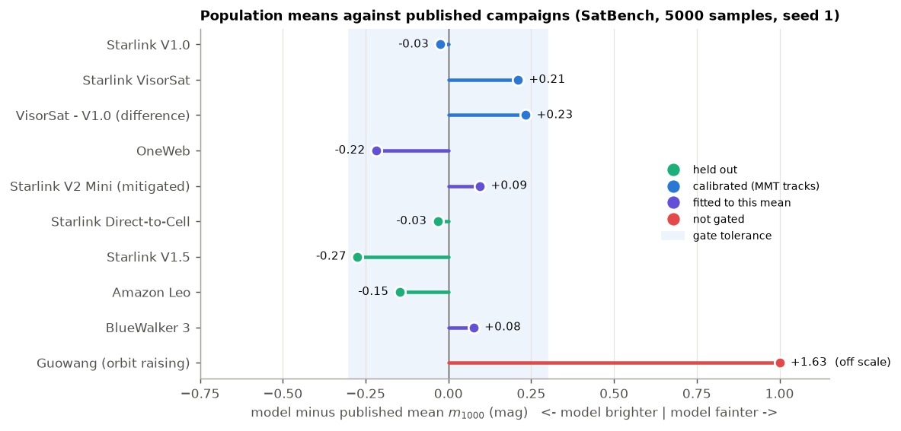
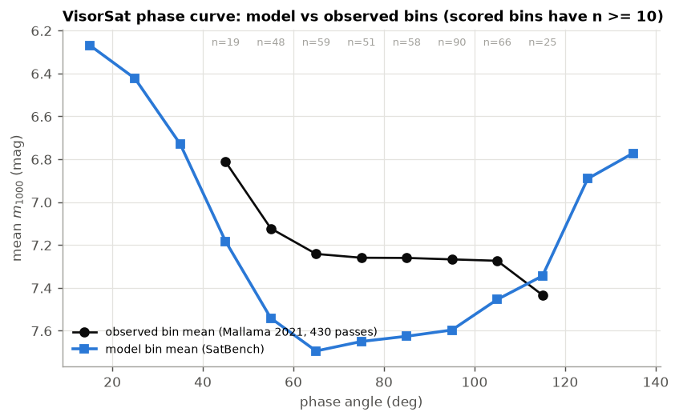
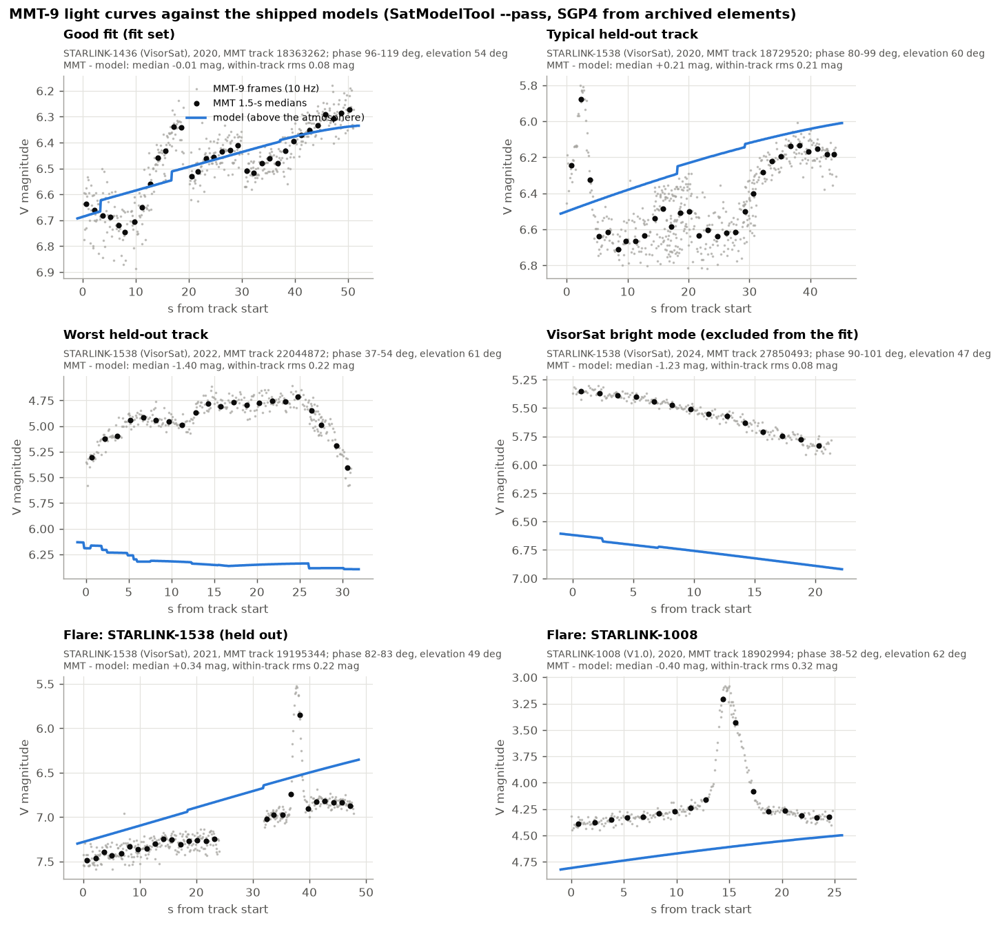
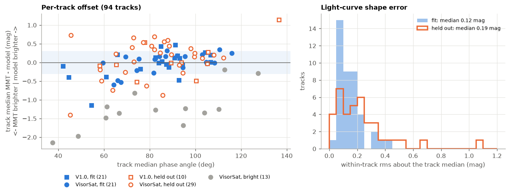
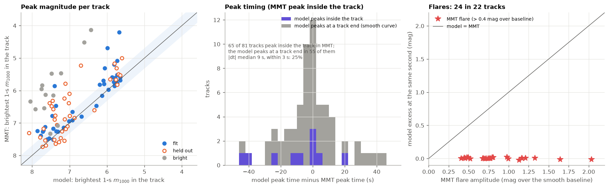
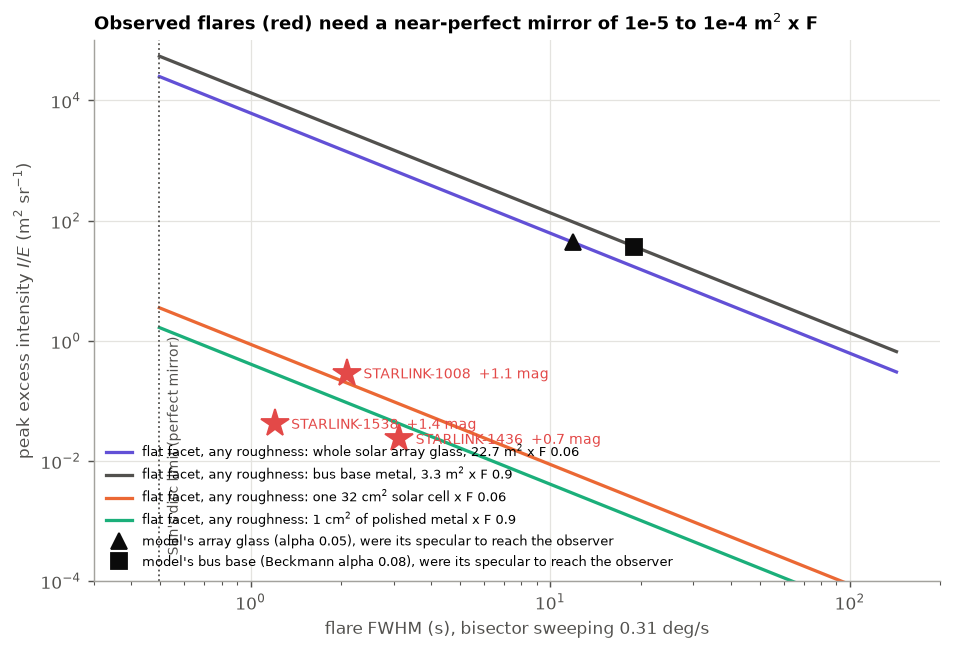
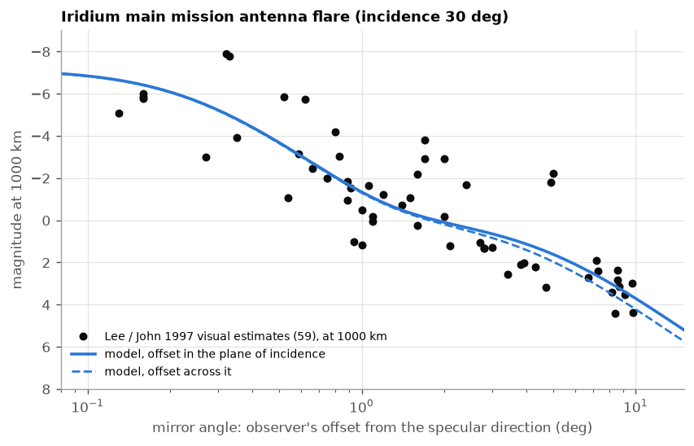
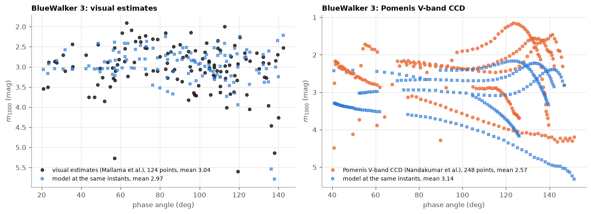
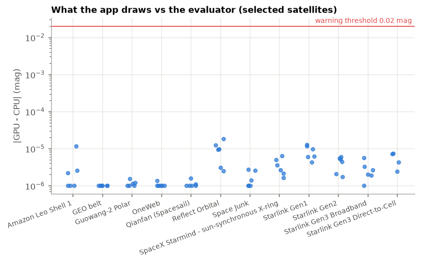

# Validation report: what passes and what does not

This page lays the satellite brightness model's evidence out in one place, with the figures behind each verdict:
the population benchmarks, the time-resolved replays of real light curves, the flare checks, the parity between
what the app draws and what is measured, and the self-tests. It says plainly what the model gets right, what it
misses, and which missing detail each miss comes from.

Every number here comes from a run that can be repeated. Unless a section says otherwise the source tree is commit
`2d059d0` with the models and benchmark files as committed there; the population numbers are the accuracy gate's
reports (`cmake --build build --target accuracy-gate`, 5000 samples, seed 1, gate verdict PASS), and the light-curve
numbers come from `tools/benchmarks/accuracy_report/mmt_replay.py` run against the same `SatModelTool` build. The
figures are drawn by `tools/benchmarks/accuracy_report/figures.py`. How to run both is at the
[end of the page](#reproducing-this-page).

## The short version

| Question | Answer | Evidence |
|---|---|---|
| Is a satellite design's **average brightness** right? | Yes, within 0.3 mag, for all eight designs with published campaigns and a known attitude (three of them held out of every fit). One design, Guowang during orbit raising, is 1.6 mag too faint and is not gated. | [Population means](#population-means) |
| Is the **shape of a light curve** right over a pass? | Mostly. On real tracks of the 2020 Starlinks the smooth part of the curve is followed to 0.1 to 0.2 mag rms within a pass; the level is right to 0.3 to 0.5 mag rms from pass to pass. | [Light curves](#time-resolved-light-curves-mmt-9) |
| Does it predict **when and how bright a Starlink flares**? | **No.** 24 flares of 0.4 to 2 mag in 94 tracks; the model shows none of them (its excess at those seconds is 0.00 to 0.02 mag). | [Flares](#flares-the-clear-miss) |
| Why not? | A Starlink flare is a glint from a near-perfect mirror of 0.1 to 1 cm² (times its reflectance) swept past the observer in 1 to 3 s. The models' surfaces are metres across and rough; no published drawing says where such small mirrors are or how they point. | [Why the flares are missed](#why-the-flares-are-missed) |
| Does it predict **a large, flat mirror's flare**? | Yes. Iridium's main mission antenna flare follows visual estimates from the peak (−6) to the far wing within 0.1 to 0.6 mag per bin. | [Iridium](#iridium-a-flare-the-model-can-make) |
| Does the **app draw** the magnitude that was measured? | Yes: the GPU's value equals the CPU evaluator's to a few thousandths of a magnitude. | [Parity](#what-the-app-draws-gpu-against-cpu) |

## How the evidence is organised

There are three kinds of comparison, and they test different things.

1. **Population means.** A published campaign reports the mean \( m_{1000} \) of hundreds of passes. SatBench
   simulates the campaign (sites, twilight window, elevations, a random satellite of the shell) and compares the
   means. This tests the satellite's surfaces and attitude law on average; it cannot see a single pass.
2. **Time-resolved replays.** A real pass is replayed instant by instant: the satellite's state from SGP4 with the
   element set of the day, the observer at the telescope's coordinates, the model's magnitude every 0.1 s. This
   tests the light curve's level and shape, including any glint the model predicts.
3. **Self-tests and parity.** The evaluator against brute-force references (per-triangle reflectance, ray-cast
   occlusion, integrals of earthshine and extinction), and the GPU shader against the evaluator. These test that
   the code computes the model it describes; they say nothing about whether the model matches a real satellite.

A model value that was **fitted** to a dataset proves only that the fit worked when compared with that dataset.
The evidence that the model is right is the **held-out** comparisons: datasets, satellites or years no value was
adjusted against. Each result below says which it is; [Model provenance](provenance.md) has the full list.

## Population means



| Benchmark | Model \( \bar m_{1000} \) | Published | Model − published | Status | Verdict |
|---|---|---|---|---|---|
| Starlink V1.0 (Mallama 2020a) | 5.904 | 5.93 | −0.03 | calibrated on MMT light curves, not on this dataset | pass |
| Starlink VisorSat (Mallama 2021) | 7.428 | 7.218 | +0.21 | calibrated on MMT light curves | pass |
| VisorSat − V1.0 | 1.523 | 1.29 | +0.23 | (difference of the two above) | pass |
| OneWeb (Mallama 2020b) | 6.962 | 7.18 | −0.22 | bus MLI fitted to this mean | pass |
| Starlink V2 Mini, mitigated (Mallama et al. 2023) | 7.965 | 7.87 | +0.09 | film distribution chosen with it in view | pass |
| Starlink Direct-to-Cell (Mallama et al. 2025) | 6.438 | 6.47 | −0.03 | **held out** | pass |
| Starlink V1.5 (Mallama et al. 2025) | 6.065 | 6.34 | −0.28 | **held out** (backsheet fitted to another paper) | pass, narrowest margin |
| Amazon Leo (Mallama et al. 2026) | 6.663 | 6.81 | −0.15 | **held out** | pass |
| BlueWalker 3 (Mallama et al. 2023b) | 3.166 | 3.09 | +0.08 | face albedo fitted to the same visual data | pass |
| Guowang, orbit raising (Mallama et al. 2025) | 5.838 | 4.21 | **+1.63** | hardware and attitude unpublished | **fail, not gated** |

The three held-out designs land within 0.03 to 0.28 mag. The Guowang miss is a model of unknown hardware flying an
assumed attitude; satellites in orbit raising fly a low-drag attitude whose geometry is not published, and the
estimated model is simply too small and dark. It is reported and left out of the gate.

**What the means do not show.** Every simulated satellite flies its nominal attitude exactly. Real satellites
jitter, roll, and switch modes, so the model's spread is too narrow everywhere it is reported: VisorSat's standard
deviation is 0.44 mag against 0.85 observed, V1.0's 0.21 against 0.67, V2 Mini's 1.30 against 0.79 the other way
(its film throws the model's spread wider than the real satellites').

### The VisorSat phase curve



VisorSat is the one dataset with per-pass magnitudes (430 passes), so its phase curve can be compared bin by bin.
The shape is right (flat from 60 to 110°, brighter toward low and high phase), but the model sits 0.33 to 0.45 mag
too **faint** in the 40 to 100° bins and the curve's weighted RMS is 0.35 mag, outside the 0.3 tolerance. That
metric is reported and not gated, for a measured reason: the table's bin *means* include passes in a bright
attitude mode (from 2021 on), while the same model reads 0.2 mag too **bright** against the held-out MMT-9 light
curves of these satellites ([below](#time-resolved-light-curves-mmt-9)). The table and the light curves disagree by
about 0.4 mag at the geometry the model was fitted at, and no single nominal attitude satisfies both.

## Time-resolved light curves (MMT-9)

The Mini-MegaTORTORA camera (MMT-9, Special Astrophysical Observatory) publishes 10 Hz light curves of individual
satellite passes. 94 tracks of three 2020 Starlinks (STARLINK-1008, a V1.0; STARLINK-1436 and STARLINK-1538,
VisorSats) from 2020 to 2025 are replayed here: SGP4 states from archived element sets, each track's along-track
timing offset fitted to MMT's own range column, the observer at MMT's coordinates, the model evaluated every 0.1 s
with occlusion between parts and with atmospheric extinction. MMT's magnitudes are compared, as published, with the
model's above-atmosphere magnitude in 1.5-second medians.

The tracks fall in three groups:

- **fit** (42 tracks): the tracks that calibrated the 2020 Starlink materials and the visor ([provenance](provenance.md));
- **held out** (39 tracks): all of STARLINK-1538, and STARLINK-1008 in odd years;
- **bright mode** (13 VisorSat tracks, from March 2021 on): 0.6 to 1.9 mag brighter than any nominal-attitude
  geometry can make; excluded as an attitude the model does not fly.



The six panels are chosen by rule, not by hand: the fitted track with the smallest error; the held-out track
closest to the held-out median in both offset and shape; the held-out track with the largest offset; a bright-mode
track; and two of the three flares studied in detail.

- **The smooth part of the curve is followed.** In the first panel the model tracks the brightening over 50 s to
  0.08 mag rms. The small steps in the model's line (about 0.04 mag) are its occlusion sampling: each part's
  shadow on another is tested at 16 points, so a shadow edge crossing a sample moves the total in a step. With
  occlusion off the curve is smooth to 0.001 mag per 0.1 s.
- **The typical held-out track** (second panel) is offset by +0.21 mag, the held-out median, and drifts by about
  0.2 mag within the pass. Its jump at 30 s is MMT changing camera channel; channels differ by up to about 0.2 mag,
  which sets a floor under any within-track comparison.
- **The worst held-out track** (third panel) is a STARLINK-1538 pass at low phase, 1.4 mag brighter than the model
  for its whole length, with a rounded shape the model does not have. Nothing in the nominal geometry makes it; it
  behaves like the bright mode but predates the tracks flagged as such.
- **The bright mode** (fourth panel) is a constant offset of 1.2 mag with the shape right: the satellite is
  presenting more of its surfaces to the observer than the nominal attitude does.



| Set | Tracks | Median MMT − model | Track rms | Within-track rms (median) |
|---|---|---|---|---|
| V1.0, fit | 21 | +0.01 | 0.35 | 0.11 |
| V1.0, held out | 10 | −0.02 | 0.47 | 0.12 |
| VisorSat, fit | 21 | +0.08 | 0.27 | 0.15 |
| VisorSat, held out | 29 | +0.21 | 0.51 | 0.22 |
| VisorSat, bright mode | 13 | −1.27 | 1.36 | 0.15 |

A positive value means the model is brighter than MMT measured. "Track rms" is the rms of the per-track medians
(how far one pass's level can be off); "within-track rms" is the rms of the 1.5-s residuals about their own track's
median (how well the shape is followed). The held-out V1.0 tracks are as good as the fitted ones on average. The
held-out VisorSat tracks are 0.2 mag too bright and scatter more: the visor's real shape is unpublished and its
size was fitted to the other VisorSat. Two trends remain after removing the phase dependence (from the calibration
study, [Results](results.md#the-2020-starlinks-against-mmt-light-curves)): about −0.2 mag per 10° of Sun altitude
for VisorSat, and a small trend with elevation.

## Flares: the clear miss



**Peak brightness.** Taking each track's brightest one-second moment (range-normalised to \( m_{1000} \)), MMT's
peak is 0.20 mag brighter than the model's in the median over the 81 nominal-attitude tracks, rms 0.65 mag (left
panel). Most tracks sit on the diagonal; the ones well above it are tracks whose peak is a flare.

**Peak timing.** In 65 of the 81 tracks MMT's brightest second is inside the track. The model's brightest second
is at one end of the track in 55 of those 65 (middle panel, grey): over a 20 to 120 s pass the model's curve is
smooth and monotonic, brightening as the range falls or the phase changes, and has no peak of its own. Only 25% of
the peaks agree within 3 s. Peak timing is not something the model reproduces, because it has nothing to time.

**Flares.** A flare here is a one-second median more than 0.4 mag brighter than the track's smooth baseline (a
sigma-clipped quadratic in time). There are 24 of them in 22 of the 94 tracks, 0.4 to 2.0 mag, median 0.77 mag,
lasting 1 to 5 s. At the same seconds the model's own curve is 0.003 mag above its baseline in the median and
0.02 at most (right panel). Across all 94 tracks the model's largest excess over its own baseline is 0.01 mag in
the median and 0.03 at the 90th percentile. The model does not make flares, at the right time or at any other.

### Why the flares are missed



A glint's peak brightness and its duration are tied together by the reflecting surface's size and smoothness. As
the satellite moves, the direction halfway between the Sun and the observer sweeps across its body at about
0.3° per second (measured on the three flares above). A flat facet of area \( A \), Fresnel reflectance \( F \)
and GGX roughness \( \alpha \) (with the Sun's disc folded in, \( \alpha_t^2 = \alpha^2 + \alpha_\odot^2 \)) then
produces a flare of peak intensity \( AF/(4\pi\alpha_t^2) \) lasting about \( 2 \times 0.64\,\alpha_t \) radians
of that sweep. Each line in the figure is one facet at every roughness.

The three studied flares (red) last 1.2 to 3.1 s with a peak excess of 0.02 to 0.3 m² sr⁻¹. Only a facet of
**10⁻⁵ to 10⁻⁴ m² (times F), close to mirror-smooth**, lies there: a polished square centimetre of metal, a single
solar cell's cover glass seen at its specular angle, or a polished edge. Every surface in the models is far off
that line:

- the solar array's glass (22.7 m², α 0.05) and the bus base (3.3 m², α 0.08) would make glints 10⁴ times brighter
  lasting 10 to 20 s, and with the nominal attitude their specular directions never reach a ground observer at
  night;
- turning the array to any attitude (a full sweep of yaw and hinge tilt with the model's own lobes, in the flare
  study that preceded the MMT refit) improves the fit to these three tracks by at most 0.02 mag rms: no
  orientation of the modelled surfaces makes a 1 to 3 s, 1 mag flare.

So the flares come from detail the models do not contain: small, flat, polished parts (fittings, cell glass at the
array's edges, harness covers, the edges of panels) whose sizes and orientations no published drawing or photograph
gives. A test population of 115 such facets (normals within 60° of nadir, polished, median \( AF \) 3.5 × 10⁻⁵ m²)
reproduced MMT's VisorSat flare **rate** (time spent more than 0.5 mag above baseline: 1.1 to 2.4% against 2.2%
observed) but not the **timing**: 0 to 1 of 24 observed flares fell on a predicted one. With their positions and
normals unknown, a population can match how often a satellite flares, not when. It changed the means by at most
0.05 mag and was not shipped.

The missing detail, in order of what it would take to predict flares:

1. **The orientation and size of small polished parts**, to about 0.1° (a 1 s flare is 0.3° of sweep). Not
   published for any Starlink.
2. **The attitude itself, to the same precision.** The bus's yaw and the arrays' angles follow onboard laws that are
   published only in outline; the bright mode above shows the attitude also changes between modes.
3. **Each satellite's actual timing**: element sets are good to about a second along track after a fitted offset,
   comparable to a flare's width.

## Iridium: a flare the model can make



Iridium's first-generation satellites carried three main mission antennas, each a 1.6 m² flat, silver-coated
panel: the textbook case of a large mirror, and the case the model's lobes are built for. The validation model
(`iridium_block1.json`, not in the roster) is compared with 59 visual magnitudes against the observer's angle from
the mirror's specular direction (Lee and John 1997, reduced to 1000 km):

| Mirror angle | Observations | Observed median | Model |
|---|---|---|---|
| < 0.6° | 12 | −5.8 | −5.3 |
| 0.6 to 1° | 9 | −2.0 | −1.9 |
| 1 to 2° | 12 | −0.9 | −0.6 |
| 2 to 4° | 11 | +1.3 | +0.6 |
| 4 to 7° | 5 | +2.2 | +1.7 |
| 7 to 15° | 10 | +3.1 | +3.4 |

The core of the flare follows from the panel's size and the Sun's disc alone; the wing (beyond about 1°) needs a
haze on the mirror's reflectance, which is **fitted** to these same observations (0.3 of the reflectance at
α 0.04). The held-out check is an MMT-9 light curve of IRIDIUM 13's wing at mirror angles of 7 to 14°, which the
model follows within 0.53 mag. Against Heavens-Above's predicted flare centres the model is about 1.1 mag fainter:
those centres (−9 at 830 km) are brighter than a 1.6 m² flat mirror can be ([Results](results.md#iridium-flares)).
The 11 visual estimates at mirror angles beyond 15° (up to −3 mag) are flares from other surfaces and are not
plotted.

## BlueWalker 3: a large flat array, replayed



BlueWalker 3's 64 m² antenna array makes it bright and close to a flat plate. Every timed observation from
2022-11-14 to 2022-12-07 (the visual estimates of Mallama et al. 2023b and the CCD photometry of Nandakumar et al. 2023) <!-- history-ok -->
is replayed with element sets at most 4 days old. Against the 124 visual estimates the model's mean \( m_{1000} \)
is 2.97 against 3.04 observed. The 248 Pomenis V-band CCD points read 0.57 mag brighter than the model at the same
instants, which is the calibration difference between the two data sets (the visual and CCD values disagree by
about 0.5 mag at the same geometry, consistently from pass to pass). The face albedo was fitted to the visual data,
so the visual agreement guards against regressions; the light-curve shapes within each Pomenis pass follow to
0.35 mag rms.

## What the app draws: GPU against CPU



Everything above is measured with the CPU evaluator. The app draws satellites with `sat_orbit.comp`, a float GPU
port of the same model. For the selected satellite the app re-evaluates the frame's own inputs on the CPU and
compares (`updateSelectedPhotometry`; harness `state` → `selection.parity`). A harness run selected the highest
satellite of twelve constellations at six instants of one evening (Arizona, Sun 10° below the horizon onward,
magnitudes 1.4 to 11.4): in the 70 cases the GPU's magnitude was within 0.00002 mag of the CPU's (median
0.000002; values below 10⁻⁶ are drawn at 10⁻⁶), against the warning threshold of 0.02. The ranges agree to a few
metres (the GPU's float position). Three single-satellite entries (the ISS, Tiangong and Hubble) had no GPU record
at those instants and are not in the set.

## Self-tests

These check that the code computes the model it describes. They run in the accuracy gate on every model.

| Check | Result at `2d059d0` | Gate |
|---|---|---|
| Known geometry: Sun declination at solstice and equinox, orbit radius and inclination, magnitude conventions | exact or to almanac precision | must pass |
| Facet lobes against per-triangle reflectance (posed) | ≤ 1 × 10⁻⁶ mag on every model | < 0.001 |
| Occlusion between parts, 16 samples against a ray cast | p95: V1.0 0.007, VisorSat 0.13, ISS 0.15, Iridium 0.24, others ≤ 0.12 mag | p95 < 0.25 |
| Earthshine table against the exact cap integral | p95 0.004, max 0.014 mag | p95 < 0.02 |
| Earthshine on a tilted plane (SH fit) | ≤ 0.029 of the irradiance | < 0.05 |
| Atmospheric extinction, Chapman column against a ray integral | ≤ 0.32% of the column | < 2% |
| Benchmark transcriptions reproduce their papers' statistics | every file | must pass |

## What is not validated

- **Flares of any satellite whose mirrors are small** (every Starlink, OneWeb, Amazon Leo, Guowang, Qianfan): the
  model gives the smooth part of the light curve and the right average, not the glints. See
  [above](#why-the-flares-are-missed).
- **Attitude modes other than the nominal one**: the VisorSat bright mode, roll manoeuvres, orbit raising. The
  Guowang miss is the clearest case.
- **The spread of a population**: every satellite flies its nominal attitude exactly.
- **Designs with no published photometry**: the stations, Starlink V3, the orbital data centres, Reflect Orbital,
  debris. Their numbers are physically computed from estimated geometry, and nothing checks them.
- **The rendered image** (meshes, bloom, glare, exposure): downstream of the magnitude, and not part of any of the
  comparisons on this page.

## Open questions

- The VisorSat table and the MMT-9 tracks of the same satellites disagree by about 0.4 mag at the same geometry.
  Which is the better reference for the nominal attitude?
- Is there a published attitude law precise enough (0.1° class) to test flare timing on any modern satellite? If
  so, a replay of that satellite with a facet population on its known parts would be the next step.
- The held-out VisorSat tracks scatter more than the fitted ones (track rms 0.51 against 0.27). Is that the visor's
  unknown shape, a different satellite behaving differently, or attitude noise?

## Reproducing this page

The light curves come from the MMT-9 public satellite database (`mmt.favor2.info/satellites`); the track list and
the replay specs (SGP4 states with each track's fitted timing offset) were built by the 2020 Starlink calibration
study and are not in the repository. Given them:

```bash
cmake --build build --config Release --target accuracy-gate          # population reports -> build/accuracy_gate/benchmark_runs
python tools/benchmarks/accuracy_report/mmt_replay.py --tool build/Release/SatModelTool.exe \
    --models data/satellite_models --rows <rows.pkl> --fitset <fitset.pkl> --work <dir> --out mmt_results.json
build/Release/SatModelTool.exe data/satellite_models/iridium_block1.json --dump-json iridium_dump.json
python tools/benchmarks/accuracy_report/figures.py --mmt mmt_results.json \
    --reports build/accuracy_gate/benchmark_runs --iridium-dump iridium_dump.json --lee <ronlee_1997.json> \
    --flares <flare_stats.json> --bw3 <bluewalker3 replay.json> --parity parity.json --out wiki/accuracy/img
```

The parity set comes from a harness run: `python tools/harness/run.py tools/harness/scripts/photometry_parity.satcmd
--out <run>`, then `python tools/benchmarks/accuracy_report/parity_extract.py <run> parity.json`.

`mmt_replay.py` prints the summary table above; `figures.py` prints every other number quoted on this page.
