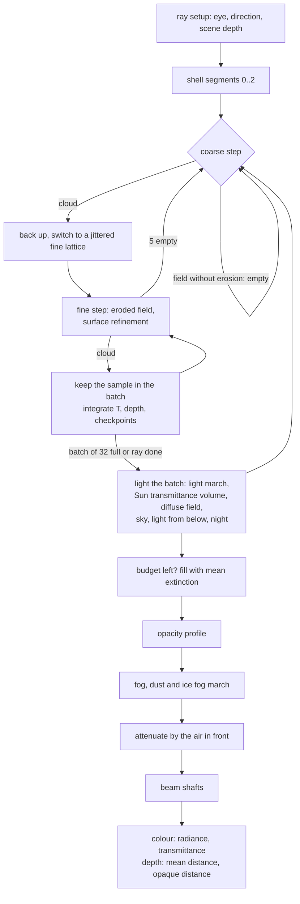

# The cloud march

`shaders/cloud_v2_march.comp` ray-marches the [cloud field](field.md) on the cloud grid and lights every sample:
the Sun or Moon through a short light march and the Sun transmittance volume beyond it, multiple scattering as the
diffuse field of a slab, the sky's light through the cloud above, light reflected from below, city light and
Reflect-beam light at night, and the halos and rainbows of ice and rain. It also marches fog and dust, and
integrates the Reflect beams' shafts through clear air. This page covers one ray. Which pixels are marched each
frame, the cloud grid's resolution and how the results are accumulated are in
[Temporal resolve and the far layer](temporal.md).

## Overview



The march outputs radiance **already attenuated** by the air between the eye and the cloud, but adds no air
light of its own: the sky pass integrates the air in front of each cloud and composites it, so a cloud and the
clear sky beside it share one atmosphere (see [Atmosphere and sky](../atmosphere-and-sky.md)).

## Ray setup

- **Eye and frame.** The eye is 2 m above the detailed ground under the observer (`terrainFrame.x`, written by
  `scene_depth.comp`), in the observer's local east-north-up (ENU) frame centred on the Earth.
- **The cloud grid.** The march runs on the grid `cv2.grid.xy`: half the render resolution, or the full render
  resolution with "Full-resolution clouds" ([Temporal: rates and resolution](temporal.md#rate-modes)).
- **Direction.** Each visit of a pixel moves the ray within its texel (see [Jitter](#jitter)).
- **Scene depth.** `tScene` is read from the half-resolution shared depth (terrain, sea, meshes) at the pixel
  shifted down by `cv2.grid.z` (0 or 1). On the full-resolution grid the depth texel's ray passes through the
  half-res texel's centre, half a full-res pixel off the march's ray, and near the limb from orbit the ground's
  distance changes by tens of km over that half pixel. The depth is therefore corrected by the difference between
  the two rays' hits on the sphere through the depth's own hit (exact for flat ground at any height), bounded to
  ±25 percent of the depth so a ridge's silhouette bleeds at most that on the half pixel it straddles. Uncorrected,
  every ray of one row parity stops at the lower ray's ground, short of the cloud, and whole cloud systems vanish on
  the frames that sample those rows.
- **Resolution and LOD.** With "Clouds follow render scale" (`display.clouds_follow_render_scale`) on, the grid
  follows the *scaled* window (`computeHalfExtent()`, `computeCloudExtent()`). The noise level of detail stays at
  the half-res pixel of the 100 percent window: `cv2.motion.w`, the march pixel over that pixel, scales the
  footprint, so the clouds keep their texture at any scale or resolution; read at the full-res pixel the noise
  flickers from orbit, read at a coarser one the storm cumulus texture filters away. A change of size recreates
  the images (`recreateComputeScaledTargets()`, checked at the start of `recordCompute()` before anything is
  recorded) and blits the temporal history across, so the clouds do not restart.
- **Shell segments.** `cv2ShellSegments()` intersects the ray with the shell between the lowest cloud base and
  the highest top and removes what lies inside the inner sphere, giving 0 to 2 segments. No special cases are
  needed for an eye below, inside or above the shell.
- **End of the march.** Each segment ends at `min(segment end, tScene, tLimit)`, where `tLimit` is "Max
  distance" (600 km) measured from the **shell entry**, not the eye: from orbit the Earth is farther away than
  the limit.
- **Soft ground contact.** Extinction fades out over the last `clamp(3 × footprint, 40 m, 600 m)` before the
  scene depth. Dense cloud meeting a slope otherwise ends on a hard line that the half-resolution depth
  stair-steps; real cloud also thins against the ground.

## Stepping

With \( t_r \) the distance past the shell entry, a step is

\[
\Delta t = \min\!\big(b + g\,t_r,\ \max(c,\ 0.012\,t_r)\big), \qquad
\Delta t \le \frac{200\ \text{m}}{\max(|\hat d \cdot \hat u|, 0.01)}
\]

with \(b\) "Step at eye" (60 m), \(g\) "Step growth" (0.014), \(c\) "Step max" (1700 m), and \( \hat u \) the
vertical **at the sample**. Steps grow with distance because the noise is read at the pixel footprint there
anyway; the vertical cap keeps any step from crossing more than 200 m of altitude, so a thin deck seen from
orbit is not stepped over.

**Coarse mode.** Each segment starts coarse, after an offset of \( 2\Delta t \times \text{jitter} \): a whole
coarse interval, so across visits the coarse lattice takes every phase and a thin deck is found at all of them.
Coarse samples read the field with no erosion, an upper bound of the eroded density. Where the
[density clipmap](#the-density-clipmap) knows the air is empty, a coarse step takes its stride without evaluating
the field at all. An empty coarse sample advances by a stride of its own, \( 2\Delta t\,(0.75 + 0.5\,u_k) \) with
\(u_k\) a golden-ratio sequence off the ray's jitter, so each stride is 1.5 to 2.5 steps. A lattice offset once at
the segment start still meets a smooth, dense surface at a depth that follows the surface's height with the
lattice's period, whatever the start jitter; the light that depth receives then draws evenly spaced contour rings
on anvil heads and tower walls. A stride of its own length per step turns the lattice into a random walk within a
few steps.

**Switch to fine.** At the first coarse sample with density the march backs up by \( (2 - j_f)\Delta t \) and
switches to fine steps, so the fine lattice is jittered too (\( j_f = \text{fract}(1.618\,j + 0.5) \), derived
from the start jitter). If the back-up passes the segment start, the march restarts at the start plus a
jittered offset; clamping to the start itself would put every ray from inside a cloud or rain on one lattice
aligned to the eye, which draws contour rings. Fine samples read the eroded field with
`detailAmt = 1 − smoothstep(D, 4D, t)`, D being "Detail fade start" (8900 m). After more than 5 consecutive
empty fine samples the march returns to coarse mode.

**Surface refinement.** Far from the eye a fine step is hundreds of metres (1.2 percent of the distance) while
a dense cloud's sunlit skin is tens of metres, so the first sample inside a tower lands at a random depth under
its surface and comes back sunlit or self-shadowed by chance. When a sample is opaque over its own step
(\( \sigma\,\Delta t \ge 1 \)), the sample before it was not, the ray's transmittance is still above 0.1 and the
step is longer than \( (2 + 1.5\,j) \) base steps (from about 7 to 14 km at the defaults, dithered per ray so
the switch draws no line), the crossing is bisected three times with unlit field reads and the bracket's inner
end is the sample that is kept. Near the eye the steps are already skin-sized, and refining every lump of a close
cumulus field costs milliseconds for nothing visible.

**Cheap samples.** A coarse sample that is almost all high-layer ice (`thin > 0.9`) or rain shaft
(`rain > 0.9`) is kept on the spot and never enters fine mode; ice and rain are nearly uniform media with
weak structure.

- An ice sample stands for two steps where the pixel spans more than 60 m; closer, it is one step, because
  two-step samples near the eye catch the fibres on some frames and miss them on others.
- With the eye inside the high layer every ray runs through its near haze in 60-120 m steps, each a field
  evaluation and a lit sample. Within a 12 m footprint a pure ice sample stands for "Near cirrus stride" (4) steps.
  A dense cloud starting inside a stride is entered up to about two steps late.
- A rain-only sample stands for **four** steps: each runs a light march whose steps evaluate the whole field,
  towers included, so under a storm the shafts would otherwise dominate the march. A shaft's edge reads slightly
  brighter, because a step carries its density a little past the edge.

**Termination and budget.** The march ends when transmittance falls below 0.01, at the end of the segments,
or when the iteration budget (`misc.x`, "March budget", 430) runs out. The unmarched remainder, including whole
segments never reached, is **filled** with the path's mean extinction,
\( T_\text{rem} = e^{-(\tau_\text{path}/\ell_\text{path})\,\ell_\text{rem}} \), lit with the mean colour so
far, at a depth halfway into the remainder. Leaving it transparent would let the horizon show through clouds.

### Density first, then light, in batches

A GPU runs a group of rays (32 on NVIDIA) in lockstep, so every iteration of a loop costs what its most
expensive ray costs. A lit sample is ten or more field evaluations (the view sample, seven light steps, a far
sample, a sky probe and two steps away from the light); an empty step is one. In a single loop, rays in empty air
would wait out their neighbours' light marches, and the march's time would be the longest ray's step count times a
lit sample's cost.

The march therefore runs in two loops per **batch** of up to 32 samples (`kBatch`). The first walks the ray on
the density field alone (coarse steps, the fine lattice, the surface refinement, transmittance and the depth
statistics) and keeps each sample that holds cloud, with its field, distance, the transmittance in front of
it within the current cloud, its weight in the ray's light and its view depth into the cloud. The second lights
the kept samples and adds them, `L += w · S`. The samples, their order and their weights are the same as a single
loop's; only the scheduling differs. Batches of 4 gain nothing, 16 to 64 about the same: 32. Lighting each sample
as soon as it is found ("search, then light") is slower on overcast, where every lit ray waits on the slowest
search each time.

!!! note "Shadowed names"
    In the lighting loop `t`, `T`, `f`, `fp` and `detailAmt` are locals that shadow the density loop's. Anything
    the lighting needs from the density loop must be stored in the batch arrays (`bF`, `bT`, `bTr`, `bCov`,
    `bW`, `bH`).

### Jitter

Every jitter sequence advances per **visit** of a pixel, not per frame: a sparse pixel is marched every fourth
frame, and a sequence stepped per frame would leave each pixel of a 2 × 2 block in its own cluster of offsets,
which shows as 2 × 2 squares in far cloud. The four per-visit offsets step by the four R4 constants
(\(1/\phi_4^k\), \(\phi_4 = 1.1673\)), so no two of them advance together.

| What | Source | Advances by |
|---|---|---|
| Sub-texel ray position | interleaved gradient noise per pixel + visit · (0.8567, 0.7339); the texel centre in fast flight | per visit |
| March start | 64 × 64 void-and-cluster blue-noise tile (an SSBO) + visit · 0.6287 | per visit; per frame in fast flight |
| Fine-lattice restart | `fract(1.618 · jitter + 0.5)`, derived from the start jitter | — |
| Light march | another cell of the blue-noise tile + visit · 0.5386; each light step, the far sample and the steps away from the light add their own golden-ratio offsets | per visit; per frame in fast flight |

The sub-texel motion lets the history integrate the whole texel footprint, so thin far cloud does not draw as
hard stairs. Fast flight is an eye moving more than 150 m a frame (`misc2.z`), where there is no useful history.
The light march has its own jitter because a shared one moves a sample's depth inside a flat cloud top together
with its light-step positions, and their product never averages out. The sub-texel x offset and the light
jitter must not share a step either: on a sloping surface the sub-texel point is the surface's depth phase.

## The density clipmap

Coarse view steps are most of a frame's field evaluations, and in empty air each costs a full early-out path.
`cloud_v2_cdc.comp` keeps a **clipmap** of the coarse field's occupancy about the eye (`shaders/include/cv2_cdc.glsl`,
march binding 23):

- **Cells.** 8 levels of 128 × 128 horizontal cells, 100 m on level 0 doubling per level, × 64 cells of 320 m in
  height (to 20.48 km above sea level), on a gnomonic plane at an anchor fixed in the drifting cloud frame, stored
  toroidally about the eye. A point reads the finest level that holds it; the march uses the levels below
  `cdc_max_level` (6). About 96 MB, allocated the first time it is on.
- **Values.** Each cell holds the **maximum** coarse extinction over 36 points of a box twice its size (a dilation by
  half a cell each way, so a cell's value bounds its neighbourhood), read at the march's footprint there, and a
  16-bit stamp: its window wrap (a slot that changed hands as the eye moved), the epoch, and a staggered sim-time
  quantum of half a cell of wind slide. A cell whose stamp does not match reads **unknown**, and the march evaluates
  the field as without the clipmap: correctness never depends on the fill.
- **Bake.** A check pass lists the stale cells, then a bake pass bakes up to `cdc_budget` (65 536) of them a frame
  with four lanes a cell.
- **Epochs.** A new epoch (every cell unknown) starts on a time jump, a teleport or a field setting change, on
  re-anchoring, when the haboob dust field changes (cells baked empty under its clear air must not keep skipping
  cloud after the march swaps to its dust-free build), and from the motion guard below.
- **When.** Up to `cdc_max_rate` (4×) of time warp: faster, cells expire faster than the budget bakes them. The
  **motion guard** turns it off while the eye moves more than 0.4 percent of the distance to the nearest cloud a
  frame, and back on in a new epoch after 60 slow frames; a bake read the field at the footprint seen from where the
  eye was, and climbing, cells baked from lower read "empty" where the coarser footprint now has cloud.

Measured on an RTX 3070 Ti at 1920 × 1009, it saves 4 to 9 ms of cloud march below orbit at full rate and nothing
from orbit, images at the noise floor.

**Light from the clipmap** ("Light march from clipmap", `cdc_light`, on). The bake also stores, per cell, the
mean and mean square of the light march's effective extinction over its points. Light steps 3 and on, and the march
away from the light, read them instead of the field on levels below `cdc_light_levels` (3: cells up to 400 m):
trilinear between the 8 nearest cell centres (the moments are linear, so they interpolate exactly), through the
**gamma model**

\[
E\!\left[e^{-L e}\right] = \left(1 + L\,\frac{\text{var}}{\text{mean}}\right)^{-\text{mean}^2/\text{var}}
\]

over at most one cell's length per independent draw. A cell **mean** alone, \( e^{-L\,\text{mean}} \), is darker
than the mean transmittance that point samples converge to (Jensen's inequality): broken cloud reads tens of levels
too dark. A path longer than a cell crosses cells that are not independent draws (a tower is cloud for kilometres),
so the model is applied cell by cell. A corner not yet baked drops out and the field takes the point with the
missing share's chance, and the last level fades into the field stochastically over its outer 40 percent, so neither
a waiting region nor the clipmap's reach draws a box in the clouds' light. The light march's far sample never reads
the clipmap: in a storm the moments there read far clearer than the field, and the towers' far shadows would vanish
where they held and stay where they did not.

## Lighting a sample

The radiance a sample scatters toward the eye is

\[
S = S_\text{key} + S_\text{amb} + S_\text{bounce} + S_\text{night}
\]

Phase functions are Henyey-Greenstein normalised so that isotropic scattering is 1 (no \(1/4\pi\)), the
codebase's convention; `SUN_INTENSITY` is 1.

### Phase functions

Computed once per ray:

| Medium | Phase |
|---|---|
| cloud, single scattering | \( 0.6\,\text{HG}(0.57) + 0.4\,\text{HG}(-0.25) \) ("Forward scatter g", 0.57), blended toward the droplets' Mie phase by "Mie phase" |
| cloud, silver lining | \( s\,(0.12\,\text{HG}(0.92) + 0.5\,\text{HG}(0.8)) \), \(s\) = "Silver lining" (0.5) |
| cloud, multiple scattering (octave model) | \( 0.85\,\text{HG}(0.2) + 0.15\,\text{HG}(-0.4) \) |
| ice (`thin`) | \( \text{HG}(0.3) \) + ice optics / 0.55 |
| rain | \( 0.3\,\text{HG}(0.97) + 0.55\,\text{HG}(0.35) \) + 0.5 × rain optics |
| snow shafts | the rain phase blended toward faint ice optics and a pillar where the shafts are below freezing |

**Mie.** `tools/make_mie_lut.py` bakes a Lorenz-Mie phase table for water droplets
(`assets/textures/cloud_mie.rgba16f`: 2048 angles × 12 effective radii from 4 to 30 µm, a gamma size distribution,
integrated over 400-700 nm against sunlight into linear sRGB; g 0.84-0.88, a cloudbow 37-40 deg from the antisolar
point, a glory). "Mie phase" (0.11) is its share of the single scattering; "Mie optics" (0.33) multiplies the tuned
share by the table's structure relative to its own smoothed shape (corona rings, cloudbow, glory) and keeps the
tuned energy; "Droplet radius (um)" (9.7) picks the row. The physical phase alone has about twenty times less side
scattering than the tuned pair and reads flatter. For the Moon the diffraction peak is capped at the table's value
about 3 deg out: moonlit cloud carries the night view's lift and the drawn Moon disc does not, so the aureole would
draw a bright disc over a crescent.

**Ice is delta-scaled.** About 45 percent of an ice crystal's scattering is a narrow forward peak that carries
on almost undeviated. It is removed from the extinction, \( \sigma \leftarrow \sigma(1 - 0.45\,\text{thin}) \),
and the phase keeps only the broad lobe (renormalised by 0.55). Counting the peak as extinction would dim
everything behind cirrus as if that light were lost. In the light march and the shadow bakes the factor is
\( 1 - 0.8\,\text{thin} \), because what reaches cloud *below* a cirrus veil includes light the ice scatters within
a few degrees (an effective g near 0.8): real cirrus barely dims the cloud under it.

**Rain** has a diffraction spike well under a degree wide plus a broad refracted lobe; a single wide lobe would
light shafts toward the Sun as white walls.

**Silver lining** is sunlight scattered forward *through* thin water cloud: the droplets' narrow diffraction peak
plus a wider lobe of a few forward scatterings. It is attenuated at 0.3 of the optical depth toward the light,
because forward scattering is not loss. The rim of a cloud in front of the Sun glows and light leaks through its
thin parts; views away from the Sun do not change. It applies to water cloud only (not ice, rain, the mid layer's
sheets or dust): on a sheet lying across the Sun over tens of degrees it would be a glare many times the Sun's.

### Key light

The key light is the Sun, or, when the Sun is below the sample's horizon at night, the Moon through the same
light march (`moonGain` × "Moon gain", 1.0).

- **The Sun / sky table** (`cloud_v2_sunlut.comp`, `include/cv2_sunlut.glsl`): a 256 × 76 RGBA16F array of five
  layers, indexed by the cube root of the Sun's zenith cosine and by height in 800 m levels from 0 to 60 km.
  Layer 0 is the Sun's colour, layer 1 the zenith sky's single-scattering radiance, layers 2 and 3 the upper and
  lower hemispheres' mean radiance ([Sky light](#sky-light)), and layer 4 holds the atmosphere's
  multiple-scattering function. All depend only on height, the Sun's zenith angle, the scattering gains and the
  ground albedo, so the table is baked when one of those changes (and after a shader reload), never per frame, in
  three dispatches. Linear filtering between rows is exactly the interpolation between 800 m levels; fixed levels
  matter, because colours that step at a different depth on every ray draw rings looking down.
- **Sun colour** (`sunColorAt()`, in the bake): the Rayleigh and Mie columns toward the Sun by the Chapman
  function (`include/atmosphere.glsl`), which handles a grazing path's tangent point exactly, plus ozone: a layer
  from 15 to 35 km crossed for the path's exact chord (`atmOzoneTau()`); its Chappuis band turns twilight cloud
  pink rather than orange. The clouds' Rayleigh has its own gain, "Cloud sunlight Rayleigh" (0.86 × physical),
  separate from the sky's.
- **Earth's shadow.** `smoothstep(horizon ± 0.004, sun elevation)` at the sample itself.
- **Solar eclipse.** × `eclipseSunVis()`, the share of the Sun's disc visible from the sample (see
  [Moon and eclipses](../moon-and-eclipses.md)).
- **Clouds beyond the light march** shadow the sample through the
  [Sun transmittance volume](#the-suns-shadow-beyond-the-light-march).
- **Rain near the eye** additionally takes `mix(1, sunCloudT, e^(−t/100 km))`, the eye's own Sun
  transmittance through cloud ([Weather](weather.md#the-sun-behind-clouds)), so a shaft's sharp forward lobe
  does not draw the Sun's disc under a storm that hides it.

### The light march

`lightAmbOD()` holds the shader's **only** lighting call of `cv2Field()` and does five jobs in one loop (each
extra call site inlines another copy of the whole field, roughly 60 KB of GPU code):

| Index | Sample | Accumulates |
|---|---|---|
| 0 … nL−1 | **equal** steps toward the light, summing to "Light march" (2500 m), each jittered over its whole step at its own offset; the first two read eroded detail (self-shadowed lumps), the rest mean erosion, or the clipmap's moments | optical depth, ice × \(1 - 0.8\,\text{thin}\), mid layer × "Mid layer shadow" |
| nL | one far sample, jittered between 1.2 and 2.0 × the march length: the far side of a tall tower | \( \sigma \times 0.8\,L \) |
| nL + 1 | a probe 250 m straight up | `sigUp`, for the sky light |
| nL + 2 … nL + 4 | three steps (at 75, 375 and 1275 m) along the mean Reflect-beam direction, night only | beam optical depth |
| nL + 5, nL + 6 | two steps **away** from the light: over a quarter of "Multi-scatter reach away from light" (1200 m), then the rest | optical depth on the light's far side, for the [diffuse field](#scattering-the-key-light) |

nL is "Light steps" (7). **Why equal steps.** A sample whose `exp(−τ)` is either about 1 (a gap) or about 0
(a cloud) is all-or-nothing, and the temporal history converges on the *mean* of `exp(−τ)`, which is far brighter
than `exp(−mean τ)` (Jensen's inequality). Long far steps of a geometric series are exactly such single samples
standing for kilometres: under a low Sun the clouds in another cloud's shadow come out tens of levels too
bright. Equal steps give the same field reads the least variance at the same cost. The far sample is jittered over
the interval it stands for: at a fixed distance it lands inside or under a flat anvil base depending on the
sample's height alone, and a storm seen edge-on from near that height shows a straight lit / shadowed band.

**Sampling footprint.** Every light sample reads the field at the view sample's footprint, or at "Light march
footprint (x length)" × the march length if that is larger (0 by default: point samples). A coarse footprint
hides grain but does not conserve a cumulus's optical depth, so a backlit cloud loses its self-shadow and reads
flat. The footprint must be one value for every call of `lightAmbOD()`; a per-step footprint pushes the march
over its register budget.

**Steps merged in pairs.** Where the view sample's footprint exceeds about twice the first step of a 1.6
geometric series over the march (\( 2 \cdot 0.6\,L / (1.6^{n_L} - 1) \), about 120 m at the defaults, i.e. from
roughly 100 km of eye altitude), two light steps would resample the same mip texels, so one sample stands for
each pair: seven steps become four samples of the same lengths. Orbit views gain about a fifth of their march
time; nothing changes below about 60 km.

**Light LOD** ("Light LOD footprint (m)", 0 = off, the default): where the ray's transmittance is below 0.5, the
footprint exceeds the setting, or the sample is rain, the middle steps collapse into one, two steps over the
same length. It is ignored for a light march longer than 3 km, where its second step would be one point sample
for kilometres: grainy, and brighter than the full march.

**Ice samples** skip the light march entirely and use \( \tau = \sigma \times 400 \) m.

**Faint samples.** A sunlit, non-ice sample whose optical depth over the light march's length is under 0.2
(`CV2_FAINT_OD`, \( \sigma < \) about 8e-5 /m: haze) takes no light march and no sky probe, unless beams light it.
Its Sun shadow is the Sun transmittance volume read at the sample itself, and it takes none of the diffuse field:
with no optical depth toward the light it would read as the lit face of a thick slab, and haze under cumulus would
glow. Inside a layer of haze, where most samples are faint, this is most of the march's lighting work.

**Decks at grazing light.** A deck lit at a low angle is shadowed by the rest of the deck, tens of km away, far
beyond the light march. The optical depth is raised to at least half of
\( \text{deck}\cdot\sigma\,\big((h_\text{top} - h)/\max(\hat u \cdot \hat l, 0.03) - 2L\big)_+ \): only the
path **beyond** what the light march already read (the deck's nominal top sits hundreds of metres above a lumpy
top's real surface, and the whole path at a 4 deg Sun would be kilometres of cloud). Without the term the band
along the terminator glows red from orbit. The mid layer's share leaves the term to the Sun transmittance volume.

### The Sun's shadow beyond the light march

A sample's light march reaches about 2L toward the Sun (the steps and the far sample). Beyond that, the
**Sun transmittance volume** gives the shadow of every other cloud. It is the one Sun shadow of the clouds: the key
light of cloud samples, the fog and dust march, the ground under the clouds (`cloud_march.comp`), the god rays in
the air ([Atmosphere and sky](../atmosphere-and-sky.md)) and the plumes and smoke in the volumetric composite
([Launch visuals](../launch-visuals.md)) all read it.

- **Rays.** 4 nested levels of 128 × 128 parallel rays toward the Sun, on two axes across the Sun's direction
  (`cv2SunGridAxes()`: a horizontal one and the other; the lightning pass writes them every frame). Their spacing is
  "Sun shadow cell (m)" (250) × 1, 4, 16 and 64 (250 m to 16 km), and a level reaches 48 to 56 cells from its
  window's centre (about 14 km to 900 km). The window is centred on the eye, or, from above mid-shell, on the point
  under the eye at mid-shell: centred on an eye in orbit, the clouds below would lie hundreds of km off the window
  across a low Sun.
- **Knots by height.** Each ray holds the Sun's transmittance **beyond** its point at 48 heights, from sea level to
  1 km above the shell's top, on its sunward branch: the point at height h is at
  \( s = s_C + \sqrt{(R + h)^2 - c_L^2} \) along the ray (\(s_C\), \(c_L\) the ray's closest approach to the
  Earth's centre, written cancellation-free). A level therefore covers every point within its reach across the Sun
  at any distance along it; a point on the far side of its ray's lowest point reads the lowest knot.
- **Lookup** (`cv2StvT()`). The four rays around a point, bilinear, at two knots; the finest level that reaches the
  point, blended into the next over its edge (48 to 56 cells), read from the finest level out and stopped once the
  finer levels cover the point; lit beyond the coarsest. A cloud sample reads it where its own light march ends
  (\(2L\) sunward, 0 for a faint sample) and half a knot up, since a knot holds the sample's own cloud; thin ice
  reads it at the middle of its layer, because at a grazing Sun one jittered height inside it speckles.
- **Bake** (`cloud_v2_lightning.comp`). From the top of the shell down each ray, in steps of about two cells
  growing by 1.2 percent of the distance from the eye (a far blocker's shadow is no sharper than the Sun's disc
  makes it), at most 4 per knot interval, the field read fine (at max(150 m, a quarter cell)) whatever the level: a
  coarse read of the thresholded field loses a cloud's optical depth. Thin ice counts as in the light march, the mid
  layer at "Mid layer shadow", rain at 15 percent (a low Sun's path runs tens of km through the curtains, whose
  coarse extinction would black out the sea under them). Each ray is two sub-rays at jittered points of its cell
  (four on a leading edge), its 48 knots split over 8 threads joined by a prefix sum of their optical depths.

**Riding with the clouds.** Each level's lattice coordinate is integrated on the CPU from the eye's motion relative
to the clouds (the drift turned out, as the resolve's reprojection does), in double precision, and the rays are
stored toroidally, so a ray keeps its slot while the eye flies and a bake rounds old still stands where its clouds
are. A value records which of 8 wraps of its slot it was baked for (the eye's coordinate goes to the GPU modulo
1024 cells); a slot that changed hands reads as invalid until it is rebaked, and the next level out stands in.

**Running means.** A ray's stored value is the mean of its jittered bakes (1, 1/2, 1/3, then a floor), stored as
10 bits with stochastic rounding. The floor follows how far sim time moves the clouds in one level-0 round: 1/32
with time still or at 1×, up to 1/4 under warp. At a fixed 1/4 the stored shadow keeps a bake's noise for ever: the
ground under an overcast wanders by a few levels and cumulus shadows shimmer with time paused.

**Schedule.** The lightning pass is 113 workgroups: the flash list and the probes at the eye, the rain map, the
volume, and the cloud over the ground (below). The volume's level 0 bakes 512 rays a frame (every ray in 32 frames),
levels 1-3 256 (64 frames); while the eye moves, level 0 takes the window's leading edge first, and while levels 0
and 1 catch up (moving more than half a level-0 cell a frame, the 128 frames after, and the first 64 frames of a
fill) a second set of workgroups bakes them four times faster. A level starting to fill is cleared first and weighted
in over 16 (level 0) or 32 frames. The volume runs while the Sun is above about −5.7 deg and the far cloud layer
has not taken over. A teleport, a time jump or a field setting resets it; recreating the screen images (an HQ photo,
a render-scale step) or changing the march rate does not, because it lives in the clouds' space.

Against a brute-force reference (the march compiled with `-DCV2_SUN_REF`, the field marched to the shell's top in
100 m + 1 % steps), a cumulus field under a storm is within about 2.4 display levels on average. An eye-centred
lattice of 128 rays cannot resolve a far shadow's edge sharply: shadows 100 km or more away are soft.

### The cloud over the ground

The same pass bakes a map of the cloud over the ground round the eye (`cv2Vt`, `cv2VtUp`; on with "Ground light
under cloud"): 5 nested levels of 32 × 32 cells, 1 km × 4^level (1 to 256 km), on a gnomonic plane at an anchor. The
cells are fixed on that plane and the window of 32 × 32 round the eye's cell is stored toroidally, so flying moves
the window by whole cells and only the cells entering it start again; the anchor follows the eye only past about
500 km (level 0) to 2000 km. One level is baked a frame: per cell, two jittered vertical columns from sea level to
14 km in 20 steps crowded low, the field read at max(100 m, an eighth of a cell), ice at 20 percent. Each column's
values are averaged, then kept as a running mean over visits (1, 1/2, 1/3, then 0.15), per slot with a stamp:

| Map | Per cell |
|---|---|
| `cv2Vt` | x the sky light's diffuse transmission \( 1/(1 + 0.11\,\tau) \); y the Sun scattered down through the cloud, \( (1/2 + 3\mu/4)\,T_d - e^{-\tau/\mu} \); z the vertical \( \tau \); w the direct beam's transmission \( e^{-\tau/\mu} \) |
| `cv2VtUp` | the sky light's diffuse transmission through the cloud above 1, 2.5, 5 and 9 km |

They are means of the columns, not the transmission of a mean column: scattered cumulus is gaps and thick cloud, not
a uniform thin sheet that turns most of the Sun into diffuse light. Lookups (`cv2VtAt4()`, `cv2VtUpCell()`) take the
finest level that holds the point, bilinear, blended into the next over its outer 3 cells, clear sky past the last.
The sky pass lights the ground under cloud from it ([Terrain](../terrain.md)); the march reads it for the deck above
a sample ([Sky light](#sky-light)) and for the light from below ([Light from below](#light-from-below)). It costs
about 0.1-0.15 ms.

### Scattering the key light

\[
S_\text{key} = C_\text{key}\;\big(p_{SS}\,e^{-\tau} + p_\text{silver}\,e^{-0.3\tau} + k_\text{ms}\,J\,b_\text{ms}\big)
\]

\( p_{SS} \) is blended toward the ice phase by `thin` and toward the rain phase by `rain`; \( b_\text{ms} \) is the
type's brightness, dimmed toward the base by the lobe occlusion (below). The multiple-scattering term \(J\) has two
models ("Multi-scatter model").

**The diffuse field (model 1, the default).** Most of a cloud's light has scattered many times; it builds up deep in
a cloud and leaks out of every face, so thick cores are bright and wisps and the parts near a surface are dark.
`cv2DiffuseField()` takes it as the diffuse field of a conservative **delta-Eddington slab** along the light: its
optical depth toward the light \( \tau_T \) is the light march's, its depth away from the light \( \tau_B \) the two
steps away (or, past a 150 m pixel, the path to the column's base along the light, with no field reads). Delta
scaling moves the droplets' forward peak (\( f = g^2 \), g "Multi-scatter droplet g", 0.85) into the direct beam:
\( t = (1 - f)\tau_T \), \( t^* = t + (1 - f)\tau_B \), \( g' = g/(1 + g) \). The Eddington solution
\( I = I_0 + \mu I_1 \) with Marshak boundaries, in units of \( F/4\pi \), is

\[
C_1 = \frac{5 - e^{-t^*}}{(1 - g')\,t^* + 4/3},\qquad
I_1 = C_1 - 3e^{-t},\qquad
I_0 = 5 - \tfrac{2}{3}C_1 - (1 - g')\,C_1\,t - 3e^{-t}
\]

Toward the eye, with \( \mu \) the cosine between the view and the light,

\[
J = 1.6\,\Big[\big(I_0 + 0.3\,g\,\mu\,I_1\big)_+ + (1 - f)\,(1 + 3g'\mu)_+\,\big(e^{-t} - e^{-\tau_T}\big)_+\Big]\,e^{-0.05\,t}\,h_V
\]

The second term is the light the forward peak carried past the unscattered beam, scattered once more. Three factors
correct a slab for a finite 3D cloud: the 0.3 (the field is nearly isotropic), \( e^{-0.05t} \) (light escapes
sideways before it reaches the far side, which a slab holds in), and \( h_V = 1 - e^{-(1 - f)x} \), the leak through
the face the eye looks at, with \(x\) the view's optical depth **into the cloud the ray is in now** (reset at every
empty step, so the next lobe's face is not read as interior), averaged over the sample's step (a cloud's first sample
is often several optical depths thick). They were fitted with one gain to a path-traced reference
(`tools/cloud_ms_reference.py`: soft, hard, lumpy and cauliflower blobs lit from above, the front, behind and the
side; correlation 0.89-0.96). \( k_\text{ms} \) is "Multi-scatter diffuse strength" (1, about the octaves' energy in a
thick cloud; the path-traced level is about 1.6). The reference's multiple scattering is smooth at the scale of a
lobe: the lobes' relief comes from the single scattering. Thin ice keeps the octave model; a faint sample takes none.

**Octaves (model 0).** \( J = p_{MS} \sum_{k=1}^{n} b^k e^{-a^k \tau} \) (Wrenninge): each octave sees a fraction
\(a\) ("Multi-scatter reach", 0.21) of the optical depth and contributes a fraction \(b\) ("Multi-scatter
strength", 0.56), over \(n\) "Multi-scatter octaves" (2). The octaves know only the depth toward the light, so every
sunlit sample, a 50 m wisp or a 5 km tower, takes the same multiple scattering, and thin cloud comes out several
times too bright. In this model the "powder" factor \( 1 - 0.21\,e^{-300\sigma}(0.5 - 0.5\cos\theta) \)
("Powder", 0.21) darkens thin edges seen away from the light.

### Sky light

The ambient is the **diffuse** transmission of the cloud above the sample (two-stream, conservative
scattering, g about 0.85), plus light from below:

```text
τ_up   = max(σ_up · 250 m, 0.6 σ (topH − h))
ambVis = mix(0.7, 1, hf) / (1 + 0.11 τ_up) · mix(1, e^(−150σ), 0.3)
ambLow = 0.35 (1 − hf) · (0.3 + 0.7 / (1 + 0.11 τ_up))
```

A straight-line Beer's law, \( e^{-\sigma_\text{up} \cdot 250\,\text{m}} \), is near 0 inside cumulus and would
turn every large cloud's lower part a flat dark grey.

- **Hue through cloud.** Sky light that has diffused down through thick cloud arrives mixed with everything else
  that entered the cloud, so it keeps the sky's hue only by the diffuse transmission
  \( 1/(1 + 0.11\,\tau_\text{up}) \) and is otherwise neutral (the sky light's luminance).
- **The hemispheres** ("Sky light model" 1, the default). The incoming light is the mean radiance of the upper
  hemisphere through \( \text{ambVis} \) and of the lower hemisphere through \( \text{ambLow}/0.35 \), each × 0.5
  (half the sphere a sample scatters from) × "Sky light on clouds (x physical)" (1). The table's layers 2 and 3
  hold them at the sample's height and Sun angle: the upper hemisphere from 8 rings of equal solid angle × 12
  azimuths of single plus multiple scattering, the lower one the air below the horizon plus the ground lit by the
  sky ("Ground albedo (sky light)", 0.25; the Sun-lit ground is the light from below, next section). The multiple
  scattering is Hillaire's function \( \Psi = L_2/(1 - f_\text{ms}) \) (EGSR 2020), baked in the table's layer 4 over
  64 directions; the sky pass uses the same function ([Atmosphere and sky](../atmosphere-and-sky.md)). Twilight and
  dusk need no terms of their own: the whole dome's light is in the table.
- **The deck above** (with "Ground light under cloud"). The probe and the column estimate see only the sample's own
  cloud, not a deck kilometres above it. The cloud-over-the-ground map's transmission above the sample's height
  (`cv2VtUpH()`) is turned into an optical depth, less what the sample's own column holds:
  \( \tau_D = \max\big((1/T_\text{map} - 1)/0.11 - \tau_\text{up},\, 0\big) \). Both hemispheres then take the
  deck's diffuse transmission, and the sunlight it scatters down,
  \( 2\mu\,\big(\min((1/2 + 3\mu/4)\,T_D, 1) - e^{-\tau_D/\mu}\big)_+ \times \) the Sun's colour, lights the sample from
  above (and × the ground albedo from below). Cumulus under an overcast is neutral grey rather than lit by a clear
  blue sky. This costs about 0.3-0.4 ms of cloud march.
- **The zenith model** (0): \( L_\text{zenith} \) (layer 1, a 12-step single-scattering integral up the vertical)
  × "Sky ambient" (2.0) × (1 + "Twilight sky light" (0) × a twilight window), faded over the Sun's first ~5 deg
  below the sample's horizon so a cloud is never brighter than the sky drawn around it; from below 30 percent of its
  hue. It undercounts the dome by a different share at every Sun elevation.
- **Night.** The moonlit sky (a share of the Moon) and the moonless night sky (the terrain's "Night sky light" on
  the moonlit-sky scale, ungated, so night clouds are never black against the airglow) are added in both models.
- **Eclipse.** A solar eclipse multiplies every sky term by `eclipseSkyLight()`.
- **Lobe occlusion** ("Lobe occlusion (sky light)", 0): the ambient is scaled by
  \( 1 - k\,\text{clamp}(-4\,\text{lobes}, -0.6, 1) \), the lobe noise's own value at the sample: darker in the
  creases between lobes, brighter on their tips, mean about 1, at no extra field read. Toward the base it dims the
  multiple-scattered sunlight too, or the creases would keep the Sun's colour and the lobes the sky's.

Ice samples skip the transmission terms.

### Light from below

\[
S_\text{bounce} = C_B\,\max(\hat u\cdot\hat l, 0)\,\operatorname{mix}(0.15, 0.3, k_\text{high})\,\text{(Ground bounce)}\,(1 - hf)^2
\]

with "Ground bounce" 0.95 and \( k_\text{high} \) = smoothstep(4 km, 9 km, height): a high sheet sees cloud tops
(albedo up to 0.3) under it, a low base the ground (0.15). \( C_B \) is the sunlight on what lies under the sample,
not at the sample, which a cloud's own shadow would zero under an anvil:

- With "Ground light under cloud" on, \( C_B \) = the Sun's colour × the map's direct + diffuse Sun on the ground
  (`cv2Vt` w + y), read where the Sun's ray from the ground reaches the sample's height
  (\( h/\tan(\text{elevation}) \) sunward, at most 30 km), so a narrow anvil's own shadow falls aside while a storm's
  walls and its anvil take the same light from below.
- Without the map, \( C_B \) is the key light at the sample plus, from 4 to 9 km up, 0.6 of the difference to the
  unshadowed Sun (a high sheet's view of the ground mostly outside its own shadow).
- By moonlight or in a solar eclipse \( C_B \) is the key light.

High ice also receives the light reflected by the cloud under it, scaled by the coverage there (mip 2): cirrus over
white cloud is lit from below. The coverage is read along the flowed direction the field sample has already
computed (`gCv2FlowD`), so it costs one texture read rather than another evaluation of the eight-wave flow.

### Night: city light and Reflect beams

When the sample is on the night side (`dayness < 0.9`):

- **City up-light** on the lower part of a cloud: the night map at mip 3 under the sample, through the same
  response curve the sky uses, × `cloud.ambientGain`.
- **Reflect-beam light.** A beam is a column of sunlight reflected down from a mirror (see
  [Reflectors and beams](../../simulation/reflectors.md)). For each beam in the tile's culled list,
  `beamGather()` computes its irradiance at the sample: the Sun's disc seen in the mirror, a soft dome
  `1 − smoothstep(0.25R, 1.15R, d)` normalised to the same energy as a flat disc of radius R (the footprint),
  times the beam's mean irradiance in Suns, \( A_\text{mirror} / (\pi R^2) \), cut where the beam is blocked
  above. The lights are summed first; occlusion is then marched **once**, along their mean direction (the
  three beam steps of the light march), because beams converging on one site come from within a few degrees of
  each other. `beamFinish()` lights the sum like the Moon: cloud, ice and precipitation phases, multiple-scattering
  octaves. Precipitation takes the rain phase with its bows where the shafts' air is above freezing, and the
  snow phase (broad lobes, a faint halo and sundogs, no bow) where it is below, by the liquid share
  `cv2.precip.w` ([Weather: rain shafts](weather.md#rain-shafts)). "Beam light on cloud" (32) scales the
  physical irradiance up to sit beside the night view's Moon.

Burning rocket engines and launch-pad floodlights also light cloud, fog and haze at night; that is a separate
full-screen pass over the cloud composite, described in [Launch visuals](../launch-visuals.md).

**Dust.** A haboob's dust share (`f.soft` < 0) multiplies the sample's sunlit light by `kCv2DustTint`
(0.95, 0.70, 0.45) and its sky light by the tint's square ([Storms: haboob dust walls](storms.md#haboob-dust-walls)).

## Atmospheric optics

The halos and bows are added to the single-scattering phase per ray, for the Sun or the Moon (so moon halos and
moonbows appear too). Every **position** is Snell's law per colour channel (650, 550 and 450 nm), so colour
order and the dependence on the light's elevation are exact; the intensity profiles are analytic.

| Optic | Model (`cv2IceOptics()`, `cv2RainOptics()`) |
|---|---|
| 22 deg and 46 deg halos | minimum deviation of 60 deg and 90 deg ice prisms, sharp inner edge, outward tail |
| sundogs | plates falling flat, effective index \( n' = \sqrt{n^2 - \sin^2 e}/\cos e \): 22 deg out at the horizon, 36 deg at 40 deg of Sun, none above about 61 deg |
| parhelic circle | a band at the light's elevation |
| circumzenithal arc | plates, only below 32 deg of light elevation |
| primary and secondary rainbow | one and two internal reflections; the bright sky inside the primary and Alexander's dark band |
| sun pillar | plates drifting almost level near the ground (ice fog only, see [Weather](weather.md#ice-fog-and-diamond-dust)) |
| cloudbow, glory, corona | from the Mie table, by "Mie optics" ([phase functions](#phase-functions)) |

Ice optics are gated per **region** by crystal habit (`cv2IceHabit()`, evaluated once per ray at its first ice
sample from cluster noise): a 22 deg halo appears in about a third of cirrus, sundogs less often, the
circumzenithal arc and parhelic circle rarely, the 46 deg halo very rarely. Rain shafts below freezing show no
bow: where the shafts' air (500 m above the ground under the eye, at the eye's temperature lapsed by
6.5 C/km) is below about −1 C, the rain phase gives way to faint ice optics and a pillar.
"Optics (halos, rainbows)" (1.0) scales the analytic optics.

## Integration and outputs

Each kept sample is taken as constant over its step, with single-scattering albedo 1:

```text
T_step = exp(−σ · stepW);   w = T · (1 − T_step)
L += w · S;   wAcc += w;   dAcc += w · t;   T *= T_step
```

The march records `tHalf`, where \(T\) first falls below 0.5, the first and last cloud contact, and checkpoints
`tq` where \(T\) falls below 0.8, 0.5, 0.2 and 0.05; `cv2TAt()` interpolates the ray's cloud transmittance at any
distance from them for the beam shafts.

**The opacity profile.** Before the fog and dust are added, the ray's first contact, half-opacity point and last
contact (log2 of the distance in metres, 16 bits each) and its transmittance are written for its 2 × 2 block of the
cloud grid (`cv2Profile`, one `uvec2` per block). `cloud_march.comp` scales the profile to the resolved cloud's
opacity and composites each plume, smoke and flame Gaussian through the cloud's four depth segments in order, so a
funnel in a rain shaft or a plume inside a cloud is hidden by the part of the cloud in front of it
([Temporal: the post pass](temporal.md#the-post-pass-cloud_marchcomp)).

**Fog and dust** are then marched separately and composited by distance around the clouds' mean depth (see
[Weather](weather.md#fog-dust-and-ice-fog)). From above their band, a ray whose cloud transmittance has fallen
below 0.01 skips that march: nothing beneath an opaque cloud shows, and dust above it is faint seen from above.

**Air in front.** The result is multiplied by the Rayleigh and Mie transmittance from the atmosphere entry to
the cloud's mean distance \( d_\text{acc}/w_\text{acc} \) (a 12-step integral starting at the atmosphere's edge,
so from orbit no steps are spent in vacuum). The march adds no air light: the sky pass adds the air in front
and composites it outside the cloud's attenuation, and shadows that air by the same Sun transmittance volume
([god rays](weather.md#god-rays-and-haze-near-clouds)). A separate coarse air light here reads far darker than
the sky's at a grazing Sun, and any split between two air models disagrees at cloud edges.

| Output | Format | Contents |
|---|---|---|
| colour | RGBA16F | rgb: attenuated cloud radiance + beam shafts; a: transmittance \(T\) |
| depth | RG32F | x: transmittance-weighted mean distance (0 = no cloud; the shafts' distance on a ray with only a shaft); y: `tHalf` if \(T < 0.1\), else −1 |
| opacity profile | `uvec2` per 2 × 2 block | first contact, half opacity, last contact, transmittance |

At sparse rate the march writes the quarter-size top-left of the colour and depth images; at full rate, every
pixel of the grid. The signed-kilometre occlusion alpha the rest of the frame reads is made later by
`cloud_march.comp` ([Temporal](temporal.md#the-post-pass-cloud_marchcomp)).

## Beam shafts

A Reflect beam is visible in clear air only by what scatters it: a little by air, far more by aerosol, so a shaft
glows low down and in hazy air and fades above about 15 km. `beamShafts()` integrates each culled beam per ray,
in closed form, after the march loop:

- The ray's interval **inside** the beam's column is found by a ray-cylinder intersection, clipped to the eye,
  the scene depth, the beam's ground point and about 60 km of altitude. (Evaluating only at the closest point
  of the view ray to the axis would make a shaft turn with the camera like a billboard when standing inside it.)
- The column's edge widens to at least 1.5 pixel footprints, with energy kept by \( (R/R_o)^2 \), so a beam
  narrower than a pixel is not a jagged line.
- Air and aerosol scattering along the interval use exact exponential columns, at the phase angle to the beam;
  aerosol is × "Beam haze / dust" (1.6).
- The result is attenuated by the air to the shaft and by the ray's own cloud transmittance there (`cv2TAt()`),
  and added to the colour. On a cloudless ray the shaft's weighted distance becomes the pixel's depth, so the
  temporal resolve reprojects it at the right parallax.

"Beam shafts" (1.0) scales them; at 0 the beams are drawn instead as the per-pixel pointing-ray lines in
`cloud_march.comp`. With shafts on, those lines remain as each beam's faint companion streak ("Beam lines (per
beam)", 0.25), because the cloud-light list clusters converged beams. The cloud-light list is culled per 16 × 16
workgroup tile against the tile's view cone (`cullCloudLightsForTile()`, up to 128 lights; on overflow every
sample walks the whole list of up to 512).

## Design constraints

!!! warning "Invariant: the register cliff"
    On NVIDIA this shader compiles either to 128 registers (with a small spill) or to about 220 (none), and the
    second is 20 to 60 percent **slower**. Trivial edits flip it: a second blue-noise read live across the loop,
    the adaptive-tile vote inside the march, a one-line debug-view exemption, any new `CV2Field` member, a
    second weather read for the far fraction, a per-step light footprint, hoisting a light step's length into a
    variable, carrying a vector out of the tower loop, even turning the dead `godT` test into the constant 1.
    Check the register count (harness `shaders reload`, see [Automation harness](../../development/harness.md))
    before timing a variant, and A/B variants in one running app; run-to-run noise is 5 to 10 percent. Edits inside
    `cv2ColumnSigma()` flip it most readily; edits in the march file mostly do not.

!!! warning "Invariant: code size"
    `cv2Field()` is inlined at every call site. There are exactly two: the view sample (coarse and fine share
    it) and `lightAmbOD()`. The small fixed loops carry `[[dont_unroll]]`. Code merely present costs: the haboob
    terms, never run, cost every view 0.5 to 1.2 ms, so the march is built twice through specialization constant 3
    (`kCv2DustOn`) and the host binds the build without them while no dust wall is near. A smaller workgroup that
    forces fewer registers spills and is slower; marking the field functions `DontInline` in the SPIR-V is honoured
    by the driver and is three to four times slower. A cost probe that duplicates a function call is superlinear for
    the same reason: measure a loop by running it twice inside its function.

- **Workgroup size** is a specialisation constant (default 16 × 16) because it bounds the registers a thread may
  have. The adaptive rate, the smooth tiles and the tile light cull assume 16 × 16.
- The rate, eye height and per-sample lighting are per ray, so the march has no cross-pixel state except the
  tile's light list.
- **Measured** (RTX 3070 Ti, 1920 × 1009, High settings with full-resolution clouds, the cloud march alone): about
  11 ms from 1.7 km under storms and 13 ms from 6.6 km; about 25 ms from 12.4 km inside the cirrus band under an
  anvil, where the near ice haze is most of the work; about 15 ms over a tropical storm cluster at 1600 × 900. The diffuse field adds
  0.1 to 0.8 ms over the octave model, the deck lookups about 0.3-0.4 ms.

## Debug views

`clouds_v2.debug_view` (the march's views):

| View | Shows |
|---|---|
| 1 | iterations / budget (blue to red) |
| 2 | opacity \(1 - T\) |
| 3 | mean distance, banded every 50 km |
| 5 | rain optical depth |
| 7 | optical depth per layer (see [the field](field.md#debug-views)) |
| 8 | beam shafts: red the tile's light count, green the beams this ray's interval found, blue the shaft radiance (log) |

Shader variants compiled with `-DCV2_EVAL_COUNT` count field evaluations per caller and clipmap misses into the
flash buffer (harness `state` → `clouds_v2.eval_count`); a per-pass GPU timer in the cloud bucket is reported as
`clouds_v2.pass_ms`.

## Settings

Clouds tab, "Lighting" (keys under `clouds_v2`):

| Label | Key | Default |
|---|---|---|
| Cloud sunlight Rayleigh | `cloud_sun_rayleigh` | 0.86 |
| Twilight sky light | `twilight_sky` | 0 (zenith model only) |
| Sun gain | `sun_gain` | 1.0 |
| Moon gain | `moon_gain` | 1.0 |
| Sky ambient | `ambient_gain` | 2.0 (zenith model only) |
| Ground bounce | `bounce_gain` | 0.95 |
| Powder | `powder` | 0.21 (octave model only) |
| Multi-scatter reach | `ms_extinction` | 0.21 |
| Multi-scatter strength | `ms_strength` | 0.56 |
| Optics (halos, rainbows) | `optics_gain` | 1.0 |
| Forward scatter g | `phase_g` | 0.57 |
| Light march (m) | `light_len_m` | 2500 (up to 16000) |
| Light steps | `light_steps` | 7 |
| Light LOD footprint (m) | `light_lod_footprint_m` | 0 (off; ignored past a 3 km light march) |
| Light march footprint (x length) | `light_sample_footprint` | 0 |
| Multi-scatter octaves | `ms_octaves` | 2 (1-8) |
| Multi-scatter model (0 octaves / 1 delta-Eddington) | `ms_model` | 1 |
| Multi-scatter droplet g | `ms_diffusion_g` | 0.85 |
| Multi-scatter diffuse strength | `ms_diffuse_gain` | 1 |
| Multi-scatter reach away from light (m) | `ms_back_m` | 1200 |
| Sky light model (0 zenith / 1 hemispheres + multi-scatter) | `sky_light_model` | 1 |
| Sky light on clouds (x physical) | `sky_light_gain` | 1 |
| Ground albedo (sky light) | `sky_ground_albedo` | 0.25 |
| Ground light under cloud (0/1) | `ground_overcast` | 1 |
| Lobe occlusion (sky light) | `lobe_occlusion` | 0 |
| Silver lining | `silver_lining` | 0.5 (0-4) |

"Sky model (0 single / 1 multi-scatter + ozone)" (`sky_multiple_scattering`) in the same section is the sky pass's
([Atmosphere and sky](../atmosphere-and-sky.md)); "Ground light under cloud" needs it. The scene-wide tonemap
controls are in the Photometry tab's EXPOSURE AND MOON section, also described there.

Clouds tab, "Quality / performance" (the march's rows; the rate and resolve rows are on the
[temporal page](temporal.md#settings)):

| Label | Key | Default |
|---|---|---|
| Step at eye (m) | `step_base_m` | 60 |
| Step growth | `step_growth` | 0.014 |
| Step max (m) | `step_max_m` | 1700 |
| March budget | `max_iters` | 430 |
| Max distance (km) | `max_dist_km` | 600 |
| Detail fade start (m) | `detail_lod_start_m` | 8900 |

Graphics presets set three of these: March budget / Light steps / Step growth are 300 / 6 / 0.015 at Low and
Medium, 430 / 7 / 0.014 at High (the defaults) and 640 / 8 / 0.008 at Ultra.

Weather tab, "Cloud shadows & god rays": "Sun shadow cell (m)" `shadow_ring1_cell_m` 250 (100-1000), the Sun
transmittance volume's finest cell; the god-ray rows are on the [weather page](weather.md#settings).

Weather tab, "Rebuild experiments" (the march's rows):

| Label | Key | Default |
|---|---|---|
| Occupancy clipmap (0 off, 2 on) | `cdc_skip` | 2 |
| Light march from clipmap (0/1) | `cdc_light` | 1 |
| Mie phase (physical share) | `mie_phase` | 0.11 |
| Mie optics (bows, glory, corona) | `mie_optics` | 0.33 |
| Droplet radius (um) | `droplet_reff_um` | 9.7 |
| Near cirrus stride (1 = off) | `near_cirrus_stride` | 4 (1-4) |

Without UI: `cdc_budget` (65536), `cdc_max_level` (6), `cdc_max_rate` (4), `cdc_motion_guard` (1),
`cdc_light_levels` (3), `cdc_near_m` (0), `cdc_fp` (−1: the march's own footprint), `sun_volume` (1; 0 lights
clouds by the light march alone, a diagnostic).

Beams tab (keys under `clouds_v2`): "Beam shafts (0 = drawn line)" `beam_shafts` 1.0, "Beam haze / dust"
`beam_haze` 1.6, "Beam light on cloud" `beam_light` 32, "Beam lines (per beam)" `beam_lines` 0.25.

Knockout bit 32768 skips the volumetric cloud march and everything of clouds v2 but the weather cube's evolution
([Weather](weather.md#with-the-volumetric-clouds-off)); bit 128 removes the beams' light and shafts. See
[Profiling](../../development/profiling.md).

## Where in the code

- `shaders/cloud_v2_march.comp`: `main()` (setup, the density and lighting loops, the opacity profile, the fog
  march, outputs), `lightAmbOD()`, `cv2DiffuseField()`, `msOctaves()`, `beamGather()`, `beamFinish()`,
  `beamShafts()`, `cv2TAt()`.
- `shaders/cloud_v2_sunlut.comp`, `shaders/include/cv2_sunlut.glsl`: the Sun / sky table (`sunTransmit()`,
  `sunColorAt()`, `skyZenithAt()`, the hemispheres and \( \Psi \); copies of the first three in `cloud_v2_far.comp`
  and `cloud_v2_lightning.comp`).
- `shaders/cloud_v2_lightning.comp`: the Sun transmittance volume and cloud-over-the-ground bakes;
  `shaders/include/cloud_lightning.glsl`: the flash buffer's layout, `cv2SunGridAxes()`, `cv2StvT()`,
  `cv2StvTFine()`, `cv2VtAt4()`, `cv2VtUpCell()`, `cv2VtUpH()`, the stamps.
- `shaders/cloud_v2_cdc.comp`, `shaders/include/cv2_cdc.glsl`: the density clipmap (`cv2CdcEmpty()`,
  `cv2CdcMeanAt()`).
- `shaders/include/clouds_v2.glsl`: `cv2ShellSegments()`, `cv2IceHabit()`; `shaders/include/cv2_optics.glsl`:
  `cv2HG()`, `cv2IceOptics()`, `cv2RainOptics()`, `cv2PillarOptics()`.
- `shaders/include/beam_cloud_lights.glsl`: the beam light list and `cullCloudLightsForTile()`.
- `shaders/include/atmosphere.glsl`: the Chapman columns, `atmOzoneTau()`.
- `tools/make_mie_lut.py`: the Mie table; `tools/cloud_ms_reference.py`: the path-traced reference for the diffuse
  field.
- `src/simulations/SatelliteSimCloudsV2.cpp`: `fillCloudsV2Params()` (the volume's lattice coordinates, fill and
  running-mean floor; the clipmap's anchor, epochs and motion guard), `recordCloudsV2()`, `createCloudMie()`, the
  blue-noise tile (`makeBlueNoise64()`).
