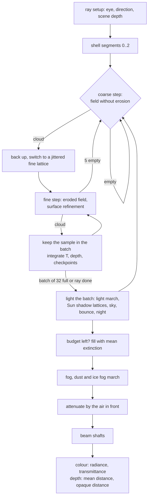

# The cloud march

`shaders/cloud_v2_march.comp` ray-marches the [cloud field](field.md) at half the render resolution and
lights every sample: the Sun or Moon through a short light march and the Sun shadow lattices beyond it, sky
light through the cloud above, light bounced from the ground, city light and Reflect-beam light at night, and
the halos and rainbows of ice and rain. It also marches fog and dust, and integrates the Reflect beams' shafts
through clear air. This page covers one ray. Which pixels are marched each frame, and how the results are
accumulated, is in [Temporal resolve and the far layer](temporal.md).

## Overview



The march outputs radiance **already attenuated** by the air between the eye and the cloud, but adds no air
light of its own: the sky pass integrates the air in front of each cloud and composites it, so a cloud and the
clear sky beside it share one atmosphere (see [Atmosphere and sky](../atmosphere-and-sky.md)).

## Ray setup

- **Eye and frame.** The eye is 2 m above the detailed ground under the observer (`terrainFrame.x`, written by
  `scene_depth.comp`), in the observer's local east-north-up (ENU) frame centred on the Earth.
- **Direction.** Each visit of a pixel moves the ray within its texel (see [Jitter](#jitter)).
- **Scene depth.** `tScene` is read 1:1 from the half-resolution shared depth (terrain, sea, meshes).
- **Resolution.** The march targets, the scene depth and every clouds v2 screen image are half of the window.
  With "Clouds follow render scale" (`display.clouds_follow_render_scale`) on, they are half of the *scaled*
  window (`computeHalfExtent()`), so at a render scale of 50 percent the march covers a quarter of the pixels of
  100 percent. The High and Ultra presets turn it off, the lighter presets on. The noise level of detail stays at
  the 100 percent pixel: `cv2.motion.w`, the ratio of the current half-res height to the 100 percent one, scales
  the footprint back, so the clouds keep their texture, only softer; read at the coarser pixel, the storm cumulus
  texture would filter away. A change of size recreates the images (`recreateComputeScaledTargets()`, checked at
  the start of `recordCompute()` before anything is recorded) and blits the temporal history across, so the
  clouds do not restart.
- **Shell segments.** `cv2ShellSegments()` intersects the ray with the shell between the lowest cloud base and
  the highest top and removes what lies inside the inner sphere, giving 0 to 2 segments. No special cases are
  needed for an eye below, inside or above the shell.
- **End of the march.** Each segment ends at `min(segment end, tScene, tLimit)`, where `tLimit` is "Max
  distance" (600 km) measured from the **shell entry**, not the eye: from orbit the Earth is farther away than
  the limit.
- **Soft ground contact.** Extinction fades out over the last `clamp(3 × footprint, 40 m, 600 m)` before the
  scene depth. Dense cloud meeting a slope otherwise ends on a hard line that the half-resolution grid
  stair-steps; real cloud also thins against the ground.

## Stepping

With \( t_r \) the distance past the shell entry, a step is

\[
\Delta t = \min\!\big(b + g\,t_r,\ \max(c,\ 0.012\,t_r)\big), \qquad
\Delta t \le \frac{200\ \text{m}}{\max(|\hat d \cdot \hat u|, 0.01)}
\]

with \(b\) "Step at eye" (60 m), \(g\) "Step growth" (0.014), \(c\) "Step max" (1700 m), and \( \hat u \) the
vertical **at the sample**. Steps grow with distance because the noise is read at the pixel footprint there
anyway; the vertical cap keeps any step from crossing more than 200 m of altitude, so a thin deck seen from
orbit is not stepped over.

**Coarse mode.** Each segment starts coarse, after an offset of \( 2\Delta t \times \text{jitter} \): a whole
coarse interval, so across visits the coarse lattice takes every phase and a thin deck is found at all of them.
Coarse samples read the field with no erosion, an upper bound of the eroded density. An empty coarse sample
advances by a stride of its own, \( 2\Delta t\,(0.75 + 0.5\,u_k) \) with \(u_k\) a golden-ratio sequence off the
ray's jitter, so each stride is 1.5 to 2.5 steps. A lattice offset once at the segment start still meets a
smooth, dense surface at a depth that follows the surface's height with the lattice's period, whatever the start
jitter; the light that depth receives then draws evenly spaced contour rings on anvil heads and tower walls. A
stride of its own length per step turns the lattice into a random walk within a few steps.

**Switch to fine.** At the first coarse sample with density the march backs up by \( (2 - j_f)\Delta t \) and
switches to fine steps, so the fine lattice is jittered too (\( j_f = \text{fract}(1.618\,j + 0.5) \), derived
from the start jitter). If the back-up passes the segment start, the march restarts at the start plus a
jittered offset; clamping to the start itself would put every ray from inside a cloud or rain on one lattice
aligned to the eye, which draws contour rings. Fine samples read the eroded field with
`detailAmt = 1 − smoothstep(D, 4D, t)`, D being "Detail fade start" (8900 m). After more than 5 consecutive
empty fine samples the march returns to coarse mode.

**Surface refinement.** Far from the eye a fine step is hundreds of metres (1.2 percent of the distance) while
a dense cloud's sunlit skin is tens of metres, so the first sample inside a tower lands at a random depth under
its surface and comes back sunlit or self-shadowed by chance. When a sample is opaque over its own step
(\( \sigma\,\Delta t \ge 1 \)), the sample before it was not, the ray's transmittance is still above 0.1 and the
step is longer than \( (2 + 1.5\,j) \) base steps (from about 7 to 14 km at the defaults, dithered per ray so
the switch draws no line), the crossing is bisected three times with unlit field reads and the bracket's inner
end is the sample that is kept. Distant towers and anvils are then shaded at their surface. Near the eye the
steps are already skin-sized, and refining every lump of a close cumulus field costs milliseconds for nothing
visible.

**Cheap samples.** A coarse sample that is almost all high-layer ice (`thin > 0.9`) or rain shaft
(`rain > 0.9`) is kept on the spot and never enters fine mode; ice and rain are nearly uniform media with
weak structure. An ice sample stands for two steps where the pixel spans more than 60 m; closer, it is one
step, because two-step samples near the eye catch the fibres on some frames and miss them on others. A
rain-only sample stands for **four** steps: each runs a light march whose steps evaluate the whole field,
towers included, so under a storm the shafts would otherwise dominate the march. A shaft's edge reads slightly
brighter, because a step carries its density a little past the edge.

**Termination and budget.** The march ends when transmittance falls below 0.01, at the end of the segments,
or when the iteration budget (`misc.x`, "March budget", 430) runs out. The unmarched remainder, including whole
segments never reached, is **filled** with the path's mean extinction,
\( T_\text{rem} = e^{-(\tau_\text{path}/\ell_\text{path})\,\ell_\text{rem}} \), lit with the mean colour so
far, at a depth halfway into the remainder. Leaving it transparent would let the horizon show through clouds.

### Density first, then light, in batches

A GPU runs a group of rays (32 on NVIDIA) in lockstep, so every iteration of a loop costs what its most
expensive ray costs. A lit sample is ten field evaluations (the view sample, seven light steps, a far sample and
a sky probe); an empty step is one. In a single loop, rays in empty air would wait out their neighbours' light
marches, and the march's time would be the longest ray's step count times a lit sample's cost.

The march therefore runs in two loops per **batch** of up to 32 samples (`kBatch`). The first walks the ray on
the density field alone (coarse steps, the fine lattice, the surface refinement, transmittance and the depth
statistics) and keeps each sample that holds cloud, with its field, distance, the transmittance in front of
it and its weight in the ray's light. The second lights the kept samples and adds them, `L += w · S`. The
samples, their order and their weights are the same as a single loop's; only the scheduling differs. Batches of
4 gain nothing, 16 to 64 about the same: 32. Lighting each sample as soon as it is found ("search, then light")
is slower on overcast, where every lit ray waits on the slowest search each time.

!!! note "Shadowed names"
    In the lighting loop `t`, `T`, `f`, `fp` and `detailAmt` are locals that shadow the density loop's. Anything
    the lighting needs from the density loop must be stored in the batch arrays (`bF`, `bT`, `bTr`, `bCov`,
    `bW`).

### Jitter

Every jitter sequence advances per **visit** of a pixel, not per frame: a sparse pixel is marched every fourth
frame, and a sequence stepped per frame would leave each pixel of a 2 × 2 block in its own cluster of offsets,
which shows as 2 × 2 squares in far cloud. The four per-visit offsets step by the four R4 constants
(\(1/\phi_4^k\), \(\phi_4 = 1.1673\)), so no two of them advance together.

| What | Source | Advances by |
|---|---|---|
| Sub-texel ray position | interleaved gradient noise per pixel + visit · (0.8567, 0.7339); the texel centre in fast flight | per visit |
| March start | 64 × 64 void-and-cluster blue-noise tile (an SSBO) + visit · 0.6287 | per visit; per frame in fast flight |
| Fine-lattice restart | `fract(1.618 · jitter + 0.5)`, derived from the start jitter | — |
| Light march | another cell of the blue-noise tile + visit · 0.5386; each light step adds its own golden-ratio offset | per visit; per frame in fast flight |

The sub-texel motion lets the history integrate the whole texel footprint, so thin far cloud does not draw as
hard stairs. Fast flight is an eye moving more than 150 m a frame (`misc2.z`), where there is no useful history.
The light march has its own jitter because a shared one moves a sample's depth inside a flat cloud top together
with its light-step positions, and their product never averages out. The sub-texel x offset and the light
jitter must not share a step either: on a sloping surface the sub-texel point is the surface's depth phase.

## Lighting a sample

The radiance a sample scatters toward the eye is

\[
S = S_\text{key} + S_\text{amb} + S_\text{bounce} + S_\text{night}
\]

Phase functions are Henyey-Greenstein normalised so that isotropic scattering is 1 (no \(1/4\pi\)), the
codebase's convention; `SUN_INTENSITY` is 1.

### Phase functions

Computed once per ray:

| Medium | Phase |
|---|---|
| cloud, single scattering | \( 0.6\,\text{HG}(0.57) + 0.4\,\text{HG}(-0.25) \) ("Forward scatter g", 0.57) |
| cloud, multiple scattering | \( 0.85\,\text{HG}(0.2) + 0.15\,\text{HG}(-0.4) \) |
| cloud, silver lining | \( s\,(0.12\,\text{HG}(0.92) + 0.5\,\text{HG}(0.8)) \), \(s\) = "Silver lining" (0.5) |
| ice (`thin`) | \( \text{HG}(0.3) \) + ice optics / 0.55 |
| rain | \( 0.3\,\text{HG}(0.97) + 0.55\,\text{HG}(0.35) \) + 0.5 × rain optics |
| snow shafts | the rain phase blended toward faint ice optics and a pillar where the shafts are below freezing |

**Ice is delta-scaled.** About 45 percent of an ice crystal's scattering is a narrow forward peak that carries
on almost undeviated. It is removed from the extinction, \( \sigma \leftarrow \sigma(1 - 0.45\,\text{thin}) \),
and the phase keeps only the broad lobe (renormalised by 0.55). Counting the peak as extinction would dim
everything behind cirrus as if that light were lost. In the light march the factor is \( 1 - 0.8\,\text{thin} \),
because what reaches cloud *below* a cirrus veil includes light the ice scatters within a few degrees (an
effective g near 0.8): real cirrus barely dims the cloud under it.

**Rain** has a diffraction spike well under a degree wide plus a broad refracted lobe; a single wide lobe would
light shafts toward the Sun as white walls.

**Silver lining** is sunlight scattered forward *through* thin water cloud: the droplets' narrow diffraction peak
plus a wider lobe of a few forward scatterings. It is attenuated at 0.3 of the optical depth toward the light,
because forward scattering is not loss. The rim of a cloud in front of the Sun glows and light leaks through its
thin parts; views away from the Sun do not change. It applies to water cloud only (not ice, rain or the mid
layer's sheets): on a sheet lying across the Sun over tens of degrees it would be a glare many times the Sun's.

### Key light

The key light is the Sun, or, when the Sun is below the sample's horizon at night, the Moon through the same
light march (`moonGain` × "Moon gain", 1.0).

- **Sun colour and zenith sky** come from a table (`cloud_v2_sunlut.comp`, `include/cv2_sunlut.glsl`): a
  256 × 76 two-layer RGBA16F array indexed by the cube root of the Sun's zenith cosine and by height in 800 m
  levels from 0 to 60 km, layer 0 the Sun's colour, layer 1 the zenith sky's radiance. Both depend only on
  height, the Sun's zenith angle and the scattering gains, so the table is baked when "Cloud sunlight Rayleigh"
  or the sky's Rayleigh or Mie gain changes (and after a shader reload), never per frame. Linear filtering
  between rows is exactly the interpolation between 800 m levels; fixed levels matter, because colours that
  step at a different depth on every ray draw rings looking down.
- **Sun colour** (`sunColorAt()`, in the bake): the Rayleigh and Mie columns toward the Sun by the Chapman
  function (`include/atmosphere.glsl`), which handles a grazing path's tangent point exactly, plus an ozone
  shell at 25 km crossed at its secant (the Chappuis band turns twilight cloud pink rather than orange). The
  clouds' Rayleigh has its own gain, "Cloud sunlight Rayleigh" (0.86 × physical), separate from the sky's.
- **Earth's shadow.** `smoothstep(horizon ± 0.004, sun elevation)` at the sample itself.
- **Solar eclipse.** × `eclipseSunVis()`, the share of the Sun's disc visible from the sample (see
  [Moon and eclipses](../moon-and-eclipses.md)).
- **Clouds beyond the light march** shadow the sample through the Sun shadow lattices and the layer shadow map
  ([below](#the-suns-shadow-beyond-the-light-march)).
- **Rain near the eye** additionally takes `mix(1, sunCloudT, e^(−t/100 km))`, the eye's own Sun
  transmittance through cloud ([Weather](weather.md#the-sun-behind-clouds)), so a shaft's sharp forward lobe
  does not draw the Sun's disc under a storm that hides it.

### The light march

`lightAmbOD()` holds the shader's **only** lighting call of `cv2Field()` and does four jobs in one loop (each
extra call site inlines another copy of the whole field, roughly 60 KB of GPU code):

| Index | Sample | Accumulates |
|---|---|---|
| 0 … nL−1 | **equal** steps toward the light, summing to "Light march" (2500 m), each jittered over its whole step at its own offset; the first two read eroded detail (self-shadowed lumps), the rest mean erosion | optical depth, ice × \(1 - 0.8\,\text{thin}\), mid layer × "Mid layer shadow" |
| nL | one far sample at 1.6 × the march length, the far side of a tall tower | \( \sigma \times 0.8\,L \) |
| nL + 1 | a probe 250 m straight up | `sigUp`, for the sky ambient |
| nL + 2 … nL + 4 | three steps (at 75, 375 and 1275 m) along the mean Reflect-beam direction, night only | beam optical depth |

nL is "Light steps" (7). **Why equal steps.** A sample whose `exp(−τ)` is either about 1 (a gap) or about 0
(a cloud) is all-or-nothing, and the temporal history converges on the *mean* of `exp(−τ)`, which is far brighter
than `exp(−mean τ)` (Jensen's inequality). Long far steps of a geometric series are exactly such single samples
standing for kilometres: under a low Sun the clouds in another cloud's shadow come out tens of levels too
bright. Equal steps give the same field reads the least variance at the same cost.

**Sampling footprint.** Every light sample reads the field at the view sample's footprint, or at "Light march
footprint (x length)" × the march length if that is larger (0 by default: point samples). A coarse footprint
hides grain but does not conserve a cumulus's optical depth, so a backlit cloud loses its self-shadow and reads
flat. The footprint must be one value for every call of `lightAmbOD()`; a per-step footprint pushes the march
over its register budget.

**Steps merged in pairs.** Where the view sample's footprint exceeds about twice the first step of a 1.6
geometric series over the march (\( 2 \cdot 0.6\,L / (1.6^{n_L} - 1) \), about 120 m at the defaults, i.e. from
roughly 100 km of eye altitude), two light steps would resample the same mip texels, so one sample stands for
each pair: seven steps become four samples of the same lengths. Orbit views gain about a fifth of their march
time; nothing changes below about 60 km.

**Light LOD** ("Light LOD footprint (m)", 0 = off, the default): where the ray's transmittance is below 0.5, the
footprint exceeds the setting, or the sample is rain, the middle steps collapse into one, two steps over the
same length. It is ignored for a light march longer than 3 km, where its second step would be one point sample
for kilometres: grainy, and brighter than the full march.

**Ice samples** skip the light march entirely and use \( \tau = \sigma \times 400 \) m.

**Decks at grazing light.** A deck lit at a low angle is shadowed by the rest of the deck, tens of km away, far
beyond the light march. The optical depth is raised to at least half of
\( \text{deck}\cdot\sigma\,\big((h_\text{top} - h)/\max(\hat u \cdot \hat l, 0.03) - 2L\big)_+ \): only the
path **beyond** what the light march already read (the deck's nominal top sits hundreds of metres above a lumpy
top's real surface, and the whole path at a 4 deg Sun would be kilometres of cloud). Without the term the band
along the terminator glows red from orbit. While the layer shadow map is on, the mid layer's share leaves the
term to the map.

### The Sun's shadow beyond the light march

A sample's light march reaches about 2L toward the Sun (the steps and the far sample). Beyond that, the
lightning pass (`cloud_v2_lightning.comp`, before the march) bakes parallel rays toward the Sun on lattices
around the eye, each storing the Sun's transmittance **beyond** each of its points; a sample reads them at the
point where its own light march ends, so the two never count the same cloud twice. All lattices share two axes
across the Sun's direction (`cv2SunGridAxes()`: a horizontal one and the other), so their rays are aligned.

| Lattice | Rays | Spacing across the Sun | Along the Sun | Reach | Casts shadow |
|---|---|---|---|---|---|
| fine grid `cv2SunGrid` | 32 × 32 | 250 m | 17 points over the ray's length (at most 400 km) | 3-3.9 km from the eye's line to the Sun; with the cascade on, only within 3-6 km of the eye | low cloud, towers, anvils |
| shaft ring 1 `cv2SunShaft` | 128 × 128 | "Cloud shadow ring 1 cell" (250 m) | 32 knots, ±16 reaching about 5 km of height | 56 cells (about 14 km) | low cloud, towers, anvils |
| shaft ring 2 | 128 × 128 | "Cloud shadow ring 2 cell" (1000 m) | ring 1's knots × the cell ratio × "ring 2 depth" (0.5) | 56 cells (about 56 km) | low cloud, towers, anvils |
| cascade `cv2SunCasc` | 128 × 32 | 2 × "Far cloud shadow range" / 128 (3.2 km); the other axis 0.8 km at sunset to about 10 km at 45 deg | 49 knots: 40 uniform through the window (about 10 km at sunset), 8 stretched sunward to at most 500 km | ±"Far cloud shadow range" (205 km) | low cloud, towers, anvils; the mid layer only while the layer map is off |
| layer shadow map | 2 levels × 256 × 256 cells | 1 km; 6 to 48 km | integrated per cell | anywhere | mid and high layers |

**Lookup order.** The finest lattice that covers a sample wins: the fine grid near the eye, then shaft ring 1,
then ring 2 (`cv2SunShaftRings()`, one call site), then the cascade (`cv2SunCascT()`), each fading into the next
over its edge. The layer shadow map multiplies the result. The cascade is read **one knot sunward** of where the
light march ends: a knot interval holds the sample's own cloud, and without that bias every sunlit face would be
shadowed by the body behind it. Thin ice reads the cascade at the middle of its layer, because at a grazing Sun
one jittered height inside it speckles.

**Why several lattices.** The cascade's rays are kilometres apart, and at a grazing Sun a far cloud top's shadow
is a layer a few hundred metres deep: the cascade alone reads lit where a finer lattice reads full shadow, and a
cloud shaded by its neighbour would be shadowed only near the eye. The rings fill that gap at two scales; larger
cells reach further and soften the shadows' edges at the same cost. The mid and high layers are kept out of the
near lattices: any lattice confined to a region about the eye draws that region, and a sheet's shadow in it is
a grey disc that follows the observer. Their shadow comes from the layer map instead, which exists wherever the
layers do.

**Riding with the clouds.** Every lattice moves with the clouds and is stored toroidally. The CPU integrates the
eye's motion relative to the clouds (the drift turned out, as the resolve's reprojection does) into the eye's
lattice coordinate in double precision, so a ray keeps its slot while the eye flies and a bake up to 32 frames
old is still in the right place. A change of axes or cell size pivots the lattice about the eye and moves no ray
by more than metres between its refreshes.

The cascade also rides **along** the Sun. Its knots stand at fixed distances along the Sun's direction from the
window's centre, which sits under the eye, so a bake read a few frames later is shifted along its rays by the
eye's motion since. The CPU integrates that motion too and keeps, for each half of the rays (each half is baked
on alternate odd frames), the knot origin of its last bake; the lookup reads each ray at the knots it was baked
for (`cv2.sunCasc8.xy`, the shift since that bake). This matters most from orbit, where the height-scaled flying
speed is hundreds of km/s: without it the window would read each cloud's own shadow, a dark, ray-streaked
rectangle under the eye.

**Jittered running means.** Each bake places a ray's sub-rays at a new point of its cell and steps at a new
phase; the stored transmittance is the mean of the bakes (a new bake weighs 1 / the bakes so far, at least 1/8
for the grid and cascade; 1, 1/2, 1/3 then 1/4 for a ring slot). While the eye moves along the Sun, a cascade
bake replaces the ray's mean instead: bakes for different knot origins cannot be averaged. With fixed sub-rays a ray knows a cloud top's
height only to a fraction of its cell, which at a 0.5 deg Sun is tens of km along the ground, and shadow edges
come out as stairs.

**Stamps.** A ring or cascade value records which of 8 wraps of its slot it was baked for (the eye's coordinate
goes to the GPU modulo 8 windows), and 0 reads as invalid. A slot that changed hands as the eye moved is ignored
until it is rebaked, and the next lattice out stands in, at any speed up to 8 windows between two bakes of the
slot. A ring is cleared when it starts to fill, so its slots come in as they are baked.

**Bake schedule** (the lightning pass is 19 workgroups):

| Workgroups | Work |
|---|---|
| 0 | the flash list; thread 1 the eye's own Sun ray and the light on drops at the eye ([Weather](weather.md)) |
| 1-4 | the rain map around the eye |
| 5-8 | the fine grid: 4 sub-rays per ray, 48 steps each at its own phase; on even frames only while the cascade is on |
| 5-12 | the cascade on odd frames: 2048 rays, 2 sub-rays × 48 steps |
| 13-14 | ring 1: 512 rays a frame (every ray every 32 frames); moving, the window's leading edge first |
| 15-16 | ring 2, the same |
| 17-18 | ring 1 again while it catches up: moving more than half a cell a frame, the 128 frames after, and its first fill |

A ring's ray marches its own far field too: through its 32 knots, then 16 quadratically spaced steps to the
fine grid's ray length. The rings' and grid's length is the shell's depth along the Sun's direction (at most
400 km) whatever the eye's height, so the sample depths do not slide along the rays as the eye climbs. With
the cascade on, the bake costs what the fine grid alone costs: the two alternate frames.

**When they run.** The cascade runs while "Far cloud shadows" is on, the Sun is above about −5.7 deg, and the
far cloud layer has not taken over, from orbit as near the ground: the lightning pass writes the lattice axes
across the Sun every frame wherever the eye is. It is weighted in once every ray has been baked (4 frames) over
8 frames.
The rings run with the cascade while the eye is below 60 km, and fade in over 16 frames. A teleport, a time
jump or a field setting resets them; recreating the screen images (an HQ photo, a render-scale step) does not,
because they live in the clouds' space.

#### The layer shadow map

The mid layer (altocumulus, altostratus) and the high layer (cirrus) shade everything under them over hundreds
of km at a low Sun. `cloud_v2_layers.comp` keeps a 2D map of their shadow (`include/cv2_layer_map.glsl`, march
set binding 22, a 6 MB device-local buffer):

- **Lattice.** A gnomonic plane tangent at an **anchor** fixed in the drifting cloud frame (re-anchored when the
  eye is more than 1500 km away, which refills it), two levels of 256 × 256 cells stored toroidally about the eye:
  1 km cells near, and 6 km cells doubling up to 48 km so the far level covers what can be seen from orbit.
  Every value is stamped with its window wrap and the anchor's epoch.
- **Columns** (mode 0, 32 workgroups a frame, each cell every 16 frames): per cell, running means of each layer's
  vertical optical depth, its square, and its first two height moments, from jittered points read at a 100 m
  footprint at 6 stratified heights. Coarse reads do not conserve the layers' optical depth (altocumulus reads
  about twice too thick, cirrus a third). The mean converges over up to 64 bakes and moves only as fast as sim
  time moves the layers.
- **Slant** (mode 1, a quarter of the cells a frame): per cell X on the layer's reference sphere (5 km and
  9.5 km), the Sun's transmittance through that layer along the whole Sun ray through X: 16 taps from where the ray
  rises out of the band's floor to its top, each the overlap of its height stretch with that column's band (its
  centroid ± the slab thickness its moments give), through the **gamma model**
  \( E[e^{-m\tau}] = (1 + m\,\text{var}/\text{mean})^{-\text{mean}^2/\text{var}} \), so broken altocumulus passes
  the right amount of light. The mid layer counts at "Mid layer shadow", cirrus at 0.2 (delta-scaled ice).
- **Lookup** (`cv2LayerShadowT()`, in the key light): where the light march ends, the Sun ray's crossing of each
  reference sphere, four slant cells bilinear, \( T^{\text{share of the band above the point}} \). At a high Sun it
  adds nothing.

`cv2MidColumn()` and `cv2HighColumn()` are hand-kept copies of `cv2MidSigma()` and `cv2HighSigma()`
([field](field.md#one-field-for-every-consumer)). "Cirrus self-shadow" (0) is how much of the high layer's map
shadow cirrus takes itself. The map costs about 0.2 ms.

### Scattering the key light

\[
S_\text{key} = C_\text{key}\;P\;\big(p_{SS}\,e^{-\tau} + p_\text{silver}\,e^{-0.3\tau} + p_{MS}\,\text{ms}(\tau)\,b_\text{ms}\big),\qquad
\text{ms}(\tau) = \sum_{k=1}^{n} b^k e^{-a^k \tau}
\]

The multiple-scattering term follows Wrenninge's octaves: each octave sees a fraction \(a\) ("Multi-scatter
reach", 0.12) of the optical depth and contributes a fraction \(b\) ("Multi-scatter strength", 0.27), over \(n\)
"Multi-scatter octaves" (2). With two octaves the light inside a cloud has two depths and nothing between: raised
until a grazing-lit top is bright, the second octave lights the whole interior flat white. Around 6 octaves at
\(a = 0.7\), \(b = 0.5\) the series falls off gradually with depth, so the top is bright and the lobes keep their
relief. \( b_\text{ms} \) is the type's brightness, dimmed toward the base by the lobe occlusion (below). The
"powder" term \( P = 1 - 0.29\,e^{-300\sigma}(0.5 - 0.5\cos\theta) \) ("Powder", 0.29) darkens thin edges seen
away from the light. \( p_{SS} \) is blended toward the ice phase by `thin` and toward the rain phase by `rain`.

### Sky light

The ambient is the **diffuse** transmission of the cloud above the sample (two-stream, conservative
scattering, g about 0.85), plus light from below:

```text
τ_up   = max(σ_up · 250 m, 0.6 σ (topH − h))
ambVis = mix(0.7, 1, hf) / (1 + 0.11 τ_up) · mix(1, e^(−150σ), 0.3)
ambLow = 0.35 (1 − hf) · (0.3 + 0.7 / (1 + 0.11 τ_up))
```

A straight-line Beer's law, \( e^{-\sigma_\text{up} \cdot 250\,\text{m}} \), is near 0 inside cumulus and would
turn every large cloud's lower part a flat dark grey.

- **Hue through cloud.** Sky light that has diffused down through thick cloud arrives mixed with everything else
  that entered the cloud, so it keeps the zenith's blue only by the diffuse transmission
  \( 1/(1 + 0.11\,\tau_\text{up}) \) and is otherwise neutral (the sky light's luminance).
- **Light from below** is the ground's: 30 percent from the open country around (gaps, the horizon), the rest
  through the column's diffuse transmission, and 70 percent neutral in colour. An overcast's base is grey, not
  the blue of clear sky.

The incoming sky radiance is

\[
L_\text{sky} = L_\text{zenith}\;D\;\text{(Sky ambient)}\;(1 + \text{(Twilight sky light)}\cdot w_\text{twi})
 + \text{moonlit sky} + \text{moonless night sky}
\]

- \(L_\text{zenith}\) is the table's zenith radiance: a single-scattering integral up the local vertical in 12
  uniform steps, each step's sunlight through the Chapman column plus ozone. Fewer steps let one sample stand
  for the whole troposphere (deep red under a grazing Sun) and the next for the stratosphere (blue), with nothing
  green between: every cloud's sky-lit side turns magenta at twilight. With 12 it is a neutral blue-grey (linear
  R/G 0.96, B/G 1.23 at a Sun 1.7 deg down). The far cloud layer and the light on rain at the eye use copies of
  the same function.
- "Sky ambient" is 1.5; "Twilight sky light" (0) boosts the sky light from about 7 deg below the sample's horizon
  to 14 deg above it, where the zenith alone under-counts the bright dome toward the Sun.
- \(D\) fades the sky light over the Sun's first ~5 deg below the sample's horizon, so a cloud is never brighter
  than the sky drawn around it.
- The moonless night sky (starlight and airglow) is the terrain's "Night sky light" on the moonlit-sky scale,
  ungated, so night clouds are never black against the airglow.
- A solar eclipse multiplies the zenith radiance by `eclipseSkyLight()`.
- **Lobe occlusion** ("Lobe occlusion (sky light)", 0): the ambient is scaled by
  \( 1 - k\,\text{clamp}(-4\,\text{lobes}, -0.6, 1) \), the lobe noise's own value at the sample: darker in the
  creases between lobes, brighter on their tips, mean about 1, at no extra field read. Toward the base it dims the
  multiple-scattered sunlight too, or the creases would keep the Sun's colour and the lobes the sky's.

Ice samples skip the transmission terms.

### Ground bounce and light from below

`S_bounce = C_key · max(û·l̂, 0) · 0.15 · "Ground bounce" · (1 − hf)²` ("Ground bounce", 0.95). High ice
also receives the light reflected by the cloud under it, scaled by the coverage there (mip 2): cirrus over
white cloud is lit from below. The coverage is read along the flowed direction the field sample has already
computed (`gCv2FlowD`), so it costs one texture read rather than another evaluation of the eight-wave flow.

### Night: city light and Reflect beams

When the sample is on the night side (`dayness < 0.9`):

- **City up-light** on the lower part of a cloud: the night map at mip 3 under the sample, through the same
  response curve the sky uses, × `cloud.ambientGain`.
- **Reflect-beam light.** A beam is a column of sunlight reflected down from a mirror (see
  [Reflectors and beams](../../simulation/reflectors.md)). For each beam in the tile's culled list,
  `beamGather()` computes its irradiance at the sample: the Sun's disc seen in the mirror, a soft dome
  `1 − smoothstep(0.25R, 1.15R, d)` normalised to the same energy as a flat disc of radius R (the footprint),
  times the beam's mean irradiance in Suns, \( A_\text{mirror} / (\pi R^2) \), cut where the beam is blocked
  above. The lights are summed first; occlusion is then marched **once**, along their mean direction (the
  three beam steps of the light march), because beams converging on one site come from within a few degrees of
  each other. `beamFinish()` lights the sum like the Moon: cloud, ice and precipitation phases, multiple-scattering
  octaves. Precipitation takes the rain phase with its bows where the shafts' air is above freezing, and the
  snow phase (broad lobes, a faint halo and sundogs, no bow) where it is below, by the liquid share
  `cv2.precip.w` ([Weather: rain shafts](weather.md#rain-shafts)). "Beam light on cloud" (32) scales the
  physical irradiance up to sit beside the night view's Moon.

Burning rocket engines and launch-pad floodlights also light cloud, fog and haze at night; that is a separate
full-screen pass over the cloud composite, described in [Launch visuals](../launch-visuals.md).

## Atmospheric optics

The halos and bows are added to the single-scattering phase per ray, for the Sun or the Moon (so moon halos and
moonbows appear too). Every **position** is Snell's law per colour channel (650, 550 and 450 nm), so colour
order and the dependence on the light's elevation are exact; the intensity profiles are analytic.

| Optic | Model (`cv2IceOptics()`, `cv2RainOptics()`) |
|---|---|
| 22 deg and 46 deg halos | minimum deviation of 60 deg and 90 deg ice prisms, sharp inner edge, outward tail |
| sundogs | plates falling flat, effective index \( n' = \sqrt{n^2 - \sin^2 e}/\cos e \): 22 deg out at the horizon, 36 deg at 40 deg of Sun, none above about 61 deg |
| parhelic circle | a band at the light's elevation |
| circumzenithal arc | plates, only below 32 deg of light elevation |
| primary and secondary rainbow | one and two internal reflections; the bright sky inside the primary and Alexander's dark band |
| sun pillar | plates drifting almost level near the ground (ice fog only, see [Weather](weather.md#ice-fog-and-diamond-dust)) |

Ice optics are gated per **region** by crystal habit (`cv2IceHabit()`, evaluated once per ray at its first ice
sample from cluster noise): a 22 deg halo appears in about a third of cirrus, sundogs less often, the
circumzenithal arc and parhelic circle rarely, the 46 deg halo very rarely. Rain shafts below freezing show no
bow: where the shafts' air (500 m above the ground under the eye, at the eye's temperature lapsed by
6.5 C/km) is below about −1 C, the rain phase gives way to faint ice optics and a pillar. No glory is modelled.
"Optics (halos, rainbows)" (1.0) scales all of these.

## Integration and outputs

Each kept sample is taken as constant over its step, with single-scattering albedo 1:

```text
T_step = exp(−σ · stepW);   w = T · (1 − T_step)
L += w · S;   wAcc += w;   dAcc += w · t;   T *= T_step
```

The march records `tHalf`, where \(T\) first falls below 0.5, and checkpoints `tq` where it falls below 0.8,
0.5, 0.2 and 0.05; `cv2TAt()` interpolates the ray's cloud transmittance at any distance from them for the beam
shafts.

**Fog and dust** are then marched separately and composited by distance around the clouds' mean depth (see
[Weather](weather.md#fog-dust-and-ice-fog)). From above their band, a ray whose cloud transmittance has fallen
below 0.01 skips that march: nothing beneath an opaque cloud shows, and dust above it is faint seen from above.

**Air in front.** The result is multiplied by the Rayleigh and Mie transmittance from the atmosphere entry to
the cloud's mean distance \( d_\text{acc}/w_\text{acc} \) (a 12-step integral starting at the atmosphere's edge,
so from orbit no steps are spent in vacuum). The march adds no air light: the sky pass adds the air in front
and composites it outside the cloud's attenuation, and shadows that air by the same Sun shadow lattices
([god rays](weather.md#god-rays-and-haze-near-clouds)). A separate coarse air light here reads far darker than
the sky's at a grazing Sun, and any split between two air models disagrees at cloud edges.

| Image | Format | Contents |
|---|---|---|
| colour | RGBA16F | rgb: attenuated cloud radiance + beam shafts; a: transmittance \(T\) |
| depth | RG32F | x: transmittance-weighted mean distance (0 = no cloud; the shafts' distance on a ray with only a shaft); y: `tHalf` if \(T < 0.1\), else −1 |

At sparse rate the march writes the quarter-size top-left of these images; at full rate, every half-res pixel.
The signed-kilometre occlusion alpha the rest of the frame reads is made later by `cloud_march.comp`
([Temporal](temporal.md#the-post-pass-cloud_marchcomp)).

## Beam shafts

A Reflect beam is visible in clear air only by what scatters it: a little by air, far more by aerosol, so a shaft
glows low down and in hazy air and fades above about 15 km. `beamShafts()` integrates each culled beam per ray,
in closed form, after the march loop:

- The ray's interval **inside** the beam's column is found by a ray-cylinder intersection, clipped to the eye,
  the scene depth, the beam's ground point and about 60 km of altitude. (Evaluating only at the closest point
  of the view ray to the axis would make a shaft turn with the camera like a billboard when standing inside it.)
- The column's edge widens to at least 1.5 pixel footprints, with energy kept by \( (R/R_o)^2 \), so a beam
  narrower than a pixel is not a jagged line.
- Air and aerosol scattering along the interval use exact exponential columns, at the phase angle to the beam;
  aerosol is × "Beam haze / dust" (1.6).
- The result is attenuated by the air to the shaft and by the ray's own cloud transmittance there (`cv2TAt()`),
  and added to the colour. On a cloudless ray the shaft's weighted distance becomes the pixel's depth, so the
  temporal resolve reprojects it at the right parallax.

"Beam shafts" (1.0) scales them; at 0 the beams are drawn instead as the per-pixel pointing-ray lines in
`cloud_march.comp`. With shafts on, those lines remain as each beam's faint companion streak ("Beam lines (per
beam)", 0.25), because the cloud-light list clusters converged beams. The cloud-light list is culled per 16 × 16
workgroup tile against the tile's view cone (`cullCloudLightsForTile()`, up to 128 lights; on overflow every
sample walks the whole list of up to 512).

## Design constraints

!!! warning "Invariant: the register cliff"
    On NVIDIA this shader compiles either to 128 registers (with a small spill) or to about 220 (none), and the
    second is 20 to 60 percent **slower**. Trivial edits flip it: a second blue-noise read live across the loop,
    the adaptive-tile vote inside the march, a one-line debug-view exemption, any new `CV2Field` member, a
    second weather read for the far fraction, a per-step light footprint, hoisting a light step's length into a
    variable, even turning the dead `godT` test into the constant 1. Check the register count (harness
    `shaders reload`, see [Automation harness](../../development/harness.md)) before timing a variant, and A/B
    variants in one running app; run-to-run noise is 5 to 10 percent. Edits inside `cv2ColumnSigma()` flip it
    most readily; edits in the march file mostly do not.

!!! warning "Invariant: code size"
    `cv2Field()` is inlined at every call site. There are exactly two: the view sample (coarse and fine share
    it) and `lightAmbOD()`. The small fixed loops carry `[[dont_unroll]]`. A smaller workgroup that forces fewer
    registers spills and is slower; marking the field functions `DontInline` in the SPIR-V is honoured by the
    driver and is three to four times slower.

- **Workgroup size** is a specialisation constant (default 16 × 16) because it bounds the registers a thread may
  have. The adaptive rate and the tile light cull assume 16 × 16.
- The rate, eye height and per-sample lighting are per ray, so the march has no cross-pixel state except the
  tile's light list.
- **Measured** (RTX 3070 Ti, 1920 × 1009, 430 iterations, 7 light steps, full rate above 30 km), the cloud bucket:
  a storm from 388 km 38 ms, from 58 km 22 ms, anvils at sunset from 8.6 km 9.2 ms, cumulus from 6 km 9.2 ms.
  Near the ground about 5 ms of the bucket is not the march (composite, resolve, shadow-lattice bakes, ground
  shadow), and the sky pass (10 to 18 ms there) is the larger cost.

## Debug views

`clouds_v2.debug_view` (the march's views):

| View | Shows |
|---|---|
| 1 | iterations / budget (blue to red) |
| 2 | opacity \(1 - T\) |
| 3 | mean distance, banded every 50 km |
| 5 | rain optical depth |
| 7 | optical depth per layer (see [the field](field.md#debug-views)) |
| 8 | beam shafts: red the tile's light count, green the beams this ray's interval found, blue the shaft radiance (log) |

## Settings

Clouds tab, "Lighting" (keys under `clouds_v2`):

| Label | Key | Default |
|---|---|---|
| Cloud sunlight Rayleigh | `cloud_sun_rayleigh` | 0.86 |
| Twilight sky light | `twilight_sky` | 0 |
| Sun gain | `sun_gain` | 2.3 |
| Moon gain | `moon_gain` | 1.0 |
| Sky ambient | `ambient_gain` | 1.5 |
| Ground bounce | `bounce_gain` | 0.95 |
| Powder | `powder` | 0.29 |
| Multi-scatter reach | `ms_extinction` | 0.12 |
| Multi-scatter strength | `ms_strength` | 0.27 |
| Optics (halos, rainbows) | `optics_gain` | 1.0 |
| Forward scatter g | `phase_g` | 0.57 |
| Light march (m) | `light_len_m` | 2500 (up to 16000) |
| Light steps | `light_steps` | 7 |
| Light LOD footprint (m) | `light_lod_footprint_m` | 0 (off; ignored past a 3 km light march) |
| Light march footprint (x length) | `light_sample_footprint` | 0 |
| Multi-scatter octaves | `ms_octaves` | 2 (1-8) |
| Lobe occlusion (sky light) | `lobe_occlusion` | 0 |
| Silver lining | `silver_lining` | 0.5 (0-4) |

The scene-wide tonemap controls (Exposure, Highlight roll-off, Auto exposure, White balance) are in the
Photometry tab's EXPOSURE AND MOON section, described in [Atmosphere and sky](../atmosphere-and-sky.md).

Clouds tab, "Quality / performance" (the march's rows; the rate and resolve rows are on the
[temporal page](temporal.md#settings)):

| Label | Key | Default |
|---|---|---|
| Step at eye (m) | `step_base_m` | 60 |
| Step growth | `step_growth` | 0.014 |
| Step max (m) | `step_max_m` | 1700 |
| March budget | `max_iters` | 430 |
| Max distance (km) | `max_dist_km` | 600 |
| Detail fade start (m) | `detail_lod_start_m` | 8900 |

Graphics presets set three of these: March budget / Light steps / Step growth are 300 / 6 / 0.015 at Low and
Medium, 430 / 7 / 0.014 at High (the defaults) and 640 / 8 / 0.008 at Ultra.

Weather tab, "Cloud shadows & god rays" (the lattices' rows; the god-ray rows are on the
[weather page](weather.md#settings)):

| Label | Key | Default |
|---|---|---|
| Far cloud shadows (0/1) | `sun_cascade` | 1 |
| Far cloud shadow range (km) | `sun_cascade_range_km` | 205 (100-800) |
| Cloud shadow ring 1 cell (m) | `shadow_ring1_cell_m` | 250 (100-1000) |
| Cloud shadow ring 2 cell (m, 0 = off) | `shadow_ring2_cell_m` | 1000 (0-4000) |
| Cloud shadow ring 2 depth (x) | `shadow_ring2_depth` | 0.5 |
| Layer shadows (mid / high) | `layer_shadows` | 1 |
| Cirrus self-shadow | `cirrus_self_shadow` | 0 |

The cascade's cell and knot sizes scale with its range (410 km gives 6.4 km cells and about 20 km knots), and
its edge fades over the last fifth of the window.

Beams tab (keys under `clouds_v2`): "Beam shafts (0 = drawn line)" `beam_shafts` 1.0, "Beam haze / dust"
`beam_haze` 1.6, "Beam light on cloud" `beam_light` 32, "Beam lines (per beam)" `beam_lines` 0.25.

Knockout bit 32768 skips the volumetric cloud march and everything of clouds v2 but the weather cube's evolution
([Weather](weather.md#with-the-volumetric-clouds-off)); bit 128 removes the beams' light and shafts. See
[Profiling](../../development/profiling.md).

## Where in the code

- `shaders/cloud_v2_march.comp`: `main()` (setup, the density and lighting loops, the fog march, outputs),
  `lightAmbOD()`, `msOctaves()`, `beamGather()`, `beamFinish()`, `beamShafts()`, `cv2TAt()`.
- `shaders/cloud_v2_sunlut.comp`, `shaders/include/cv2_sunlut.glsl`: the Sun / sky table (`sunTransmit()`,
  `sunColorAt()`, `skyZenithAt()`; copies in `cloud_v2_far.comp` and `cloud_v2_lightning.comp`).
- `shaders/cloud_v2_lightning.comp`: the Sun shadow bakes; `shaders/include/cloud_lightning.glsl`: their layout,
  `cv2SunGridAxes()`, `cv2SunGridLen()`, `cv2SunCascT()`, `cv2SunShaftT()`, `cv2SunShaftRings()`, the stamps.
- `shaders/cloud_v2_layers.comp`, `shaders/include/cv2_layer_map.glsl`: the layer shadow map
  (`cv2MidColumn()`, `cv2HighColumn()`, `cv2LayerShadowT()`).
- `shaders/include/clouds_v2.glsl`: `cv2ShellSegments()`, `cv2HG()`, `cv2IceHabit()`, `cv2IceOptics()`,
  `cv2RainOptics()`, `cv2PillarOptics()`.
- `shaders/include/beam_cloud_lights.glsl`: the beam light list and `cullCloudLightsForTile()`.
- `shaders/include/atmosphere.glsl`: the Chapman columns.
- `src/simulations/SatelliteSimCloudsV2.cpp`: `fillCloudsV2Params()` (the lattices' coordinates and weights, the
  layer map's anchor), `recordCloudsV2()`, the blue-noise tile (`makeBlueNoise64()`).
