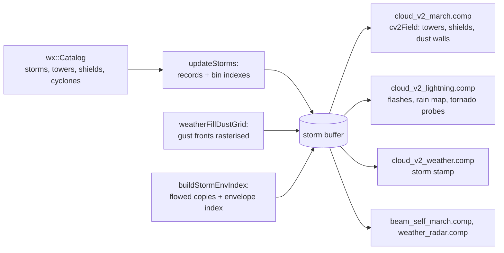

# Storms in the cloud field

This page covers how the weather's **storm objects** are drawn by the volumetric clouds: the storm buffer that
carries them to the GPU and its spatial indexes, the cumulonimbus towers and anvil shields in the field, the cloud
each storm stamps into the weather cube (squall lines' trailing rain, tropical cyclones' bands and central dense
overcast), tornado funnels, the haboob dust wall, and where the wildfire smoke is drawn. Where storms come from, how
they live and move, and what decides a tornado or a haboob is simulation, covered on
[Weather and storms](../../simulation/weather.md), [Tropical cyclones](../../simulation/tropical-cyclones.md),
[Haboobs](../../simulation/haboobs.md) and [Wildfires](../../simulation/wildfires.md). The tower's shape profile is
described with the rest of the field on [The cloud field](field.md); lightning, rain and fog are on
[Weather, rain, lightning, fog](weather.md).

## From catalog to GPU

The storm catalog (`wx::Catalog`, `src/simulations/Weather.h`) is a pure function of sim time: asked for a moment it
returns the storms alive, their towers, their anvil shields and the tropical cyclones. Each frame that sim time
moved, `SatelliteSim::updateStorms()` asks it for the frame's moment and writes the answer into one storage buffer,
the **storm buffer** (`stormBuf`), which every shader that evaluates the cloud field binds:

Storms live in the cloud **map's** frame, the drifted sphere the weather cube and noise volumes are read in
(`cv2Drift`), so they ride with the clouds. The buffer is written on the CPU into a shadow copy; the ranges each
writer marks (`VulkanContext::mirrorDirty`) are copied to the device-local buffer at the start of the frame's GPU work.
With time paused nothing is rewritten.

### Layout

`shaders/include/cv2_storms.glsl` declares the buffer; `SatelliteSim.h` mirrors it with `GpuStormTower`,
`GpuStormShield`, `GpuStormCyclone` and the `kStorm*` / `kShield*` offsets.

| Section | Capacity | Record | Contents |
|---|---|---|---|
| tower head | 1 | `uvec4` | towers, table entries, list entries, frame |
| towers | 8192 | `CV2Tower`, 48 B | axis (map-frame unit vector) and strength; role (1 dominant, 0.7 / 0.5 flanking), size, overshoot, shear bearing; reach (m), seed, anvil width factor, head drift factor |
| tower table / list | 65 536 / 196 608 | `uvec2` / `uint` | open-addressed hash of cube-face bins, 256 a face side (~39 km) |
| shield head | 1 | `uvec4` | shields, bins a face side (0 = shields off), bins, list entries |
| shields | 4096 | `CV2Shield`, 64 B | a capsule along a great-circle chord: strength, radii at both ends, thickness, age, stratiform rain share, a line system's rear tangent and lead; a negative lead marks a cyclone's central dense overcast and holds its eye radius |
| shield table / list | 32 768 / 131 072 | | bins of 128 a face side (~78 km) |
| cyclones | 8 | `CV2Cyclone`, 64 B | centre (map frame and where the low cloud reads it, flowed), intensity, hemisphere, eye / CDO / outer-band radii, band phase, radius of maximum wind, vmax, over land, spiral arm count |
| dust head, frame, grid | 512 × 512 | `uint` | the haboob walls ([below](#haboob-dust-walls)) |
| envelope index | 131 072 / 393 216, + copies | | read only by the weather bake (`CV2_STORM_ENV`) |

Towers and shields are sorted strongest first before they are written. Past a section's capacity the weakest are
dropped, and a crowded bin keeps its strongest: up to 12 towers and 31 shields a bin.

### Bin indexes

A shader that needs the towers near a point computes the point's **bin key** (`cv2StormBinKeyN()`: the cube face
of its direction and the equal-angle cell on that face, 0 never a key) and probes the open-addressed table (linear
probing, load factor at most 0.5, so probes are short) for the bin's list start and count. A point reads its own bin
and nothing else, on any face, so every tower must be listed in **every** bin its reach touches.

`listStormBins()` finds those bins: the rectangle of bins spanned by 16 points on the reach's rim (on every face the
rim crosses), then, row by row, cut in from both ends to the first bin that the shape can actually touch
(`KeepDisc` for a tower, `KeepCapsule` for a shield: a test of the bin's centre against the shape grown by the bin's
chord circumradius, plus 60 m of slack for the GPU's float key). Everything between the two ends of a row is kept, so
the list is a superset of the exact one. A tower's reach covers everything of it: the widest flared head, blown
downwind, the lean, the anvil hang's footprint and the storm cumulus around it, padded 6 percent. A shield is listed
out to 1.6 radii along its spine, the farthest its frayed outline can reach.

The table is built in host memory and copied in one sequential run: the device-side copy is write-combined, and
scattered 4-byte stores were most of the index's cost. Tower and shield listings run on the storm catalog's thread
pool, each chunk appending to its own list, the lists joined in order, so the result is identical to a serial build.

!!! warning "Invariant"
    The bin key on the CPU (`stormBinKey()`, SatelliteSimWeather.cpp) and on the GPU (`cv2StormBinKeyN()`) must use
    the same face rule and cell rounding, and the bin counts the CPU lists with must be the shaders': the tower bins are
    the constant `kCv2StormBinsPerFace` (256); the shield bins are read from `cv2ShieldHead.y`. A tower listed short of
    its reach is cut along a bin edge.

!!! warning "Invariant"
    A table entry packs `(list start << 5) | count`, so a bin can hold at most 31 entries (`kShieldMaxPerBin`).
    `GpuStormTower`, `GpuStormShield` and `GpuStormCyclone` must stay byte-for-byte the GLSL records; their sizes are
    `static_assert`ed, their field order is not.

## Towers

`cv2ColumnSigma()` (`shaders/include/clouds_v2.glsl`) draws the deep convection. It runs first in `cv2Field()`
because the low layer needs two of its outputs, the proximity to a tower (the storm cumulus rises there) and the rain
core under it.

1. Above the highest a tower can reach (the cumulonimbus top for the latitude's tropopause, plus the overshoot), it
   returns before any lookup: two atans and a hash probe per sample above the storms would cost every ray.
2. It reads the point's bin and loops over the towers listed there, skipping any whose reach the point is outside.
3. For each tower it sizes the radius from "Cb tower radius" by the tower's size, strength and role; a weaker tower
   is **shorter**, not thinner. Only anvil-reaching (dominant) towers get the waist, the flared head under the lid,
   the downwind head drift and, on about a third, an overshooting dome. The head's width and drift are the storm's
   own factors (`CV2Tower.c.zw`), which grow as the storm matures and are largest for supercells and organised
   systems. The full profile is on [the field page](field.md).
4. The best margin over all candidate towers is kept, together with that tower's height fraction, top, bearing and
   lift gradient, and the lobes are fetched once after the loop.

Alongside the density it reports the storm strength (the mid layer gives way to it), the proximity for the storm
cumulus, how close a dominant head is overhead (the anvil hangs lower there), and the **rain core**: heavy rain
under a dominant tower's body, a little longer downwind, written to `gCv2RainCore` for the low layer's rain branch.

A tropical cyclone's eyewall and inner-band towers do not flare: the cyclone's central dense overcast is their anvil.
With flared heads every eyewall tower would reach across the eye, and every sample there would walk a full bin.

## Anvil shields

Every storm carries an anvil **shield**: a capsule along the upper wind from just upwind of its anvil-reaching towers'
heads to a length that grows with the storm, with a radius growing toward its far end. It outlives the towers that fed
it, drifting downwind, thinning and fraying, so a dead storm leaves an orphan anvil turning into cirrus. Squall lines
and mesoscale convective systems have one long capsule behind the line; a tropical cyclone has its central dense
overcast with an eye, a weak outflow sheet past it and chains of thin capsules along its arms (the arm cirrus).

`cv2ShieldAt()` (cv2_storms.glsl) reads the point's shield bin and returns the strongest shield's strength there,
tapered toward the capsule's far end, the point's distance from the spine in radii, the thickness factor and the age.
A bin lists its shields strongest first and a shield's share never exceeds its strength, so the loop stops at the
first shield that cannot beat the best found. A cyclone's shield opens over its eye.

`cv2AnvilSigmaP()` turns that into density under the tropopause:

- **Outline.** The strength is frayed at two scales, by the cluster field and by the storm-lobe volume at one and
  three times its scale, more as the shield ages. The fray factor is floored at 0.8, so the outline never reaches
  past the 1.6 radii the shield is binned to; past 1.25 / 0.8 radii, with no dominant head near, the function returns
  before its texture fetches. Presence is 0 at the 0.05 cutoff: a little density kept at the edge would draw a hard
  arc along any view grazing it.
- **Body.** Thickness "Anvil thickness" × the outline × the shield's thickness factor, plus "Anvil hang" under a
  dominant head; a lumpy underside, a flat lid with low domes; an aged shield is thinner ice. Density × "Anvils".
- **Presence below the band.** The high (cirrus) layer gives way under a shield; with storm objects on that presence
  comes from the same lookup.

While storm objects are off (`cv2ShieldHead.y` is 0) the shield is fed by the weather map's cumulonimbus typing
instead: the cube read at the point and 12, 25 and 40 km upwind.

## The weather bake's storm stamp

The weather map knows nothing of the storms, so each storm stamps its own cloud into the weather cube when a face is
baked (`cloud_v2_weather.comp`, `stormStampTowers()` then `stormStampFinish()`). Without it a storm could stand in clear
map air, its rain falling from nothing under its anvil.

### The envelope index

The bake needs every tower whose **envelope** reaches a texel, \( E = \text{reach} + \max(40\ \text{km}, 0.8\,\text{reach}) \)
(`cv2StormEnvRadius()`), well past the anvil. Listing towers that far in the march's index would multiply the tower
search, so the bake reads a second index of its own (`buildStormEnvIndex()`): its own copy of the towers and shields,
each placed where the low cloud reads the weather cube for it. The low cloud reads the cube through the flow
(`cv2FlowDisp`, up to hundreds of km), so the copy uses the tower's **flowed** position (`stormFlowedDir()`, a double
CPU replica of the shader's flow); stamped at the unflowed position, a storm's field lands beside it. Shield envelope
bins are 64 a face side.

The envelope index is built only on a frame the bake runs (~1-1.3 ms). In time warp, `updateStorms()` runs at the top
of the frame and the envelope index is built on worker threads of its own, joined before the frame's uploads
(`clouds_v2.storm_env_async`); the result is identical.

!!! warning "Invariant"
    `stormFlowedDir()` duplicates `cv2FlowDisp()` in double. Changing the flow's waves in one and not the other
    moves every storm's stamped cloud away from its towers.

### What a storm stamps

In coverage units, per texel:

| Channel | Air-mass cells, multicells, supercells | Squall lines and MCSs (from the shield copy) |
|---|---|---|
| convective cloud | a broken cumulus field over the envelope's inner part, congestus within "Storm cumulus reach" of the tower | |
| stratiform deck | the forward flank: an ellipse under the anvil downwind of a dominant tower | the trailing stratiform region behind the line, and a shelf band 1-22 km ahead of it |
| rain | under that deck, heaviest near the tower | the trailing region (weaker in the transition zone 12-55 km behind) |
| clear moat | at the envelope's edge (subsidence) | 25-90 km ahead of the line |

A squall line **bows**: its middle towers stand ahead of its ends (the bow is packed into the shield's rain field), and
every distance is measured from the spine moved forward by it. No rain falls ahead of a line. A supercell's
**rear-flank rain-free base**, where its tornado stands, clears the map's rain there (`gRainFree`).

The stamp then reshapes the texel: a convective share types it toward congestus, a deck share toward stratiform
(the low layer thickens a raining stratiform deck into nimbostratus), the moat subtracts coverage. Inside an envelope
only the storm's own rain falls: the map's precipitation is cut by 95 percent there. With storm objects on, the map's
own bright broken regions stop at congestus; cumulonimbus and its convective rain come only from storms. "Storm cloud
field" scales the whole stamp; "Storm clear moat" the moat.

### Tropical cyclones

`stormStampFinish()` adds each cyclone (up to 8) around its flowed centre:

- **Spiral arms**: logarithmic spirals trailing the rotation, as many as the cyclone's arm count (2 for a tropical
  storm to about 5 at Category 5; a fractional count crossfades only over the last 15 percent before the next whole
  number, since half-and-half mixtures interfere into rings), pitch 30 deg tightening to 22 deg with intensity, turning
  with the circulation. Each arm is thin (it covers about 15-23 percent of its period), pinches and swells along its
  length, feathers into filaments at its edge, breaks up outward and fades to wisps; its edge is roughened by the map
  read at a permuted direction (unrelated real cloud structure). Three weaker, finer arms run between them.
- **Eyewall**: a ring of convection at the radius of maximum wind, with the heaviest rain.
- **Central dense overcast**: a deck under the CDO shield, floored at the full coverage threshold so the low cloud is
  overcast whatever the map has there, fading out between 0.75 and 1.1 of the CDO's radius. It rains heaviest near the
  radius of maximum wind, thinning to light stratiform rain at its edge.
- **Eye**: cleared outright.
- **Swirl**: the bake reads the source map through a static differential rotation about each cyclone (cyclonic, up to
  0.6-1.5 rad near the CDO, none past the outer bands, `cycloneSwirl()`), so the map's own cloud near a storm trails
  round it in spirals. It is static in the storm's frame: a rotation growing with time would wind up without end. The
  noise the march textures the clouds with does not swirl.

A hurricane's arms and eye edge are a few km sharp, so where a cyclone can reach a texel the cyclone part of the stamp
is averaged over 3 × 3 points of the texel; the tower and line fields are smooth over tens of km and are read once at
its centre. Point-sampled, whole texels would switch on and off as the storm moves through the map.

The cyclone's wind also raises the sea state and, on a coast, the sea itself (storm surge): see [The sea](../sea.md)
and [Tropical cyclones](../../simulation/tropical-cyclones.md).

### When faces are re-baked

With storms stamped, a face is due once "Weather cube tick" (10 s of sim time) behind, faces out of view at a quarter
of that rate; at ordinary speed a due face is baked over four frames of rows, and in time warp the faces go by a quota
per frame, the visible part of an in-view face only. A sim-time jump of more than 15 min marks every face stale; with
time held, every face is re-baked when the storms uploaded change, so a cube baked on a jump's first frame (before the
catalog had that moment's storms) does not keep a hurricane without its arms. Details are on
[Weather, rain, lightning, fog](weather.md#re-baking-the-weather-cube).

## Tornadoes

A tornado (or a waterspout) is not part of the cloud field: it is a set of plume Gaussians in the dust list that
`cloud_march.comp`'s volumetric composite draws with the launch plumes and smoke
([Launch visuals](../launch-visuals.md)). `SatelliteSim::weatherFillTornadoes()` builds them each frame for the
funnels on the ground within 250 km (from dominant towers within 200 km; whether and where a storm puts one down is
`tornadoOf()`, a pure function of the storm).

**Parts.** A funnel of 10 dense, narrow Gaussians (peak optical depth 40 at a sigma of a third of the funnel's radius,
so the visible edge sits at the radius), widening 2.2-3 times to the base, lowering over its first ~90 s and roping
out (thinner, bent) over its last third; a lowered wall cloud under the base (sigma 700 m, 300 m at sea, 200 m thick,
optical depth 8); and once it touches down a debris cloud (optical depth 6) or a spray ring at sea (3). They stand
on the full-resolution DEM under the funnel (read once per ~500 m of its track), within the procedural terrain detail's
tens of metres of the drawn ground.

**Hung from the drawn base.** Threads 2-5 of the lightning pass probe up to four funnel columns (the nearest
funnels' Earth-fixed directions, passed in the flash buffer): from the ground up in 250 m steps, then 5 bisections, to
the first height where the field (rain and thin ice left out) passes 1e-3 /m, and the optical depth above it in 12
steps. The host reads the answers the next frame, eases them per storm over ~0.4 s, and runs the funnel 250 m into
that base with the wall cloud just under it; the cloud in front hides the join. Without a probe result (volumetric
clouds off, or no cloud found over it yet) it hangs from the cumulonimbus type's base. The haboob grid holds its clear air back within 3.5-6.5 km of a
tornado, so a funnel always has its storm's base to hang from.

**Light.** A funnel is lit as the march lights the base it hangs from: the sky's light through the column's diffuse
transmission \( T_d = 1/(1 + 0.11\,\tau) \) plus 0.35 × (0.3 + 0.7 \(T_d\)) from below, relative to clear sky, its sky
hue kept only by \(T_d\) (grey under a storm), and a little Sun. At night it is unlit; lightning lights it.

**In the composite.** A tornado Gaussian is marked by its seed (`seedK` ≥ 256, `ib.w` ≥ 1024), which carries a spin
phase. `cloud_march.comp` reads the billow field in log-polar coordinates about its centre turned by that phase
(`tornadoCyl()`), so the funnel, wall cloud and debris rotate as rigid bodies at their own rates. It keeps 0.3 of its
optical depth in the billows' troughs, adds no albedo to the sky-light give-back (it carries its own sky light, so
what is behind it is blocked, not passed through), and is exempt from the thinning applied to a Gaussian the eye is
inside. Like every plume it is composited through the cloud by depth, and it pulls the sky pass's air split toward its
own distance by its opacity in front of the cloud, so the haze in front of rain or fog behind the funnel is not
painted over it. With the probe, the ~40 field evaluations per funnel on one thread cost nothing measurable.

## Haboob dust walls

A haboob's wall is cloud in the field: marched, light-marched and shadowed like cumulus, and tinted. Each frame
`weatherFillDustGrid()` (SatelliteSimHaboob.cpp) rasterises the storms' gust fronts (`haboobFrontOf()`, see
[Haboobs](../../simulation/haboobs.md)) into a **512 × 512 grid** in the storm buffer, on the tangent plane at the
observer's sea-level point, cells 400 m near the ground growing by 0.6 percent of the eye's altitude to 6 km. Per cell,
32 bits:

| Bits | Field |
|---|---|
| 0-15 | the wall's strength e, 0 to 1: nothing ahead of the front, full just behind its foot, half over the pall behind it, gone ~26 km back, × a smooth noise along the front (3.5 km knots), so the wall is a row of heads |
| 16-27 | its top, in 2 m units: the head's height falling to 0.4 of it over the pall |
| 28-31 | the clear air ahead of the front, 0 to 1 |

Each front point stamps a strip along the front, in 16 row bands on the storm pool's threads; the strongest stamp wins
a cell. The grid is rebuilt when sim time moves 2 s or the eye a quarter cell; only the rows that changed are copied.
`cv2DustWallAt()` reads it C1-bilinearly (linear facets of 0.4-3 km cells draw straight creases on the wall's face).

**Shape** (`cv2DustWallSigma()`): the low layer's 3D margin, \( m = e + 1.6\,\text{lobes} - g(z) \), with \(z\) the
height over the wall's top; \(g\) is least at the **nose**, 0.35 of the top, so the head runs ahead of its foot. The
lobes are the cumulus shape volume at a 4 km period read at an anchor that moves with the nearest wall over the ground
and rises 2 m/s, so the billows churn up the face. Extinction 0.016 /m at the core (a few hundred metres of visibility).

**Light.** The dust's share of a sample rides in `CV2Field.soft` as a negative value (another field member pushes
the march past its register budget; every reader of `soft` takes max(soft, 0)), and the march multiplies that share
of the key light by `kCv2DustTint` (0.95, 0.70, 0.45) and the sky light by its square (light scattered many times in a
thick wall).

**Clear air.** Ahead of the front the air sinks and dries: the low cloud and its rain are removed outright,
\( \times (1 - \text{smoothstep}(0, 0.8, \text{clear})) \), up to the walls' highest top (1.35 × the tallest head,
about 3 km above the ground) and fading over the next 400 m (`kCv2DustClearFadeM`), from 8 km behind the front to
~12 km ahead. Both the top and the lateral edge are displaced by the wall's lobe volume, so the cleared region's
edges read as raised, lumpy cloud bases rather than cut planes, and the storm's cumulus above stays whole. A partial
clearing would leave a veil every ray marches and lights.

**Two builds of the march.** The haboob code, merely present in the inlined field, costs every view 0.5-1.2 ms of
cloud march (code size, not loads). The march's pipelines (pass A and pass B) are therefore built twice through
specialization constant 3 (`kCv2DustOn`, under `CV2_DUST_SPEC`), and the host binds the dust-free pair whenever the grid holds no wall
(`dustGpuOn`). The density clipmap starts a new epoch whenever the dust field changes, so cells baked empty under the
clear air do not keep skipping cloud after the swap. Other shaders that call `cv2Field()` keep the code.

**Far field.** Beyond the grid (from orbit) the walls are plume Gaussians in the dust list's aerosol range, faded in
over the grid's outer 15 percent; with "Haboobs as cloud" off they are drawn everywhere.

## Wildfires

Wildfires draw no cloud in the field. Their parts, all covered on [Wildfires](../../simulation/wildfires.md):

- **Smoke**: plume Gaussians in the dust list's aerosol range, composited by `cloud_march.comp` with spectral
  extinction (`shaders/include/smoke.glsl`); the Sun on land and sea under it is dimmed by `smokeSunTransmit()` in
  `sat_sky.frag`, skipped under full cloud shadow.
- **Flames** near the eye: emissive Gaussians in the same list.
- **The burning front**: point sprites appended by `kessler_fireballs.comp`, moved onto the drawn ground by
  `wildfire_ground.comp`.
- **Burn scars**: `fireScarAt()` in `sat_sky.frag`.

## Costs

On an RTX 3070 Ti (1600 × 900 unless noted):

| Item | Cost |
|---|---|
| `updateStorms()` | ~1 ms CPU a frame while time runs (catalog 0.15, tower bins 0.15-0.2, index 0.25-0.3, shields 0.3-0.45); 6-15 ms on the frame after a jump (new spawn bins, a new year's cyclone seasons) |
| envelope index | ~1.1-1.3 ms CPU on frames the bake runs (off the main thread in time warp) |
| weather bake near storms | ~1.35 ms GPU a face at 1 h/s (storm stamp ~0.25, cyclone supersample ~0.12) |
| tower and shield loops | ~0 in hurricane, squall-line and supercell views; ~1 and ~1.8 ms of cloud march in a storm cluster (the Maritime Continent) |
| a hurricane's eyewall towers | ~6.7 ms of cloud march from 12 km over the eye (their cloud, not the search) |
| anvils | 3-4 ms of cloud march in a hurricane or storm cluster view |
| haboob wall | 0.1-0.4 ms of cloud march; the grid 1.3-1.9 ms CPU a rebuild on workers |
| tornado probes | within noise |

What storms cost is mostly the cloud they add, not the search for it.

## Settings

Weather tab, "Storm objects" section, and the Weather window's Controls (keys under `clouds_v2`):

| Label | Key | Default |
|---|---|---|
| Storm objects (Weather window) | `storm_objects` | on (off: no towers, no shields, the map alone) |
| Storm frequency (x) | `storm_frequency` | 1 |
| Storm lifetime (x) | `storm_life` | 1 |
| Storm cloud field | `storm_field` | 1 (0 = the map alone) |
| Storm clear moat | `storm_moat` | 1 |
| Storm complexes (x) | `storm_complexes` | 1 |
| Tropical cyclones (x) | `storm_cyclones` | 1 |
| Haboobs (x) (Weather window) | `haboobs` | 1 |
| Haboobs as cloud (Weather window) | `haboob_field` | on (off: plume Gaussians everywhere) |
| Anvils | `anvil` | 8 |
| Anvil thickness (km) | `anvil_thick_km` | 3.7 |
| Anvil hang (km) | `anvil_hang_km` | 0.87 |

Without UI: `storm_index_tight` (true; false lists every bin of a shape's bounding rectangle, an A/B),
`storm_shield_bins_ab` (0; 64 lists shields in 64 bins a face side, an A/B), `storm_env_async` (true),
`weather_tick_s` (10). The tower shape sliders ("Cb tower radius", "Cb head flare", "Cb head drift", "Storm cumulus
reach" and the rest) are listed on [the field page](field.md#settings).

Debug view 7 (optical depth per layer) shows the dust wall in red with the low layer, towers and anvils in blue.
Harness: `storms`, `storms go`, `storms list`, `storms tornado`, `haboob`, `state` → `weather` (towers, shields,
cyclones, `tornado_list`, `cube`, `gpu_hash`); see [Automation harness](../../development/harness.md).

## Where in the code

- `shaders/include/cv2_storms.glsl`: the storm buffer, `cv2StormBinKeyN()`, `cv2StormBin()`, `cv2ShieldAt()`,
  `cv2DustWallAt()`, the envelope bins.
- `shaders/include/clouds_v2.glsl`: `cv2ColumnSigma()`, `cv2AnvilSigmaP()`, `cv2DustWallSigma()`, the dust clear air
  and `kCv2DustOn` in `cv2Field()`.
- `shaders/cloud_v2_weather.comp`: `stormStampTowers()`, `stormStampFinish()`, `cycloneSwirl()`, `cycloneNear()`.
- `shaders/cloud_v2_lightning.comp`: flashes from the towers, the tornado column probes (threads 2-5).
- `shaders/cloud_march.comp`: the plume composite (`dustCloudsCS()`, `tornadoCyl()`).
- `src/simulations/SatelliteSimWeather.cpp`: `updateStorms()`, `listStormBins()`, `fillStormIndex()`,
  `buildStormEnvIndex()`, `stormFlowedDir()`, `tornadoOf()`, `weatherFillTornadoes()`.
- `src/simulations/SatelliteSimHaboob.cpp`: `haboobFrontOf()`, `weatherFillDustGrid()`, the far-field Gaussians.
- `src/simulations/Weather.h/.cpp`: the catalog.
