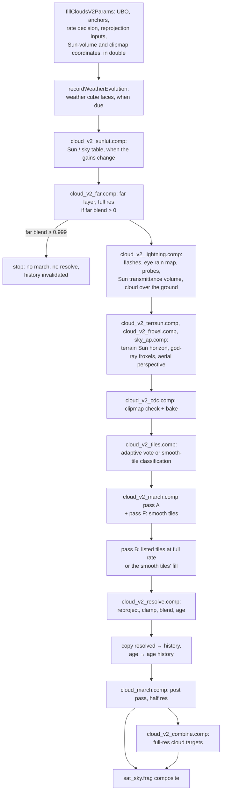
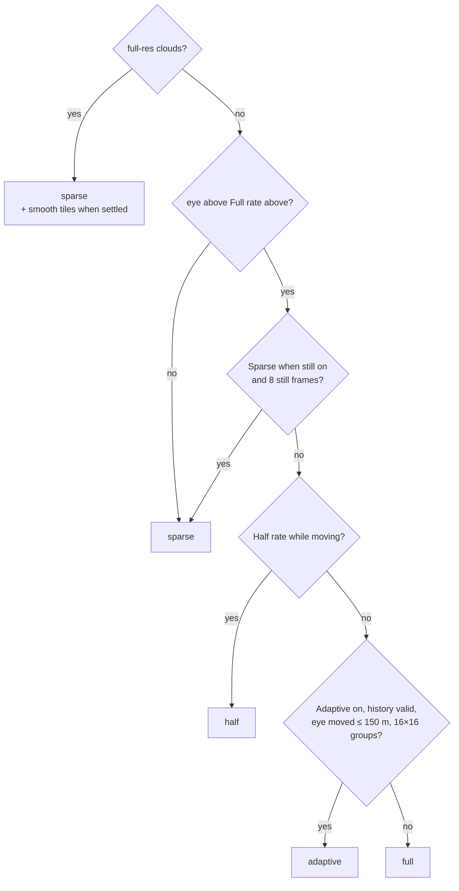

# Temporal resolve and the far layer

Marching every pixel every frame is expensive near the ground, and a single march is noisy (jittered starts,
sub-texel ray positions, short light marches). The cloud pipeline therefore marches all or a subset of the pixels
of its grid each frame and accumulates them in a reprojected history. This page covers the cloud grid's resolution,
how the rate is chosen, the resolve, `cloud_march.comp`'s post pass (which produces what the rest of the frame
reads) and the full-resolution combine, the clouds' shadow on the ground, how clouds hide stars and satellites, HQ
exports, and the **far cloud layer** that replaces the march from far orbit. The march itself is in
[The cloud march](march.md).

## Pass order

All of this runs inside the `cloud_march` GPU timestamp bucket, orchestrated by `recordCloudsV2()` and
`fillCloudsV2Params()` in `src/simulations/SatelliteSimCloudsV2.cpp`.

The combine pass runs only with full-resolution clouds; otherwise `cloud_march.comp` writes the cloud targets
itself.

| Image / buffer | Format | Size |
|---|---|---|
| new samples (+ depth) | RGBA16F + RG32F | the cloud grid; the sparse rate uses its quarter-size top-left |
| full-rate tiles (pass B) | RGBA16F + RG32F | the cloud grid |
| resolved (+ depth, read back as depth history) | RGBA16F + RG32F | the cloud grid |
| history | RGBA16F | the cloud grid |
| age, age history | R32F | the cloud grid |
| opacity profile | `uvec2` per 2 × 2 block | the cloud grid |
| post-pass targets A / B (+ derivatives with full-res clouds) | RGBA16F | half res |
| cloud targets A / B (full-res clouds) | RGBA16F | full res |
| far layer | RGBA16F | full res |
| Sun / sky table | RGBA16F array | 256 × 76 × 5 |
| flash buffer (flashes, rain map, Sun transmittance volume, god-ray froxels, cloud over the ground) | storage buffer, device-local and host-visible | about 30 MB |
| density clipmap | storage buffer | about 96 MB, allocated on first use |
| weather cube | RGBA8, 2048² × 6, 9 mips | — |

"Half res" is half of the window, scaled by the render scale when "Clouds follow render scale" is on (see
[The cloud march](march.md#ray-setup)). "Full res" is the window, likewise scaled. When the size changes, the
images are recreated and the history and resolved images are blitted into the new size, so the accumulation carries
on instead of restarting.

The flash buffer lives in device-local, host-visible memory when the device offers it: every lit cloud sample and
every sky pixel's god rays read it, and in system memory those reads cross PCIe (about 1-2 ms of the sky pass).
`SATLIGHTSIM_FLASH_HOSTMEM=1` forces system memory.

All clouds screen images live in `VK_IMAGE_LAYOUT_GENERAL`; passes are separated by memory barriers only. The
cloud targets A/B are the exception: they move between general and shader-read layouts each frame for
`sat_sky.frag`.

## The cloud grid and full-resolution clouds

The march and the resolve run on the **cloud grid** (`computeCloudExtent()`, `cv2.grid`): half the render
resolution, or, with "Full-resolution clouds" (`full_res`), the full render resolution. The scene depth stays half
res either way (`computeHalfExtent()`), and so does `cloud_march.comp`'s post pass.

On the full-res grid the march **always runs sparse**: one full-res pixel per 2 × 2 block a frame, rotating over
the block, which is the ray count of the half-res full rate. Full rate, the half-rate checkerboard and the adaptive
tiles never run on it (their tile targets are half-res sized). The noise is read at the **half-res** pixel's level
of detail (`cv2.motion.w`), since at the full-res pixel the sub-pixel noise flickers from orbit; the march's scene
depth is corrected for the half pixel between the depth's ray and the march's
([The cloud march](march.md#ray-setup)).

**The combine.** `cloud_march.comp` composites at half res (aurora, airglow, beams, plumes and dust, the ground
shadow, cirrus), taking the cloud as the full-res image's 2 × 2 box (the bilinear tap at the half texel's centre),
and writes, besides the composite \((A_h, B_h)\), its **derivatives** with respect to that cloud's transmittance
\(a\) and radiance \(b\), carried through every step. `cloud_v2_combine.comp` then writes, per full-res pixel,

\[
B = B_h + \frac{\partial B}{\partial b}(b_f - b_h) + \frac{\partial B}{\partial a}(a_f - a_h),\qquad
A = A_h + \frac{\partial A}{\partial a}(a_f - a_h)
\]

with every half-res term bilinear. Where nothing but the cloud is in the composite this is the full-res cloud
exactly; the affine steps (plumes in front of or behind it, cirrus) are exact; the power-law suppressions (aurora and
dust behind cloud, beam lines) are first order. The despeckle, the missing-distance fill and the occlusion alpha
(below) are done there at full res. The sky pass skips its joint-bilateral upsample when the targets are finer than
the scene depth.

On by default on Medium, High and Ultra, off on Low, Planetarium and Potato. On an RTX 3070 Ti at 1920 × 1009 it
costs about 1 to 4 ms of cloud bucket over half-res full rate (the resolve about 1 ms of it), and gives cloud edges
at full sharpness; the [smooth tiles](#smooth-tiles) pay part of it back. `full_res_moving_mode` (no UI, an A/B):
0 the sparse rotation (default), 1 the sample held at one pixel of each block, 2 every pixel marched while the eye
moves from above "Full rate above".

## Rate modes

| Mode (`misc.z`) | Pixels marched per frame | When |
|---|---|---|
| **sparse** (0) | one pixel per 2 × 2 block, cycling (0,0), (1,1), (1,0), (0,1) over four frames | always on the full-res grid; on the half-res grid with the eye below "Full rate above" (30 km), or above it in a still view with "Sparse when still" on |
| **full** (1) | every pixel | the half-res grid with the eye above "Full rate above" |
| **half** (2) | a checkerboard, alternating each frame | where full rate would run, with "Half rate while moving" on (half-res grid) |
| **adaptive** (3) | sparse, plus full rate in 32 × 32 tiles that need it (pass B) | where full rate would run, with "Adaptive rate while moving" on (half-res grid) |

The decision, per frame, on the CPU:

With full-resolution clouds the High, Ultra and Medium presets march sparse at any altitude. The Low, Planetarium
and Potato presets (half-res grid) turn on "Adaptive rate while moving" and "Sparse when still", the cheaper
configuration they are measured with.

**Why full rate from altitude** (half-res grid). From orbit a moving camera keeps invalidating the history, and a
sparse grid without history is visibly blocky. A ray from altitude crosses only a thin shell, so marching all of
them is affordable. **Why sparse when still** (when chosen): a still view's sparse march converges on the same
image through the history at about a third of the cost.

**History validity.** The history is valid when it was valid last frame, the hash of every cloud setting that
changes what a pixel shows is unchanged, the eye moved less than 20 km, and sim time moved less than 600 s.
Cinematic cuts, shader reloads, target recreation and the far layer taking over invalidate it. The Sun transmittance
volume and the clipmap ([march](march.md#the-suns-shadow-beyond-the-light-march)) have a validity of their own:
they live in the clouds' space, so a screen-only reset (recreating the images for an HQ photo or a render-scale
step, or a change of the march rate) keeps them, while a teleport, a time jump or a field setting resets them.

**A still view** has no camera rotation beyond 0.3 of a pixel, no eye motion beyond 1 m, a sim time step of at most
0.5 s, no zoom change, and valid history.

**Fast-flight LOD** ("Fast-flight cloud LOD", 0 = off by default): at 1, with valid history, while boost is held
and the eye moves more than 2 m a frame, or whenever it moves more than 150 m a frame, the march takes at most 2
light steps, a 1.5 × base step and 60 percent of the iteration budget; at 2, whenever the eye moves more than
2 m a frame. Above 150 m a frame the history is of little use anyway, and the march switches its jitter per frame
(see [Jitter](march.md#jitter)).

## Smooth tiles

On the full-res grid the sparse march takes four times the rays of the half-res sparse grid, and that resolution
matters at cloud edges and fine structure, not across a smooth cloud body or clear sky. With "Smooth tiles at half
density" on, `cloud_v2_tiles.comp` classifies each 32 × 32 tile of the grid from **last frame's resolved clouds**:
smooth when no 4 × 4 window in it (with a one-pixel ring) varies by more than "Smooth tile threshold (levels)" (30)
of display radiance (the sky's tonemap at its exposure) or twice that of transmittance. Pass A skips a smooth tile;
pass F marches it at a quarter of the sparse grid's density (one 2 × 2 block of each 4 × 4, the four rotating every
four frames, so each pixel still takes its own ray once in 16 frames), and a fill pass gives the other blocks the
marched samples, so the resolve sees a complete sparse grid.

Smooth tiles run only once the eye has been still for 64 frames, with a valid history: a fast flight replaces the
history with the quarter grid's tent, which reads smooth everywhere, and tiles classified from it would be marched
thinly from a history without their detail.

## Adaptive tiles

`cloud_v2_tiles.comp` runs one 16 × 16 workgroup per 32 × 32 half-res tile (each thread owns one 2 × 2 block's
sparse pixel). A tile votes for full rate when, for any of its pixels:

- **parallax** exceeds "Adaptive parallax" (1.6 px): \( (|\Delta\text{eye}| + \text{volume slide}) /
  (d_\text{prev} \cdot \text{pixel angle}) \), with \(d_\text{prev}\) last frame's resolved cloud distance; or
- **its history is off screen**: the rotation-only reprojection falls outside the previous frame. This test has
  no margin, because a pan uncovers only about 2 px a frame and any margin would mean no edge tile ever votes.

Voting tiles are appended to `TileBuf` with indirect arguments (4 workgroups each) and flagged. Pass A returns
early on a flagged workgroup; pass B (the same shader with specialisation constant 2 = 1, dispatched indirectly)
marches the listed tiles into the full-rate images and also writes their sparse-grid samples, so the quarter grid
stays complete for the resolve.

**Why two passes:** inside one full-rate dispatch, skipping pixels saves nothing, because a warp costs as much as
its slowest lane. **Why the vote is its own pass:** inside the march it pushes the shader past the 128-register
allocation ([design constraints](march.md#design-constraints)).

In a still view nothing votes and the cost is the sparse grid; flying through a storm, only tiles with near cloud
pay full rate. "Foveated full rate (radius)" (0, experimental) additionally makes tiles within that radius of the
screen centre vote.

## The resolve

`cloud_v2_resolve.comp` runs one thread per pixel of the cloud grid and writes the resolved colour, depth and age.

### Fresh samples and the spatial estimate

A pixel is **fresh** if it was marched this frame: every pixel at full rate, this frame's parity at half rate,
the block's one pixel at sparse rate, every pixel of a listed adaptive tile (read from the full-rate images).

Over the 3 × 3 of this frame's new samples the resolve gathers: min, max, mean and standard deviation in
**mean-colour space**, \( (\text{rgb} / \max(1 - T, 0.02),\ T) \); min and max in plain radiance; the nearest
cloud distance; the opacity-weighted mean distance; and the sum of the four axial neighbours. Pixels with no
fresh sample take a spatial estimate:

| Rate | Fresh pixel | Other pixels |
|---|---|---|
| sparse | half its own sample, half the axial mean | bilinear read of the quarter grid |
| half | \( 0.5 \times \) own + \( 0.125 \times \) each diagonal | mean of the four (fresh) axial neighbours |
| full, adaptive tile | own; plus a 3 × 3 tent `blur` used in fast motion | — |

On every sparse grid, what fast motion and a lost history lean on (`blur`) is a [1 2 1] **tent** of the quarter
grid's samples (four bilinear taps half a sample out), widened to about 4 × 4 samples as the parallax passes 6 to
24 px. The bilinear estimate alone carries single rays to the screen: inside cloud in fast flight, the blue-noise
tile's all-or-nothing samples show as a speckle that repeats every 64 samples.

**Per block.** On the sparse grid the four pixels of a 2 × 2 block share their new sample, so every box they take
depends on the block alone. Each workgroup works the boxes out once per block in shared memory (the 7 × 7 ring split
over four threads and reduced, the 3 × 3 box by one thread, in the same order), and each pixel reads its block's:
the same result at about two thirds of the cost (about 1.1 ms at 1920 × 1009 on the full-res grid). Other rates keep
the per-pixel loops.

### Reprojection

All reprojection inputs are computed on the CPU in double precision: the previous view rotation, the previous
eye, the eye's ECEF displacement, and the change in the map's drift angle.

1. Take the pixel's view direction in ECEF.
2. Choose a depth: its own resolved distance; else the nearest cloud distance among its 3 × 3 new samples (a
   cloudless pixel reprojected at infinity would drag small clouds into streaks in motion); else infinity.
3. The world point is turned by the drift change (the clouds move with the map), offset by the eye's
   displacement plus the shape wind's shift (0.9 of "Wind"), and projected into the previous view.

This is exact for any rotation about a known eye. The history is sampled with a 9-tap Catmull-Rom filter; a
bilinear read at a fractional offset is a small blur that compounds every frame while the view slides slowly.

### Motion

**Motion is parallax, not pixel motion.** `motionPx` is the distance between the reprojection at the cloud's
depth and the same ray reprojected at infinity, in pixels, with two floors: the noise volumes' own relative slide
(the part reprojection cannot follow), and the eye's sideways motion at the pixel's depth, the depth capped at
max(50 km, 2 × the eye's height). A pure rotation reprojects exactly and is not motion; raising the blend weight
during a pan would swap the accumulated image for the quarter grid's noisy samples.

**Neighbourhood parallax.** The clamp box, its slack and the variance clipping follow `mNb`: the parallax of the
**nearest** cloud in the 3 × 3 (or, for a pixel with no cloud of its own, the 7 × 7) new samples, multiplied by
the history's memory (1 / the still weight). A far horizon cloud moves about 0.1 px a frame while the eye climbs
fast, which reads as still by its own parallax, but over a history of ~50 frames that is 5 px of lag; and a pixel
just behind a cloud's trailing edge, reprojected at infinity, would keep the cloud it showed a frame ago. The
blend weight itself keeps the pixel's own `motionPx`. A truly still eye has no eye term, so still views are
unchanged.

### Clamping

- **Still** (`mNb` under 0.05 to 0.5 px): the box is the range of the **7 × 7** new samples around the pixel,
  widened by its own range. The samples are often all-or-nothing (a light-march point lit or self-shadowed under
  a grazing Sun), and in a 3 × 3 the nine samples sometimes agree: a zero-width box then clamps the history's mean
  to one value, and which frames agree depends on the blue-noise tile, so the tile is drawn over every
  half-shadowed surface. Forty-nine samples nearly always hold both values. A tight box against quarter-grid
  neighbours also makes blocky 2 × 2 squares in far cloud.
- **Moving** (0.1 to 1.5 px): the box tightens toward the 3 × 3 mean ± "Motion clamp (sd)" (1.4) standard
  deviations (variance clipping), which rejects the ghost of a small cloud next to clear sky. Its **colour**
  (opacity keeps the tight box) also spans the 5 × 5 new samples within ±25 percent of the pixel's distance,
  fading out over 1 to 3 px of the neighbourhood's parallax: nine all-or-nothing light samples would otherwise
  collapse the box and clip a lit cumulus to a blocky speckle whenever the view moves. A near cloud's samples
  never widen a far pixel's box.
- **Truly still, unclamped.** When the reprojection's own parallax, the volumes' slide and the eye's move at the
  nearest cloud are all under about 0.05 to 0.15 px a frame, the history is taken unclamped: there is nothing to
  reject, and with time running the clouds' drift moves the eye under a metre a frame relative to them, which a
  tight box would turn into flicker on every sub-pixel puff. This is withheld (`cu2.w`, from the CPU) for the
  first 64 to 96 frames after the Sun transmittance volume resets, because the shadows arriving then are a real
  change the clamp must let through.
- History is clamped first in mean-colour space, then in plain radiance: mean-colour space divides by opacity,
  which inflates near-transparent pixels (the clear air inside beam shafts) by up to 50 times, and clamped only
  there, history at cloud edges blows up into bright blocks.

### Blending and age

\[
w_\text{new} = \text{mix}\big(w_\text{still},\ \max(w_\text{still}, w_\text{moving}),\ \text{smoothstep}(0.05, 1, \text{motionPx})\big)
\]

- \( w_\text{still} \) is "History weight" (0.046, at most 0.15: higher values make a woven checker as each pixel
  alternates between its own ray and its neighbours' estimate). It falls to 40 percent of that between 300 and
  3000 km of eye altitude, against flicker of small clouds seen from medium orbit.
- \( w_\text{moving} \) is "History weight moving" (0.05, at most 0.5).

**Age.** Each pixel carries the number of samples its history holds (R32F, reprojected with the colour and copied
to its own history image). The blend weight is at least \( 1/(\text{age} + 1) \), so a young pixel (uncovered by
a pan, disoccluded, or rejected by the clamp) takes the running mean of its samples instead of keeping its first
noisy rays at the low still weight for seconds. While young (under about 2 to 10 samples) it also leans on its
neighbourhood's smooth estimate by "New pixel smoothing" (0.42). What the clamps remove from the history lowers the
age in proportion. The age grows by 1 a fresh sample (0.5 for an interpolated pixel) up to "Accumulation" (39;
0 turns the age off). With accumulation at 0 and a still weight near 0.02 a reset takes hundreds of frames to
converge; at 32 the grain is under a level after 40 frames.

**Block convergence.** As motion or the new-sample weight rises, a fresh pixel leans toward its spatial estimate
and the other three pixels of a sparse block take a matching weight, so all four update nearly alike. In fast
parallax (6 to 24 px) the fresh samples blend toward this frame's tent and the weight toward 0.7. Without valid
history the output is this frame's spatial reconstruction (the tent on a sparse grid). A non-finite value is written
as no cloud, so it cannot spread through the history.

### The resolved depth

The resolved distance is the 3 × 3 new samples' **opacity-weighted mean** distance rather than one ray's noisy
estimate. In a still view (parallax under 0.5 px **and** total texel shift under 0.5 px, rotation included) it
also blends at 0.1 with the previous frame's value, read back in place. The sky pass splits the air in front of
clouds at this distance ([Atmosphere and sky](../atmosphere-and-sky.md)), so a depth that jumped with the
sparse four-frame cycle would flicker that air. The gate includes rotation because a pitching camera would
otherwise blend the depth of a different direction into each texel, drawing streaks along the horizon.

## HQ photos and cinematic exports

HQ photos and cinematic HQ exports set "Full rate above" to 0 and "Sparse when still" off for their duration,
with time paused, and settle each pose for "HQ photo settle frames"; on the full-res grid the march stays sparse and
the settle frames average its rotation. During an HQ export's settle frames the clouds' resolve and the sky's
temporal AA take a **running mean**: weight \( 1/n \) (`cv2HqHistWeight`, set per settle frame in `cineTick()`)
instead of their still weights, seeded by the previous frame's result as a prior worth one pose of samples (none
after a cut), with the clouds' accumulation cap raised to 256. Each exported frame is then the mean of about twice
the settle frames' samples, half of them shared with its neighbour. At the still weight the history remembers about
20 frames, so every exported frame would be an independent draw keeping a sixth of the per-sample noise: grain on
wispy cloud edges that changes every frame. Outside an HQ export nothing changes.

## The post pass: cloud_march.comp

`cloud_march.comp` is a half-resolution compute pass (16 × 16) that turns the resolved clouds into the two
targets every later consumer reads (with full-res clouds, into the half-res inputs of the combine). Despite its name
it does not march the volumetric clouds; it composites them with everything else that lives at half resolution. In
order:

1. **Ray, eye ground, tile culls** of the beam pointing rays and the Gaussian volumes (before the bounds check, so
   their barriers stay in uniform control flow).
2. **Legacy cirrus** (`cirrusMarchCS`), active only when the volumetric march is knocked out.
3. **Read** the resolved radiance, transmittance and depth; with full-res clouds, the 2 × 2 box of the full-res
   images (opacity-weighted mean distance, nearest opaque distance).
4. **Despeckle** (half-res grid only; the combine does it at full res). A cloud texel with at most one neighbour of
   comparable opacity is replaced by its 3 × 3 tent, and an edge texel (opacity falling sharply across it) leans
   60 percent on the tent: isolated sub-pixel wisps caught on some frames flicker otherwise.
5. **Depth fill.** A cloudy texel with no distance takes its neighbours' opacity-weighted distance.
6. **Cloud behind a surface.** A resolved cloud whose distance is past the texel's scene depth (by 5 to 25 percent
   plus a margin) is dropped. The march clamps its new samples to the depth, but the history does not know about a
   surface that moved in front of it: flying past a mesh, the cumulus behind it would stay in its texels as blocky
   patches.
7. **Far-layer fade.** Radiance × (1 − far blend), transmittance toward 1.
8. **Aurora and red airglow**, added to the radiance (see [Aurora and airglow](../aurora-airglow.md)).
9. **Gaussian volumes** (`dustCloudsCS()`): Kessler debris dust clouds, rocket exhaust plumes and flames, wildfire
   smoke, tornado funnels, haboob far-field walls and re-entry fireball trails, composited **through** the cloud by
   depth. The cloud's [opacity profile](march.md#integration-and-outputs) along this texel's ray, scaled to the
   resolved opacity, splits each Gaussian's optical depth and light over four depth segments (first contact, half
   opacity, last contact); front to back, each segment's cloud light is dimmed by the plumes in front of it, each
   plume's light by the cloud in front of it. Without a profile the cloud's mean distance ±15 percent stands in.
   Plumes and smoke are lit through the clouds' Sun shadow (the Sun transmittance volume at the Gaussian's lit
   point), the sky through the deck above them and the sunlight that deck scatters down, and their multiple
   scattering is that of the optical depth stacked along the ray. See [Launch visuals](../launch-visuals.md),
   [Storms](storms.md#tornadoes) and [The Sun's Fury](../../simulation/kessler.md).
10. **Beam pointing rays**: each beam's drawn line, cut by the scene depth, the beam's own cloud block altitude
    and the view ray's opaque cloud.
11. **Ground shadow** (below).
12. **The air split.** Where smoke or another plume is in front of a cloud, the alpha's distance (where the sky
    pass splits the air) is the opacity-weighted mean of the plume's distance and the cloud's, the plume's capped at
    the cloud's own distance (its profile's half point), so the air between them is not added undimmed by the plume.
    Plumes an engine light reaches keep the cloud's distance, or the engine-light pass would light them twice.
13. **Write the targets**, and with full-res clouds the derivatives the combine needs.

Lightning and the rain, snow and diamond dust at the eye are not part of this pass. A flash lasts a few frames
and a drop is smaller than a half-res texel, so both would be swallowed or smeared by the cloud history and the
sky's temporal AA. They are drawn in the main render pass after the sky TAA, at full resolution, over the
tonemapped frame (lightning channels and glow first, then the drops), and read the cloud targets only to be
hidden by the cloud in front. See [Weather](weather.md#precipitation-at-the-eye).

| Target | rgb | a |
|---|---|---|
| `cloudMarchTargetA` | radiance: clouds, cirrus, aurora, red airglow, Gaussian volumes, beam lines and shafts | signed occlusion distance in **km** |
| `cloudMarchTargetB` | transmittance, per channel | ground shadow: Sun transmittance at the surface point |

The alpha of target A encodes occlusion: \( \ge 0 \) is an opaque cloud (the ray's transmittance fell below
0.1) at its mean distance (or the half-opacity point if no mean exists); \( < 0 \) is minus the mean distance of
translucent cloud; −60000 means no cloud. It is in kilometres because the target is RGBA16F, whose largest value
is 65504: in metres every cloud beyond 65.5 km would be infinite. A texel with no cloud but an emissive volume or
plume in it carries that light's distance instead, **flagged** by the half float's lowest mantissa bit
(`cloudAlphaFlag()`, `cloudAlphaIsEmit()` in `shaders/include/cloud_occlusion.glsl`; the bit is cleared on every
real cloud distance). Gathered texels are exact, so the bit survives; a filtered read is not a flag.

!!! warning "Invariant"
    Anything that treats target A's alpha as "a cloud is there" must skip flagged texels, as the engine-light
    and lightning passes in `lightning.frag` do. Otherwise a plume is lit twice: once in this pass and again as
    if it were a cloud at its own distance.

!!! note "Naming trap"
    Inside `cloud_march.comp` the transmittance accumulator is named `A_*` and is stored in target **B**; the
    radiance `B_*` is stored in target **A**. The names follow the composite `colour × A + B`.

## Hiding point sources

Stars, planets, satellite points, flare sources and glare sprites are hidden by cloud through
`cloudPointVisibility()` (`shaders/include/cloud_occlusion.glsl`): an opaque texel nearer than the source hides it
completely; translucent cloud in front dims it by \( T^\text{power} \), ramped in across the cloud's distance
(±1 percent + 300 m) so sources behind thin cloud dim and sources in front do not.
`cloudPointVisibilityAt()` evaluates this per **texel** for the four texels around the source (gathered) and
blends the four results bilinearly. Filtering the alpha instead would mix a real cloud distance with the no-cloud
marker into something near 0 km, which reads as an opaque cloud in front of everything along every cloud outline.
See [Points, bloom and glare](../points-bloom-glare.md).

## The cloud shadow on the ground

For surface pixels only (the scene depth hit something), the post pass reads the
[Sun transmittance volume](march.md#the-suns-shadow-beyond-the-light-march) at the surface point: the same shadow
the clouds and the air take, from one lookup. It fades out between 0.6 and 1 × "Cloud shadow range (m)" (Terrain
tab, 300 km) from the eye, and is skipped where the texel and its eight neighbours all lie behind cloud that
transmits under 1 percent: ground the clouds hide needs no shadow.

The result rides in target B's alpha and multiplies the direct sunlight on terrain and sea. Consumers read it
through the sky pass's [1 2 1] tent (`cloudShadowT`), never the raw centre texel. Knockout bit 256 disables it.

## The far cloud layer

From far orbit a half-res pixel spans kilometres, and the march's sub-texel sampling flickers on small clouds. The
**far layer** (`cloud_v2_far.comp`) replaces the march there with a 2D evaluation of the same placement, per
full-resolution pixel.

**When.** The far blend is a smoothstep of the eye's altitude between "Far cloud layer from" (600 km) and "Far
cloud layer full at" (8900 km) (`SatelliteSim::cloudFarBlend()`). Above 0.999 the march, resolve, lightning and
Sun-volume passes are not dispatched at all, and the history restarts on the way back down. The layer needs the
eye above 16 km.

**Per pixel.**

- The ray meets a sphere 1.5 km above sea level. `cv2FarColumn()`, the hand-kept 2D copy of the low layer's
  placement ([field](field.md#one-field-for-every-consumer)), gives the strength `e`, the cover fraction, the
  type's extinction, base and top. The footprint is stretched by \(1/\max(\mu, 0.15)\) along grazing views.
- **The edge is the march's eroded edge.** The march draws cloud only where a column's density at the cloud's
  widest point survives the mean erosion, so the coverage it draws moves a lot with "Erosion detail". The column
  finds the field margin at which `cv2FieldLow()`'s eroded density is positive, by a 10-step bisection on the same
  terms, and the pixel's cloud share ramps up from there over 1.25 × the cells' sub-pixel spread (plus a lobe width
  while the cells resolve). The far layer therefore follows "Erosion detail" as the march does: over the western
  Pacific the two cloud fractions differ by at most 0.08 from 980 to 9000 km of eye altitude (0.44 and 0.36 at
  980 km, equal at 9000 km), and their blurred images correlate at 0.93 to 0.99.
- **Optical depth:** \( \tau = \sigma_\text{type} \cdot \text{thickness}(e) \cdot 0.6 \cdot \) "density"
  (1.2). "Coverage bias" (−0.1, field units) shifts the threshold.
- **Slant coverage:** at a zenith angle z, the apparent cover is \( 1 - (1 - f)^{1 + k \tan z} \) (k "slant
  coverage", 0.91, capped at 12), because seen obliquely clouds hide the gaps between them.
- **Relief:** two more columns a footprint away give e's gradient, which tilts the shading.

**Lighting** treats the cloud as a conservative two-stream slab with g = 0.85:

\[
R(\tau) = \frac{a\tau}{1 + a\tau}, \quad a = 0.75(1 - g)
\]

The key light uses the slab's direct-beam reflectance at the Sun's incidence (`slabRmu()`), times
\( \mu_0^{1/(1 + k_\text{low})} \) with \(k_\text{low}\) "low-Sun light" (0.38): a flat slab's \( \mu_0 \) would go
dark well before the terminator, where the march's 3D tops stay lit. It is scaled by "sunlight" (4.1). Sky light
is \( R \times \) the zenith sky (the same 12-step integral as the march's table) × "sky light" (0.6), plus the
moonless night sky; the Moon replaces the Sun at night, city light reaches the base, and an eclipse dims both
terms.

**Mid and high layers** are sampled at three heights inside each lens (from the same cluster reads as the march),
lit as slabs, and placed over the low layer by the **adding method**:

\[
L = L_U + L_\text{low}\,\frac{(1 - R_U)^2}{1 - R_U R_\text{low}}
\]

A plain attenuator over the decks draws a grey camouflage pattern.

**Composite.** `cloud_march.comp` fades the march's clouds out by the far blend, and `sat_sky.frag` puts the far
layer **behind** the half-res composite: \( c' = (c\,T_f + L_f)\,T + L \), so aurora, airglow and beam light stay in
front. The far layer has no scene-depth test (a half-res depth read per full-res pixel draws a dot grid), no Cb
towers, no rain and no ground shadow.

## Debug views

| View | Shows |
|---|---|
| 6 | rain at the eye: red the rate in the eye rain map (bursts included), green the map's maximum (drawn by `cloud_march.comp`) |
| 11 | adaptive full-rate tiles tinted red (drawn by the resolve; the march then sees view 0) |

Harness `state` reports the current rate under `clouds_v2.rate` (sparse, full, half or adaptive) and
`clouds_v2.fast_lod`, and the cloud bucket's per-pass GPU times under `clouds_v2.pass_ms`;
`tools/harness/tstab.py` measures temporal stability against settled references (see
[Automation harness](../../development/harness.md)).

## Settings

Clouds tab, "Quality / performance" (keys under `clouds_v2`):

| Label | Key | Default |
|---|---|---|
| History weight | `history_weight` | 0.046 (max 0.15) |
| History weight moving | `history_weight_moving` | 0.05 (max 0.5) |
| Accumulation (samples, 0 = off) | `sampler_accumulation` | 39 (0-128) |
| New pixel smoothing | `sampler_new_smoothing` | 0.42 |
| Motion clamp (sd) | `sampler_motion_clamp_sd` | 1.4 |
| Full rate above (km) | `full_rate_above_km` | 30 |
| Sparse when still (0/1) | `sparse_when_still` | 0 (1 on Low, Medium, Planetarium, Potato) |
| Half rate while moving (0/1) | `half_rate_moving` | 0 |
| Fast-flight cloud LOD (0/1/2) | `fast_flight_lod` | 0 |
| Foveated full rate (radius) | `fovea_radius` | 0 |
| Adaptive rate while moving (0/1) | `adaptive_rate` | 0 (1 on Low, Medium, Planetarium, Potato) |
| Adaptive parallax (px) | `adaptive_parallax_px` | 1.6 |

Weather tab, "Rebuild experiments" (the grid's rows):

| Label | Key | Default |
|---|---|---|
| Full-resolution clouds (0/1) | `full_res` | 1 (on Medium, High, Ultra; off on Low, Planetarium, Potato) |
| Smooth tiles at half density (0/1) | `smooth_tiles` | 1 |
| Smooth tile threshold (levels) | `smooth_tile_threshold` | 30 (0.5-32) |

Without UI: `full_res_moving_mode` (0).

"Clouds follow render scale" (Display tab, `display.clouds_follow_render_scale`) is off by default and on for the
lighter presets; changing it, or the render scale, by hand makes the preset Custom.

Clouds tab, "Noise scales" (the far layer rows):

| Label | Key | Default |
|---|---|---|
| Far cloud layer from (km) | `far_layer_from_km` | 600 |
| Far cloud layer full at (km) | `far_layer_full_km` | 8900 |
| Far cloud layer sunlight | `far_layer_sun_gain` | 4.1 |
| Far cloud layer sky light | `far_layer_sky_gain` | 0.6 |
| Far cloud layer slant coverage | `far_layer_slant` | 0.91 |
| Far cloud layer coverage bias | `far_layer_cover_bias` | −0.1 |
| Far cloud layer density | `far_layer_density` | 1.2 |
| Far cloud layer edge softness | `far_layer_softness` | 1.0 |
| Far cloud layer low-Sun light | `far_layer_low_sun` | 0.38 |

## Where in the code

- `src/simulations/SatelliteSimCloudsV2.cpp`: `fillCloudsV2Params()` (rate decision, history validity,
  reprojection inputs, smooth-tile gating), `recordCloudsV2()` (pass order and barriers), `createCloudsV2Targets()`,
  `createCloudCombine()`; `computeCloudExtent()` / `computeHalfExtent()` for the grids.
- `src/simulations/SatelliteSimCinematic.cpp`: `cineTick()` (the HQ export's running mean).
- `src/simulations/SatelliteSim.h`: `cloudFarBlend()`.
- `shaders/cloud_v2_tiles.comp`: the adaptive tile vote (mode 0), the smooth-tile classification (1) and fill (2).
- `shaders/cloud_v2_resolve.comp`: reprojection, clamping, blending, age, depth history.
- `shaders/cloud_march.comp`: the post pass, `dustCloudsCS()`, the ground shadow lookup, the derivatives.
- `shaders/cloud_v2_combine.comp`: the full-resolution combine.
- `shaders/cloud_v2_far.comp`: the far layer; `cv2FarColumn()` in `shaders/include/clouds_v2.glsl`.
- `shaders/include/cloud_occlusion.glsl`: `cloudPointVisibility()`, `cloudPointVisibilityAt()`, the emissive flag,
  `smokeAirSplitM()`.
- `shaders/sat_sky.frag`: the composite of the cloud targets and the far layer.
