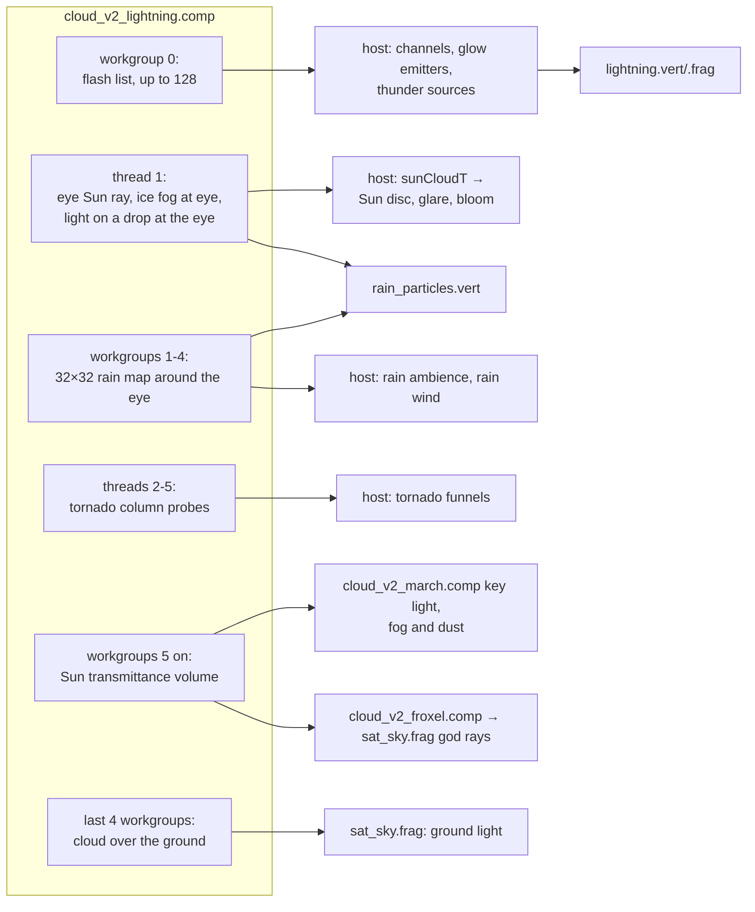
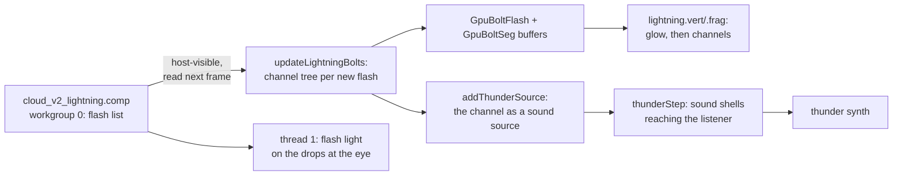

# Weather, rain, lightning, fog

This page covers the weather effects built on the [cloud field](field.md): rain shafts and the precipitation an
observer stands in (rain, sleet, snow and diamond dust as particles in the world, blown by the surface wind),
lightning and the thunder it makes, fog, dust and ice fog, the Sun hidden behind clouds, the clouds' shadows on the
air (god rays), and how the weather cube is re-baked as time runs. The weather map itself (coverage, cloud types,
precipitation, evolution over time) is described in [The cloud field](field.md); the clouds' shadows on each other
in [The cloud march](march.md). Storm objects (towers, anvil shields, cyclones, tornadoes, haboobs) are on
[Storms in the cloud field](storms.md).

Most of these effects are fed by one compute pass, `cloud_v2_lightning.comp`, which runs before the march each
frame and writes the clouds' flash buffer (`CV2FlashBuf`, `shaders/include/cloud_lightning.glsl`):

The flash buffer lives in device-local, host-visible memory when the device offers it (system RAM otherwise;
`SATLIGHTSIM_FLASH_HOSTMEM=1` forces it): every lit cloud sample and the sky pass's god rays read it, and in system
RAM those reads cross the PCIe bus. Lightning and the drops at the eye are drawn in the main render pass after the
sky's temporal AA, at full resolution, so neither the cloud history nor the sky's history smears them.

## Rain shafts

Rain shafts are part of the field: below a cloud's base, where the weather map precipitates, the low layer
returns rain curtains instead of cloud ([The cloud field](field.md)). Heavy rain falls in a core under each dominant
storm tower's body, a little longer downwind; a storm's forward flank and a squall line's trailing region rain from
the stratiform deck the storm stamps into the weather cube ([Storms](storms.md#the-weather-bakes-storm-stamp)).
Lighter, intermittent rain falls wherever the map's precipitation says; inside a storm's envelope only the storm's
own rain falls.

In the march a rain sample is cheap (no fine steps, one sample standing for four coarse steps, a two-step light
march) and uses the rain phase: a sub-degree diffraction spike plus a broad refracted lobe, with the primary and
secondary rainbows ([The cloud march](march.md)). Lit through the cloud above, a shaft is dark under a Cb and bright
at its sunlit edge, which is where rainbows show: at storms near the terminator, with a low Sun behind the
observer. A clear bow needs dense shafts: below a "Rain" of about 1.5 it barely shows, so the default is 3.0. Where
the shafts' air is below freezing they are snow, which shows faint ice optics and no bow.

The Reflect beams light the shafts at night by the same rule (`beamFinish()`). Their phase follows the temperature
of the shafts' air, 500 m above the ground under the eye (`cv2.precip.w` is its liquid share): liquid rain shows the
bow opposite the satellites; snow takes the snow phase, broad lobes with a faint 22 deg halo and sundogs around the
satellites and no bow. Light pillars rising from the beams' ground spots (ice plates reflecting the lit snow below)
are not modelled.

## Precipitation at the eye

Near the observer, rain, sleet, snow and diamond dust are drawn as **particles**: individual drops in the world,
not streaks attached to the camera, so walking moves through the rain. They are one instanced draw
(`rain_particles.vert/.frag`, recorded by `recordRainParticles()`) in the main render pass after everything
else, that is after the sky's temporal AA has resolved the frame. A drop is far smaller than a half-res cloud
texel and moves several pixels a frame; drawn into the cloud composite it would be fattened and smeared by both
histories. The particles are the near part of the rain volume, drawn one particle at a time: beyond their reach the
march's rain shafts carry the rain.

Nothing is stored per particle. Every particle is built in the vertex shader from its instance index and a hash, so
the draw needs no buffers beyond the flash buffer's rain map and lighting terms.

### Temperature: rain, sleet or snow

The air temperature at the eye (`SatelliteSim::cv2EyeTempC`, computed in `fillCloudsV2Params()`) is a simple
climate model:

\[
T = -18 + 45\cos^{1.5}(\text{lat}) + \min(0.25\,|\text{lat}|,\ 15)\cdot s - 6.5\,h_\text{km}
\]

in degrees C, where \(s\) is the season (+1 at local midsummer, from the Sun's declination in that hemisphere)
and \(h\) the eye's altitude. That gives about 27 C at the equator, 9 C at 45 deg and −12 C at 75 deg at sea
level. The **liquid share** is `smoothstep(−1, 2.5, T)`: all snow below −1 C, all rain above 2.5 C, and in
between each particle is a drop or a flake by its own hash (**sleet**). The distant rain curtains stay rain; only
the eye's precipitation changes type.

### The rain map

Workgroups 1 to 4 of the lightning pass fill a 32 × 32 map of 40 m cells (±640 m) around the eye, at the eye's
height: each cell evaluates `cv2Field()` (no erosion) and stores the rain rate,
\( \text{rain} \times \operatorname{clamp}(\sigma / 0.0012, 0, 1) \), from 0 (none) to 1 (a Cb core). Each
workgroup also stores its maximum. On the host, the previous frame's maxima decide whether to draw at all (rain
near the eye, or else diamond dust in sunshine). In the shader every particle reads the map at its own position
(`cv2RainMapAt()`, bilinear), so walking toward a shaft its drops appear in the far boxes before the observer is
inside it. A ~6 s value noise in sim time (`cv2RainBurst()`, 0.35 to 1) makes showers come in bursts. The host copies
the map out of the flash buffer in one block before reading it (single reads of device memory cross the bus).

### Nested world-fixed boxes

The particles live in a local frame fixed to the nearest 0.25 deg point on the ground (`cv2.rainE/N/U`); the eye's
position in it is computed in double and wrapped to 1024 m, which every box size divides. Level k is a box of
side \( L = 4\ \text{m} \times 2^k \) holding \( N_0 \times 2^k \) particles, where \(N_0\) is "Drop particles
(x1000, nearest box)" (16 000). Each particle wraps within its box as it falls and drifts, so the box always
surrounds the eye. Level k is drawn over distances \([L/4, L/2]\) from the eye (level 0 from the eye itself,
fading in from 8 to 25 cm), cross-faded with the next level over \([0.4, 0.5]\,L\). "Drop reach (m)" (33, at
most 64) sets the number of levels, the last one ending at the reach: 5 levels and 496 000 instances at the
defaults, most of them culled in the vertex shader where there is no rain.

Each level holds twice the particles in eight times the volume, so particles thin out with distance by design; each
far particle stands for more real drops (from about a dozen in the nearest box to thousands in the farthest).

### Sizes and fall speeds

| Particle | Size | Fall speed |
|---|---|---|
| raindrop | the **area-weighted** Marshall-Palmer distribution, Gamma(3, Λ), 0.5 to 6 mm | terminal velocity \( v = 9.65 - 10.3\,e^{-0.6 D} \) m/s (Atlas): ~4-7 m/s for the drops seen |
| snowflake | an aggregate of 2 to 8 mm | 0.8 to 1.4 m/s, fluttering ±3 to 9 cm |
| diamond dust | a 0.15 mm ice plate, tumbling | 0.25 to 0.45 m/s |

Every particle carries the same share of the rain's geometric cross-section (below), so a particle's size is drawn
from the distribution of cross-section, \( D^2 e^{-\Lambda D} \), not the number distribution. Λ follows the rain
rate round the eye (`RainDrawPC::dropLambda` \( = 4.1\,R^{-0.21} \)): 2.5 /mm at 10 mm/h, 1.7 at 60 mm/h, so heavier
rain falls faster through its bigger drops.

**Raindrops are redrawn.** Each rain particle is redrawn at a new place every "Drop persistence" (60 ms of sim time),
each at its own phase and faded over its epoch's ends, so the field never pulses. A far particle stands for thousands
of real drops; kept as one body it would creep across the screen as a lump a few pixels a frame. Redrawn, every frame
holds unrelated streaks, as a camera sees rain. Flakes and diamond dust are followed for good (a flake is seen as a
flake) and take 0.35 of the shutter, so a flake in a breeze draws as a flake, not a dash.

### Motion

The fall and the wind are **integrated over sim time on the CPU** (`updateRainMotion()`, in double) and handed
to the shader as phases wrapped to 1024 m (`cv2.rainMotion`, `cv2.rainWind`). A particle's fall offset is its
terminal speed, quantised to 1/64 m/s, times the shared fall phase, so the shader can take the phase modulo its
box exactly. Integrating rather than evaluating \( v\,t \) is what lets the speed and the wind change smoothly:
with \( v\,t \) every change of v or of the wind would move every particle at once. Pausing stops the rain;
reversing time runs it backwards.

- **Fall.** "Drop fall speed (x physical)" (1) × each drop's terminal velocity. Ice particles fall on a phase of
  their own (`cv2.snowMotion`) at that factor capped at 1.5.
- **Wind.** The **surface wind** at the eye (`surfaceWindAt()`, a pure function of place and sim time, eased over
  0.25 s), the sum of:
    - a **mean wind** at eye height, from a slow value noise over place and hours: median about 1.4 m/s, up to about
      6 m/s, any direction ("Surface wind (x)");
    - the **storm towers' outflow** within 60 km, away from each tower, strongest a few km out, by its strength
      (a flanking tower half), capped at 1.5 × "Storm outflow (m/s)";
    - a **tropical cyclone's** wind field: rising linearly to the radius of maximum wind, \( (r_\text{mw}/r)^{0.6} \)
      beyond, cyclonic and turned 20 deg inward, 0.7 of vmax at the eye's height, calm in the eye;
    - **gust fronts**: events hashed per 15 s bin of sim time and 2 deg cell, each a 1-2 s rise to +50-100 percent of
      the wind plus more near storms and in heavy rain (at most +10 m/s), turned 15-40 deg, decaying over 5-20 s. A bin's
      chance is ~0.1 in calm, dry air (a gust every ~2.5 min) to ~0.45 in a downpour by a storm (~30 s apart), faded in
      with the conditions so a change never pops a gust in mid-decay ("Gust fronts");
    - small continuous **turbulence** ("Wind turbulence").
- **Shower outflow.** Rain also blows away from the rain map's rain-weighted centre (the shower's core), at
  0.25 × "Storm outflow" × the rate, 0.3 of that for snow.
- **Snow** drifts with the same wind × "Snow drift (x surface wind)" (0.7), integrated separately; flakes flutter on
  two slow oscillations of their own.

The surface wind also drives the ambience (`gust`, `surface_wind`, `rain_driven`; below) and, near a cyclone, the
sea state ([The sea](../sea.md)).

### Coverage is conserved

A particle is drawn as the **streak** it sweeps over the shutter time "Drop shutter (ms)" (33): its own fall and
drift relative to the eye, including the eye's own velocity (capped at 30 m/s; a jump of more than 2 km/s, such
as a Go to, counts as no motion). The streak's pixels together cover the particle's real cross-section, so each
pixel's alpha is the share of the exposure the particle spent on it, and its drawn width is its real width or one
pixel, whichever is larger.

Each particle carries the rain's real geometric cross-section per m³ divided by the particle density at its
level. For rain the cross-section is Marshall-Palmer's (\( N_0 = 8000\ \text{m}^{-3}\text{mm}^{-1} \),
\( \Lambda = 4.1 R^{-0.21} \)) at a rain rate \( R = 60\,r^{1.5} \) mm/h (a light shower, r = 0.2, is about
5 mm/h; a Cb core, r = 1, 60 mm/h); snow carries four times that; diamond dust half the ice fog's extinction.
Summed along a ray, the particles' coverage is the rain's optical depth. The share of particles drawn is
\( \sqrt{r/0.5} \), each fading in and out over its own hash band as the rate changes, so nothing pops.

Where one particle would carry so much coverage that it draws as a bright dot (far away, heavy rain: alpha 0.12
to 0.35) it fades out, and the rain volume carries that distance alone; real rain there is a haze, not grains. A
streak that would need more than 0.8 coverage widens instead of becoming opaque. "Drops at the eye
(visibility)" (3.1, up to 10) multiplies the alpha: 1 is physical.

### Light

A particle is lit the way the cloud march lights a rain sample at the eye, so the drops and the rain volume beyond
them agree. Thread 1 of the lightning pass computes the terms once per frame:

- `cv2RainKey`: the Sun through the clouds toward it (the eye's Sun ray, [below](#the-sun-behind-clouds)) and
  the Earth's shadow, or at night the Moon dimmed by the column above at its slant; an eclipse dims it.
- `cv2RainAmb`: the zenith sky through the cloud above (two-stream diffuse transmission of the column's optical
  depth, as the march's ambient), plus the ground and horizon, the key light's bounce off the ground, city light
  at night, and the light of every lightning flash at its distance, so a close strike in a downpour lights every
  drop. Its hue is the zenith's only in proportion to the column's diffuse transmission, and at most 60 percent of
  it; the rest arrives white, as light that came down through thick cloud does. Under a Cb the drops are grey, not
  sky-blue.
- `cv2RainKeyDir`: the direction to the key light, and the liquid share.
- `cv2.beamEye`, `cv2.beamEyeDir` (computed on the CPU, in double, from the cloud-light list): the Reflect beams'
  irradiance at the eye in Suns × "Beam light on cloud" × the night share, and its irradiance-weighted direction
  toward the satellites. It is the march's `beamGather()` evaluated at the eye. Standing in a beam, the drops show
  the bow opposite the satellites and flakes and ice crystals glint around them.

Copies of the Sun / sky table's `sunTransmit`, `sunColorAt` and `skyZenithAt` live in `cloud_v2_lightning.comp`
for this and must be kept in step. The terms are divided by the frame's white balance, because the particles are
drawn after it.

Each particle scatters through the volume's own phase function (`shaders/include/cv2_optics.glsl`, shared with the
march):

- **Raindrops** take the rain phase, a diffraction spike plus a broad refracted lobe, and the rainbow optics:
  drops 42 deg from the antisolar point flash the bow's colours, drops toward the Sun glow in its diffraction
  lobe.
- **Snowflakes** take the snow phase (broad lobes, a little of the ice optics and the pillar) plus a plate glint:
  each flake is tilted up to about 12 deg from level and turns as it flutters, flashing when its face mirrors
  the key light into the eye.
- **Diamond dust** draws only the glints of plates tumbling in every orientation, with no diffuse light; it does
  not occlude.

The fragment shader applies the sky's tonemap (with its highlight roll-off) and blends **premultiplied**,
`ONE, ONE_MINUS_SRC_ALPHA`: a drop dimmer than the sky behind it darkens it, as a real one does. Particles are
depth-tested against the unified scene depth at their range, so terrain, opaque cloud and meshes in front hide
them. Below 100 percent render scale with the sky TAA off they test the half-res scene depth instead.

The draw happens only when the lightning pass ran this frame, the eye is below 6 km, and the previous frame's
map held rain (or there is diamond dust in sunshine). It costs about 0.35 ms for rain and 0.2 ms for snow at the
defaults (RTX 3070 Ti, 1600 × 900), about 0.8 ms at a 64 m reach.

!!! note "Known overlap"
    The march's rain volume is not cut at the particles' reach, so the rain within the nearest few tens of
    metres is counted twice (an optical depth of about 0.02 to 0.05).

### Hand-off to sound

The host reads the rain map's central 6 × 6 cells (±120 m), times the liquid share of precipitation from the
eye temperature, eased over 2 s, as the `rain` ambience driver. The surface wind gives three more: `gust` (the gust
fronts' envelope, 0 calm to about 1.5), `surface_wind` (its speed / 15 m/s) and `rain_driven` (the rain rate pushed up
to 60 percent by a gust, read by the rain layer's intensity). The `wind_gust` layer swells with `gust`, so the roar
rises with the gust the rain is seen to lean in. Rain and thunder are both procedural; there are no sample files for
them. See [Ambience](../../sound/ambience.md).

## Lightning

Lightning is split between the GPU and the host. The GPU decides **which** flashes happen, from the storms and
clouds it draws; the host builds what each flash **looks** and **sounds** like from its record; a full-resolution
draw after the sky TAA puts it on screen.

### Where flashes come from

Workgroup 0 of the lightning pass (256 threads) walks two sources around the observer, out to the horizon of
12 km cloud tops:

- **Storm towers.** The storm buffer's towers ([Storms](storms.md#towers)); only **dominant**, anvil-reaching
  towers flash. Their rate is "Lightning rate: Cb towers (/min each)" (1.1) × the tower's activity (its strength
  from 0.35 to 0.75), with up to three flashes per tower per slot.
- **Storm regions.** A fixed equal-angle lattice of 64 × 64 regions on each of the six cube faces of the drifted
  sphere, about 156 km across, the same at any eye altitude (only how far out it is walked changes, so climbing
  or descending never reshuffles the flashes). Each region draws candidate flashes at the most active rate,
  "Lightning rate: storms (/min per 20 km)" (0.53 flashes a minute per 20 × 20 km of full-strength storm, scaled
  by the region's true area), at random points inside it. Each candidate reads the weather cube at its point (the
  deep-convective type, the coverage and the rain) and the strongest storm tower whose reach covers it, and is kept
  with probability equal to the storm's activity there. This thinning makes the rate per area follow the storms while
  only the few candidates alive this frame read them. A whole storm system flashes, its stratiform region included,
  but never a map region with no storm in it.

The schedule is hashed from the source and a 2 s slot of **sim time**; the current and the previous slot are
evaluated. It is deterministic and reversible: replaying or reversing time shows the same flashes, and with time
paused a flash stays frozen (harness `time add 0.25` steps through one).

**The column probe.** Each live flash samples `cv2Field()` at 16 heights from 150 m above the ground to above the
tropopause (the Cb type's top + 1.5 km) and takes the lowest and highest heights holding cloud (density without
rain or thin ice above 4e-4 /m) as the base and top of the cloud **actually drawn** there. With no cloud, or less
than 1.5 km of it, there is no flash.

**Kinds.**

| Kind | Share | Where |
|---|---|---|
| cloud-to-ground (1) | up to 30 percent, where the storm is strong | origin at 25 to 45 percent of the cloud's depth; ground point 1.5 to 9 km aside |
| spider lightning (3) | about 40 percent | 150 m under the cloud base, spreading near-level |
| in cloud (0) | the remainder | 30 to 75 percent of the cloud's depth |
| red sprite (2) | "Lightning sprites (chance)" (0.013) per ground stroke | about 75 km up, within about 15 km of the stroke |

**Timing** (`cv2FlashIntensity()`, `include/cloud_lightning.glsl`): a 50 ms stepped leader with no brightness of
its own, then for a ground stroke 1 to 4 return strokes (sharp pulses decaying over 35 ms) over a fading
continuing current, lasting 0.25 to 0.85 s in all; an in-cloud flash flickers through 2 to 6 softer pulses
(60 ms) over 0.35 to 1.15 s. A sprite starts 4 ms after the return stroke, rises over 12 ms and decays over
about 70 ms. Up to 128 flashes are listed (`kCv2FlashMax`), each a 64 B record: origin, ground point, kind, id,
shape seed, age, distance, the cloud's base and top, strength, duration.

### The channel

`updateLightningBolts()` reads the previous frame's list, only if the lightning pass wrote it last frame (a stale
list would hang on screen), together with the observer direction it was written in. For each new flash
`buildBoltTree()` builds the channel **once** as geometry, a fractal tree grown from the flash's seed by midpoint
displacement down to pieces about 3 pixels long at the flash's distance (4 m to 2.5 km), and caches it by id until
the flash has ended. "Lightning tendrils" (1.23) scales the branch and tendril counts.

- **Cloud-to-ground.** The main channel wanders inside the cloud from the charge region, leaves the cloud's flank
  or base, and comes down **slanted** to the ground point, covering most of the sideways distance on the way.
  Branches leave the channel about every 260 m, always down and outward and shorter the lower they start; they
  carry twigs, and the twigs many dim tendrils (fewer far away, where they would be sub-pixel). Two to five
  short upward streamers rise from the ground near the strike.
- **In cloud and spider.** Three to six arms spread nearly level for 6 to 30 km (longer in strong storms),
  branching into a web of twigs and drooping tendrils.
- **Sprite.** A head with 20 to 45 tendrils hanging 12 to 35 km, forking and splaying as they fall, and a few
  streamers rising from the head.

Each frame the host uploads the live flashes (`GpuBoltFlash`: frame, intensity, age, state, four glow emitters)
and their segments (`GpuBoltSeg`, 32 B; up to 131 072) in this frame's eye-centred frame. The state animates the
tree: during the leader the revealed part works down the channel (faint, its tips brighter); a ground stroke's
branches light with the first return stroke and fade within about 0.1 s while the main channel carries the later
strokes; a spider spreads through its web at 150 km/s, its front brightest.

### Drawing

`recordLightning()` draws in the main pass after the scene and before the rain particles, at full resolution and
after the sky TAA, so a flash lasting a few frames is neither averaged away nor smeared.

**Blending.** Both draws are **screen**-blended, \( \text{out} = s + d(1 - s) \), after applying the sky's
tonemap. For the tonemap \( 1 - e^{-x} \) this is exactly the tonemap of the summed light,
\( T(a + b) = T(a) + T(b)(1 - T(a)) \), so any number of overlapping strokes saturate instead of clipping.

**Glow.** One full-screen triangle loops over the flashes' emitters (the origin; a ground stroke's exit from the
cloud; the advancing fronts of three spider arms). At each pixel it reads the four half-res cloud-composite
texels around it, each with its own distance and opacity (one filtered distance would mix a cloud's with the
no-cloud marker), skipping texels flagged as an emissive volume's distance ([Temporal resolve](temporal.md)), and
lights the cloud there by `boltGlow()`: a diffusion core about 4 km wide whose distance is floored at about 3.5 km
(the light has crossed at least that much cloud wherever it leaves it, so no cloud surface shows a point-like lamp),
and a faint tail with a 15 km scale, windowed to zero by 45 km. From orbit a flash is a soft patch 10 to 20 km
across. × "Lightning glow" (0.088). A sprite's head is instead a flattened red glow about 15 km across, seen through
the air. The same pass, in another mode, lights clouds, haze and ground with burning rocket engines and pad
floodlights at night ([Launch visuals](../launch-visuals.md)).

**Channels.** One antialiased quad per segment, at the channel's **true luminous width**: 3 m for a return
stroke's main channel, 1.2 m for branches, 0.6 m for twigs, 0.35 m for tendrils; 380 m tapering to 120 m for a
sprite's tendrils (red, the tips leaning violet). A channel thinner than a pixel is drawn one pixel wide with its
energy scaled by its true width, so a far stroke is a fine dim line and never fatter than it is. A halo of the
light scattered by rain and air (70 m about the main channel, 22 m about branches, 1.5 to 22 px) widens it.
Terrain hides a channel through the depth test, and the cloud and rain in front of it through
`cloudPointVisibilityAt()`; inside a cloud only its glow shows. × "Lightning bolts" (1.25).

**Air.** Channels and glow are dimmed by the air **column** between the eye and the point (`boltAir()`: 8 km scale
height, an optical depth of about 0.15 per scale height), so a flash seen from orbit crosses only the air below
the eye rather than a fixed haze length.

The lightning draw costs about 0.3 ms.

### Thunder

Thunder is **streamed from sound shells**. When a flash's channel is built, `addThunderSource()` keeps it as a
sound source: the positions, directions and lengths of its main channel and branches in Earth-fixed axes (up to
48 flashes, each for 150 s of sim time; sprites make none). Its sound leaves at the return stroke and travels at
343 m/s in **sim time**. A piece at distance d is heard when \( g = d - 343\,(t - t_0) \) crosses zero, so each
frame `thunderStep()` finds the pieces whose g changed sign between the last frame's listener and time and this
frame's, whether time or the listener moved, and sends the synth one level per sounding flash:
\( \sqrt{\text{length} \times \text{weight} / d^2} \) per second of arrivals, with the mean distance and the
bearing (pan).

So the roll is the channel's geometry as heard from where the listener is now. Standing still, near pieces arrive
first: a clap for a channel seen broadside, a long rumble for one running away. Flying toward a storm the sound
arrives sooner and compressed (at most 3×); outrunning it, it never arrives; paused, nothing arrives; time warp
plays it faster; a teleport (more than 5 km) or a jump of more than 20 s of sim time arrives silently. The
`thunder` ambience driver is 1 while a roll is arriving, about to (~2 s) or ended within 4 s, and the layer is
gated on it, so the Sound tab lists thunder only when there is some. The synth's voices are described in
[Ambience](../../sound/ambience.md).

### Harness

`lightning` lists the flashes in progress, their built trees and drawn segments, and the thunder sources (age,
distance, extent, time to arrival, pieces, whether heard), pending rolls and level; `lightning spawn
kind=cg|ic|spider|sprite dist_km= az= ...` places a flash by hand, which runs through the same channel, glow and
thunder code. `audio record` carries the sound shells on its own clock. See
[Automation harness](../../development/harness.md).

## Fog, dust and ice fog

`cv2FogDust()` returns three extinctions driven by the weather cube. It is **not** part of `cv2Field()`: any
addition to the march's main loop costs registers ([The cloud march](march.md)), so fog and dust get their own short
march after the clouds'. Heights are measured above the **smoothed** ground (`cv2Ground()`, tens of km), so valleys
fill deeper and ridges stand out.

### Fog

| Kind | Forms where |
|---|---|
| radiation fog | clear or broken nights (burning off as the Sun passes about 12 deg), in valleys below the ~80 km mean ground and on low ground by the sea |
| advection (sea) fog | the coast and the sea, under a stratiform regime, day or night |
| mist | in rain |

Fog is patchy on the cluster field. Its top lies at "Fog depth" (200 m) × (0.5 + presence), undulating with the
low shape noise (a flat sheet reads as a painted plane), and its extinction is "Fog density" (0.0013 /m, about
2.3 km visibility) × presence. "Fog amount" (0.26) sets how readily it forms.

### Dust

Over dry land: the map clear over about 100 km, not sea, not rain. Dust varies gently by region (a value noise on
the direction at roughly 400 to 1300 km) and in plumes on the coarse cluster field, and falls off exponentially
with height (scale "Dust height", 1500 m). Its ground extinction in a full plume is "Dust density"
(0.00025 /m, about 15 km visibility) × "Dust amount" (0.5). Dust is mostly a terrestrial effect, so seen from
above it fades to 8 % between 15 and 60 km of eye altitude; aircraft heights see all of it. From orbit at night
the city-lit dust would otherwise draw a soft tan blob round every desert city. A haboob's dust wall is a separate,
dense thing drawn as cloud ([Storms](storms.md#haboob-dust-walls)).

### Ice fog and diamond dust

Over the ice sheets under a clear sky: Antarctica (everything south of about 72 to 80 deg S, the ice shelves
included, and Antarctic land north of that), Greenland's interior above 800 to 1600 m, and the high Arctic's
land. A thin haze of ice crystals with a 250 m scale height, patchy, with ground extinction "Ice fog density"
(0.000079 /m) × "Ice fog amount" (0.42). It is lit with halo-rich ice optics (22 and 46 deg halos, sundogs,
parhelic circle, circumzenithal arc) and a **sun pillar**, for the Sun or the Moon; at the eye it sparkles as
diamond dust ([particles](#precipitation-at-the-eye)) at a rate of the ice fog's density / 5e-5 per metre.

### The fog march

After the cloud loop, `cloud_v2_march.comp` marches the ray's stretch inside a band of
`max(1.6 × fog depth, 4 × dust height, 6 × 250 m) + 5 km` above sea level, cut at the scene depth (or the
sea-level sphere when there is no surface) and capped at 150 km. When the eye is inside the band the far end is
dropped; from above, the near end, keeping the dense part.

- **20 steps**, jittered, with \(u^2\) spacing crowding toward the dense end: near the eye from inside the band,
  near the ground from above (coarse steps in the dense air draw concentric bands).
- **Exact height integration.** Dust and ice fog are exponential in height, and each step integrates the profile
  exactly, \( H\,|e^{-a_0/H} - e^{-a_1/H}| / |a_1 - a_0| \); one height per step draws the step pattern as rings on
  the ground seen from altitude. Samples below the ground carry no dust or ice fog.
- **Lighting**, once per ray at the band's middle: the Sun colour (from the Sun / sky table) gated by the
  horizon, times the path to the fog's top; the sky (the mean of the upper and lower hemispheres from the Sun / sky
  table with the sky-light model on, the zenith otherwise); the Moon; and at night city light (in proportion to the
  lights) and the moonless sky. Each step's sunlight is shadowed by the clouds through the Sun transmittance volume at
  the sample and by the terrain through the terrain Sun-horizon map, the diffuse share taking 70 percent of that
  shadow, so sunlight through a gap draws a lit shaft in the haze. Phases: fog takes the cloud phase and, with the
  delta-Eddington model on, the clouds' diffuse field for its multiple scattering; dust a forward lobe with a tan
  albedo and a diffuse multiple-scattering term (single scattering alone makes a dusty sky a grey veil); ice fog the
  ice optics. An eclipse dims the Sun and sky terms.
- **Compositing.** Samples nearer than the clouds' mean depth go in front of them, the rest behind:
  \( L = L_\text{near} + T_\text{near}(L_\text{cloud} + T_\text{cloud} L_\text{far}) \).
- **Skipped under opaque cloud.** When the eye is above the band and the ray's cloud transmittance has fallen
  below 0.01, the fog march does not run: everything beneath an opaque cloud is hidden, and the dust above it is
  faint (8 % seen from orbit). In an orbit view of a storm this saves a few ms.

Knockout bit 2048 switches all three off; the Planetarium and Potato presets set it.

## The Sun behind clouds

Thread 1 of the lightning pass marches from the eye toward the Sun, when the Sun is above −5.7 deg (sine −0.1)
and the eye is below the cloud shell's top: 32 quadratically spaced steps over
\( L = \min(h_\text{top} / \max(\sin e, 0.03),\ 400\ \text{km}) \), stopping early at optical depth 8. It writes:

- the Sun disc's cloud transmittance \( e^{-\tau} \), read back by the host and eased over 0.15 s into
  `CloudParams.sunCloudT` (1 when the march is not running);
- the Sun's transmittance at the eye including the horizon, and the ice fog density at the eye (whether diamond
  dust can sparkle);
- the ray length and the two axes across the Sun (`cv2SunProf`), written every frame.

`sunCloudT` multiplies the Sun disc, its corona, glare and lens flare (the minimum with the pixel's own cloud
transmittance), the Sun's bloom seed, and the key light of rain samples near the eye. Without it a storm that
hides a low Sun still shows a Sun-shaped glow from the forward scattering of the haze and rain in front of it.
While the god rays are off it also dims the direct in-scatter of air within about 3 km of the eye's line to the
Sun, within 50 km and below 8 to 14 km (applied to the whole sky, one small cumulus over the Sun would darken
everything); with them on, the air is shadowed by the Sun transmittance volume instead.

Clouds near the eye's line to the Sun are shadowed through the Sun transmittance volume, not by this one ray: a
single ray applied to every cloud near the line would darken all of them when the Sun slips behind one cloud's tip
([The cloud march](march.md)).

## God rays and haze near clouds

**God rays** are the clouds' shadows on the air, drawn by the sky pass (`sat_sky.frag`, under `SKY_SUN_SHADOW`:
every variant but SKY_LITE and the environment probes, whose eye is a satellite). The clouds and the air between
them share **one** Sun shadow, the **Sun transmittance volume** baked by the lightning pass: nested levels of
128 × 128 parallel rays toward the Sun, the finest "Sun shadow cell" (250 m) apart, each holding the transmittance
beyond its point at 48 heights ([The cloud march](march.md) describes it). The terrain's own shadow on the air comes
from the terrain Sun-horizon map ("Terrain god rays").

- **The froxel volume.** `cloud_v2_froxel.comp` fills a 320 × 180 × 64 grid (screen tiles × log-spaced depths, 50 m
  to 400 km) with the product of the two transmittances once a frame, each froxel at a point of its cell that moves
  each frame along a low-discrepancy sequence (`cv2FroxJitter()`), with two depth samples (four at fixed depths
  without the sky TAA), read from the finest level out. The sky pass reconstructs from the same points, so the sky TAA
  averages a tent over each tile: thin shafts do not alias into tile-sized steps. With "God-ray froxels" off the sky
  pass reads the volume directly per pixel; the HQ photo does that for its duration.
- **Per step.** Each step of the sky's single-scattering loop takes eight reads within 30 km of the eye ("God ray
  reads", 8; 4 is cheaper and grainier, left to the TAA), four beyond, weighted along the step by the Rayleigh and
  by the Mie + haze profiles separately (one shadow each). A step wholly above the volume's top under a Sun above its
  horizon takes no reads: nothing up there is shadowed.
- The shadowed share is lit by the sky like the air in the Earth's shadow, or a storm's shadow would be a black
  wedge, and the air in front of a cloud (`airFront`) takes it too. Looking away from a low Sun the shadows converge
  on the antisolar point (anticrepuscular rays). "God rays" (1) is how much of the shadow the air takes, 0 to 1.

See [Atmosphere and sky](../atmosphere-and-sky.md) for the loop they sit in.

**Haze near clouds** ("Haze near clouds", 1.9, 0 to 20) adds aerosol to the sky pass's Mie column below 12 km,
with a 2.5 km scale height, at \( 0.25 + 0.75 \times \) the weather cube's cover (+ 0.6 × its rain) around each
air sample: humid air under and around weather systems. Aerosol is what scatters forward, so with it a sunlit
stretch between cloud shadows glows toward the Sun as a ray, where clean air shows the shadows only as darker
bands. The sky loop integrates its density exactly over each step, like the Rayleigh and Mie columns.

## Re-baking the weather cube

The weather cube (2048 × 2048 a face, ~5 km a texel, 9 mips; [The cloud field](field.md)) is re-baked as sim time
moves, for the map's evolution and for the storms stamped into it ([Storms](storms.md#the-weather-bakes-storm-stamp)).
`SatelliteSim::recordWeatherEvolution()` decides what to bake each frame:

- **When a face is due.** With storms stamped, once it is "Weather cube tick" (10 s of sim time) behind, the faces
  out of view (beyond the eye's horizon cap plus a face's half-width) at a quarter of that rate. Without storms, once
  it lags by about 300 m of the evolution wind's drift. A settings change or a jump of more than 15 min makes every
  face stale. With time held, every face is re-baked when the storms uploaded change.
- **At ordinary speed** a due face is baked over four frames of rows (0.13-0.3 ms a slice).
- **In time warp** (once six frames of sim time pass a face's due time) the faces go in one dispatch with a face mask,
  at most ceil(faces in view × frame step / tick) a frame, the most behind first, in view first, plus one face out of
  view when the quota leaves room. A face in view bakes its levels of 128 texels and more a side (levels 0-4) only
  over the **rectangle the eye can see**: its horizon cap plus 12 deg (the cloud tops beyond the horizon, the flow's
  and evolution's displacements, the Sun volume's and the lightning lattice's reach) projected onto the face, padded;
  coarser levels and faces whose rectangle covers over half of them bake whole. The rest of an in-view face is due at
  the out-of-view rate and shares the frame's single full-face bake with the faces out of view, the most behind
  first. Same-time baking keeps every face at one moment, so the storms' stamped cloud moves as one body.

Level 0 (2048) computes the coverage and precipitation at its own resolution and takes the cloud type and ground
height from level 1, baked first in the same frame. A face costs about 0.7-1.3 ms; near storms at 1 h/s about
1.35 ms, of which the storm stamp is ~0.25 and the cyclone supersample ~0.12 (RTX 3070 Ti).

Settings without UI: `clouds_v2.weather_tick_s` (10), `weather_one_face` (false; true bakes one face a frame, an A/B),
`weather_rect_bake` (true), `weather_rect_levels` (5), `weather_rect_max_share` (0.5), `weather_rect_margin_deg` (12).
Harness `state` → `weather.cube` (rebakes, all-six bakes, face lag, tick, `bake_ms`, `bake_faces`, `rect_bake`,
`rect_bakes`, `env_job_ms`); `shaders reload weather=<spv>` A/Bs a bake variant in one app.

## With the volumetric clouds off

Everything on this page is driven by the volumetric clouds, so it all stops when their march is knocked out
(bit 32768, set by the Planetarium and Potato presets). `recordCloudsV2()` then records nothing of the clouds
except the weather cube's evolution, which the flat stand-in cloud layers still read: no march, resolve or far
layer, and no lightning pass. Without the lightning pass there are no flashes, no rain particles, no thunder, no
rain sound, no tornado probes and no Sun transmittance volume (so no god rays), since all of them key on that pass
having run this frame. Fog, dust and ice fog are part of the march and go with it.

## Settings

Weather tab (keys under `clouds_v2`):

**Lightning**

| Label | Key | Default |
|---|---|---|
| Lightning rate: storms (/min per 20 km) | `lightning_storm_rate_per_area` | 0.53 (0 = off) |
| Lightning rate: Cb towers (/min each) | `lightning_rate` | 1.1 (0 = off) |
| Lightning glow | `lightning_glow` | 0.088 |
| Lightning bolts | `lightning_bolt` | 1.25 |
| Lightning tendrils | `lightning_tendrils` | 1.23 |
| Lightning sprites (chance) | `lightning_sprites` | 0.013 |

**Rain & snow**

| Label | Key | Default |
|---|---|---|
| Rain | `rain_amount` | 3.0 (0 = no shafts, no drops) |
| Drops at the eye (visibility) | `rain_streaks` | 3.1 (1 = physical, up to 10) |
| Drop reach (m) | `drop_reach_m` | 33 (4 to 64) |
| Drop particles (x1000, nearest box) | `rain_particles_k` | 16 |
| Drop shutter (ms) | `rain_shutter_ms` | 33 |
| Drop fall speed (x physical) | `drop_fall_speed` | 1 (0.3 to 5; snow at most 1.5) |
| Drop persistence (ms, 0 = never redrawn) | `drop_persistence_ms` | 60 |
| Surface wind (x) | `surface_wind_gain` | 1 |
| Storm outflow (m/s) | `storm_outflow_mps` | 8 |
| Gust fronts | `gust_fronts` | 1 |
| Wind turbulence | `wind_turbulence` | 1 |
| Snow drift (x surface wind) | `snow_drift` | 0.7 |

**Fog, dust & ice fog**

| Label | Key | Default |
|---|---|---|
| Fog amount | `fog_amount` | 0.26 |
| Fog depth (m) | `fog_depth_m` | 200 |
| Fog density (1/m) | `fog_density` | 0.0013 |
| Dust amount | `dust_amount` | 0.5 |
| Dust height (m) | `dust_height_m` | 1500 |
| Dust density (1/m) | `dust_density` | 0.00025 |
| Ice fog amount | `ice_fog_amount` | 0.42 |
| Ice fog density (1/m) | `ice_fog_density` | 0.000079 |

**Cloud shadows & god rays**

| Label | Key | Default |
|---|---|---|
| Sun shadow cell (m) | `shadow_ring1_cell_m` | 250 (the Sun transmittance volume's finest cell) |
| God rays | `godrays` | 1 (0-1) |
| Terrain god rays (0/1) | `terrain_godrays` | 1 |
| Haze near clouds | `haze_aloft` | 1.9 (0-20) |

In "Rebuild experiments": "God-ray froxels (0/1)" (`godray_froxels`, 1) and "God ray reads (near, 8 = full)"
(`godray_reads`, 8). The storm-object settings are listed on [Storms](storms.md#settings), the weather-evolution
sliders on [the field page](field.md#settings). "Optics (halos, rainbows)" is on the Clouds tab
([march](march.md#settings)).

## Where in the code

- `shaders/cloud_v2_lightning.comp`: the flash schedule and column probe, the eye rain map, the eye Sun ray, the
  light on a drop at the eye, the tornado probes, the Sun transmittance volume and cloud-over-ground bakes.
- `shaders/include/cloud_lightning.glsl`: `CV2FlashBuf` layout, `cv2FlashIntensity()`, `cv2RainMapAt()`,
  `cv2RainBurst()`, the Sun transmittance volume and froxel lookups; mirrored on the host by `kCv2FlashMax`,
  `kCv2RainMapOffset`, `kCv2FlashBufBytes` and the other `kCv2*Offset` constants in `src/simulations/SatelliteSim.h`.
- `shaders/cloud_v2_froxel.comp`: the god-ray froxel volume.
- `shaders/rain_particles.vert/.frag`, `shaders/include/rain_particles.glsl`: the particles;
  `src/simulations/SatelliteSimRain.cpp`: `recordRainParticles()`, `updateRainMotion()`, `surfaceWindAt()`.
- `shaders/include/cv2_optics.glsl`: the rain, ice and pillar optics shared by the march and the particles.
- `src/simulations/SatelliteSimLightning.cpp`: `updateLightningBolts()`, `buildBoltTree()`, `recordLightning()`,
  `addThunderSource()`; `shaders/lightning.vert/.frag`, `shaders/include/lightning_draw.glsl` (`boltGlow()`,
  `boltAir()`).
- `src/simulations/SatelliteSimAmbience.cpp`: `updateThunder()`, `thunderStep()`, `thunderRecordTick()`, and the
  rain and wind drivers.
- `shaders/include/clouds_v2.glsl`: `cv2FogDust()`, `cv2DirNoise()`, `cv2PillarOptics()`, the rain branch of
  `cv2FieldLow()`, the rain core in `cv2ColumnSigma()`.
- `shaders/cloud_v2_march.comp`: the fog march.
- `shaders/sat_sky.frag`: the god rays (`SKY_SUN_SHADOW`) and the haze near clouds.
- `shaders/cloud_v2_weather.comp`; `src/simulations/SatelliteSimCloudsV2.cpp`: `recordWeatherEvolution()`,
  `weatherViewRect()`, `fillCloudsV2Params()` (eye temperature, rain frame, fog parameters).
- `src/simulations/SatelliteSim.cpp`: `sunCloudT` easing.
