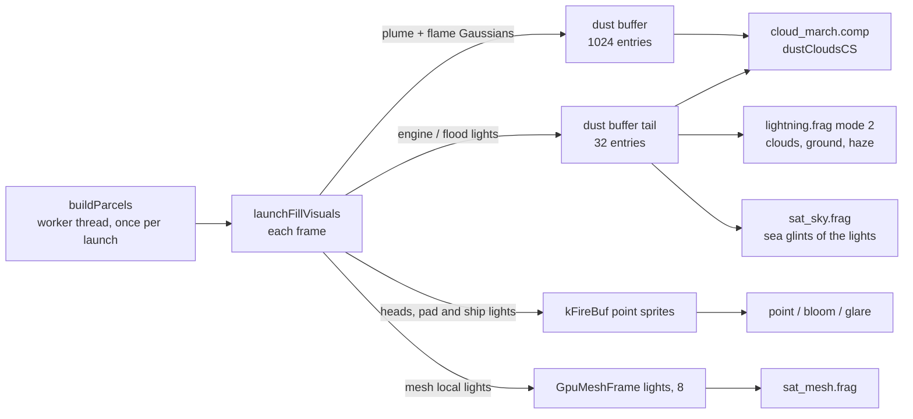

# Launch visuals

This page covers how a rocket launch is drawn: the exhaust plumes and the ground clouds at lift-off and landing,
the flames out of the engines, the light the engines and floodlights throw on clouds, haze, exhaust, the ground,
the sea and the meshes, and the launch pads and landing ships at night. It is written for a graphics programmer.

What it does not cover: how rockets fly (tracks, staging, attitude, recovery, droneships) is
[Rockets](../simulation/rockets.md); which launches happen and when is [Launches](../simulation/launches.md); the
rocket, pad and ship models' JSON format is [Satellite models](../modding/satellite-models.md); the pads' graded
ground, apron pattern and coast patches are on [Terrain](terrain.md) and the cities' exclusion round pads on
[Cities](cities.md); the mesh renderer itself is [Satellite meshes](satellite-meshes.md).

## Overview

Everything here is a pure function of sim time and the launch's batch (its hashed seed): time warp, reversal and
bookmarks show the same plume. The CPU builds most of it each frame and hands the GPU small lists:

| Effect | Where it is drawn | Units |
|---|---|---|
| Exhaust plumes, ground clouds | `dustCloudsCS` in `shaders/cloud_march.comp`, half resolution, in the cloud composite | Sun's light per unit solar irradiance, in the sky's units |
| Flames, a ship's deck glow at a distance | the same list, emissive (`col.w = 1`) | on-screen energy of a point, or surface brightness once resolved |
| Rocket heads, pad and ship lights | point sprites appended to the visible list from `kFireBuf` | effectFlare, like a satellite |
| Engine and flood light on clouds, haze, ground | `shaders/lightning.frag` mode 2, full resolution after the sky TAA | intensity in suns × m² |
| The same lights on the exhaust | `dustCloudsCS` | same |
| The same lights on meshes | `shaders/sat_mesh.frag` local lights | same |
| The same lights mirrored in the sea | `shaders/sat_sky.frag` | same |

The dust buffer is shared with the [Kessler dust clouds and re-entry trails](../simulation/kessler.md): of its
1024 Gaussians the Kessler dust takes at most 384, re-entry fireball trails up to 704, and plumes and flames the
rest. Plumes are capped at 384 Gaussians a frame (a wide one covers much of the screen and costs every pixel it
covers).

## Exhaust parcels

The exhaust of each burn is a sequence of **parcels**: lumps of gas emitted every 1 s (the booster's ascent below
60 s, the upper stage, deorbit burns), 1.5 s (the booster's ascent later), 2 s (boostback, entry and landing burns)
or 0.5 s (a vent). `buildParcels()` integrates every parcel of a launch once, over its whole life, and samples it at
log-spaced ages (`launch::Parcel`: centre, radius, condensed share, swept air). Each frame `Parcel::at()`
interpolates the samples. The build runs on a worker thread (at most four at once) from up to two minutes before
lift-off, only for launches within about 4500 km of the eye, and not past 1 h/s of warp.

`launch::makeParcel()` (`src/simulations/Launches.cpp`) is the physics, in the Earth-fixed frame:

- **Expansion and entrainment.** The parcel's radius grows at the exhaust's own expansion speed (about 2 km/s for
  rocket gas into near vacuum, 100 m/s for vented propellant) weighted by the exhaust's share of the mass, \(
  v_{exp} \, m / (m + M_e) \), plus diffusion \( K_d / \sigma \) with \( K_d \) = 25, 8 and 400 m²/s below 15 km,
  to 60 km and above. It sweeps up air at \( 4\pi\sigma^2 \rho (\dot\sigma + 0.25 |v_{rel}|) \). Above 80 km the
  coupling to the air falls to 3% by 160 km: the air's mean free path is about a kilometre there and the exhaust
  largely passes through it, which is why a twilight launch's bell grows to hundreds of kilometres. So low down a
  parcel is a narrow trail the wind carries; high up it is a bell expanding at km/s that falls back into thicker
  air.
- **Momentum.** Entrained air mixes in at the wind's velocity (an exact update for any step size). Gravity acts on
  the exhaust's share only; Coriolis and centrifugal terms are included.
- **Wind.** Each launch has a hashed wind direction at the pad. Speed varies with height: a few m/s at the ground,
  a jet near 12 km, strong winds near 95 km, layered oscillation above about 35 km. The direction turns with height
  (vertical wavelengths of 9 and 23 km, strongest above 50 km), so high trails twist and kink over minutes, like the
  corkscrewed trails of real twilight launches.
- **Condensation and evaporation.** The condensed share is \( e^{-a/\tau_{evap}} (1 - e^{-a/\tau_{cond}}) \). The
  exhaust is invisible at the nozzle: \( \tau_{cond} \) runs from 0.25 s low down to 1.5 s at 90 km. It evaporates
  over 7 minutes below 3 km, 25 minutes to 18 km, an hour above (sea spray and ground clouds set their own).
- **Turbulent growth** (`ParcelOpts::growK`): the radius also grows at `growK` × the speed through the air, capped
  at 60 m/s (a young parcel still moves at km/s). The ascent trail uses 0.05 below about 1.5 km above the pad,
  fading out by 6 km: the low column thickens as it entrains.
- **The ground** (`ParcelOpts::groundM`): a parcel that reaches it spreads along it with a small rebound. Parcels
  within 30 km of the pad rest on the pad's own ground height.

The scattering cross-section per kilogram (`kappaAt`) runs from 10 m²/kg low down (condensing vapour and soot) to
1000 m²/kg above about 90 km, where the exhaust's water freezes into sub-micron ice. The albedo rises from
0.95 − 0.55 × the vehicle's soot to 0.98 above 40 km. Plumes are drawn for 40 minutes (low) to an hour (high).

### The trail as a polyline

A burn's parcels are the knots of a polyline. Each Gaussian spans the chord between two neighbouring knots as they
are now (centre the midpoint, axis and length the chord), so the trail bends and shears with the winds that carry
it. Its along-trail sigma is 0.35 to 0.5 of the chord (tighter while young, so it does not reach ahead of the
stage); its radius and condensed share are the means of its two ends. The newest piece, the **head**, runs from the
youngest knot to the burning stage's nozzle and grows with the burn; when the next knot is born the segment that
replaces it is the same Gaussian. So the trail leaves the stage continuously, with no step each time a parcel is
emitted.

Old, wide parcels overlap their neighbours, so every 2nd, 4th or 8th knot stands for its neighbours past 2, 10 and
30 minutes, but only once the parcel is 2, 4 or 8 times wider than its spacing.

### Rims

High up (above 60 km, radius over 2 km) a parcel that has swept up about its own mass of air piles gas at its rim:
a limb-brightened shell, the "jellyfish" bell. Up to 45% of its cross-section goes to the rim. Along a trail the rim
is a tube whose limb is two Gaussians beside the segment, as long as it, so neighbours join into the tube's two
edges. A lone parcel, or a trail seen end-on, gets a ring of 7 Gaussians round the line of sight.

### Colour

Each plume Gaussian's colour is the Sun's light at the parcel times its albedo:

1. The sunlight's path through the air (per-channel extinction coefficients 0.11, 0.2, 0.42 of the grey column).
2. The ozone shell's Chappuis absorption along the Sun's path (vertical optical depth 0.019 / 0.027 / 0.0016 at
   680 / 550 / 440 nm), counted once with the secant capped at 12.
3. From 30 to 100 km the sub-micron ice scatters blue more than red (Angström exponent 1.5, luminance kept), but
   only as far as the sunlight there still has its blue. This is why twilight plumes, like noctilucent clouds, are
   off-white to blue, and why there is no magenta band between the orange low trail and the white bell.

Below 25 km the CPU adds the blue sky's light on the parcel and, where that is more than 2% of the Sun's, applies
the Earth's shadow to the Sun's part itself and passes the sky's share of the colour to the shader, which lights
that share isotropically with half the self-shadow. Above 25 km the shader draws the Earth's shadow per pixel (the
bell's lit edge is the terminator).

### Units

The sky and the clouds use phase functions normalised to a mean of 1 (4π per steradian); `dustCloudsCS`'s phases
are per steradian. The CPU therefore multiplies a plume's light by 4π by day. At night it uses 10, because the
night exposure is not physical: a sunlit plume against the dark sky would otherwise read far dimmer than it is
(the same reason as the Kessler dust). `nightBoost` blends the two by the Sun's height.

### Budget

Candidates are ranked by cross-section over range squared, raised by their peak optical depth. Only the drawn ones
and the first past the cut are sorted (`std::partial_sort`). Near the cut a Gaussian fades by priority, to zero at
the cut and full at three times it, so pieces of a trail do not switch on and off as plumes age and the view moves.

## Shading in `dustCloudsCS`

For each plume Gaussian the shader integrates its optical depth along the ray in closed form (an erf), as for the
Kessler dust. Plumes are real clouds: their optical depths are summed, their light per unit optical depth
averaged, and the composite is \( 1 - e^{-\tau} \).

The list is culled three ways, none of which changes the image by more than a bound far under one display level:

- **Per tile** (`cullDustForTile()`): each 16×16-texel workgroup tests every Gaussian's view cone once against the
  tile's own cone and keeps a bit mask in list order, so the sums run in the same order as a full scan and give the
  same result. Each Gaussian also carries a mask of the engine lights that can reach it.
- **Per texel, the faint skip**: a plume whose optical depth at the texel is below \(10^{-5}\) and whose light is
  below \(2 \times 10^{-7}\) of white at the frame's sky exposure (word 2 of the dust buffer's header) is skipped
  before its lighting. Summed over the whole list that is at most 1% dimming and \(2 \times 10^{-4}\) of white.
- **On the CPU** (`dustCullInsignificant()`): plume Gaussians whose summed worst-case bounds stay under
  \(2 \times 10^{-4}\) of white and 1% dimming are not uploaded at all. Old, wide, Earth-shadowed exhaust is the
  typical case: in a droneship view 160 of 390 Gaussians covered every texel while adding about \(10^{-6}\) of white.

Knockout bits 16777216 (tile cull and faint skip off) and 33554432 (CPU cull off) are their A/Bs.

- **The eye inside a Gaussian.** Its optical depth thins from a Mahalanobis radius of 3 to 1.5 sigma, down to 10%,
  so the exhaust round a stage the camera follows is structure in front, not a fog the camera is in.
- **Billows, aloft.** Above about 12 km each Gaussian is modulated by the clouds' baked Perlin-Worley
  (`cloudNoiseTex.r`) at the ray's closest approach, read in the parcel's own frame: its offset from the centre in
  Earth-fixed axes, in units of its width. The pattern rides with the parcel, stretches as it spreads, and does not
  rescale as the camera moves round it. Each parcel is seeded (`ib.w` = 4 × seed + a fraction). The mean is
  divided out (`kPlumeNoiseMean` 0.70), so the trail's brightness is unchanged on average. Gaussians fainter than
  τ = 0.01 skip the noise.
- **Billows, low down.** Below 3 to 12 km the billows come from one field shared by every Gaussian there, read in
  ECEF relative to the terrain detail's integer-anchored 2048-m cell (cells of 2048/3 and 2048/9 m, whole numbers
  of texture periods per anchor cell), so overlapping puffs form one lumpy mass and the field stays with the air.
  The faint tails are cut (τ × smoothstep(0.02, 0.35, τ)) for crisp, cauliflower edges. The field's change toward
  the Sun (one more fetch 70 m sunward) lights lobes facing the Sun and darkens those behind them; its density
  darkens the mass against the engine lights.
- **Self-shadow.** Every Gaussian with τ > 0.01 takes its own optical depth toward the Sun, in closed form, from
  where its light comes from: the closest approach moved toward the eye by up to 1.5 sigma as the ray's optical
  depth grows (a thick puff is seen by its near surface). A floor of 0.4 (0.25 low down) stands for multiple
  scattering.
- **Phase and multiple scattering.** Single scattering uses an ice phase, 0.45 HG(g 0.8) + 0.55 isotropic. A
  multiple-scattering term grows with the summed optical depth (0.075 (1 − e^{−0.6τ})) plus a second for optically
  thick exhaust (0.17 (1 − e^{−0.25τ²})), which brings a sunlit steam cloud to about albedo / π. The engine lights
  use only the first term.
- **Compositing.** The plumes' distance is weighted by their light, not their optical depth, so a bright exhaust
  beside a stage is not pushed behind a dim, thick cloud kilometres away. In front of the clouds (nearer than the
  cloud's mean distance) a plume covers them; behind, it is seen through them. Either way it dims what lies behind
  it by \( e^{-\tau} + 0.85\,a\,(1 - e^{-\tau}) \) with \( a \) its albedo: a clean plume scatters the sky's light
  back and barely dims the sky, a sooty one silhouettes against it.

!!! warning "Invariant"
    A half-res texel with no cloud of its own but a plume or flame carries that light's distance in the cloud
    target's alpha, **flagged** in the half float's lowest mantissa bit (`cloudAlphaFlag` /
    `cloudAlphaIsEmit`, `shaders/include/cloud_occlusion.glsl`). Its opacity is the plume's, which `dustCloudsCS`
    has already lit by the engine lights. Any pass that treats the alpha as "a cloud is here" must skip flagged
    texels, or it lights the exhaust a second time (`lightning.frag`'s engine-light mode and the sea's reflection
    do).

A burning stage sits inside its own exhaust, whose light-weighted distance is about the hull's. `sat_sky.frag`
therefore composites the cloud texel over a mesh pixel with a soft depth test: fully when nearer than the mesh,
not at all past 1.25 × its distance + 20 m.

## Ground clouds

`buildParcels()` adds parcels that start on the ground (`Parcel::ground` 1 and 2), drawn by the low-altitude path
above as lumpy, self-shadowed masses.

**Lift-off.** While the stack is within \( h_{imp} = 60\,(\dot m / 1000)^{0.4} \) m of the pad (about 200 m for
Super Heavy, 90 m for Falcon 9, at least 3 s, at most 20 s), every 0.75 s parcels of exhaust and deluge steam start
on the pad's ground and roll out at 70-150 m/s. A Starship pad sprays water up through its steel deflector, so its
cloud billows out all round (three parcels a step). Other pads send most of it out of the flame trench's mouth
70 m behind the pad as a fan, with a little spilling round the sides. The mass per step is the stage's flow × 0.75 s
× 1.3 (deluge) or 0.9, scaled by \( (1 - h/h_{imp})^{1.5} \) with a floor of 0.15. The parcels start 22 m wide, grow
with their speed through the air (`growK` 0.12), rise (buoyancy 0.25 m/s² fading over 90 s) and evaporate over
6-7 minutes.

**Landings.** In a landing burn's last stretch, while the stage is within \( 80\,(\dot m / 1000)^{0.4} \) m of the
ground, three parcels every 0.5 s spread from under it. What they are depends on the surface (`boosterLandingAt()`
gives the recovery and the touchdown point):

| Surface | Look | Life |
|---|---|---|
| A pad (a tower catch) or landing zone | steam and exhaust, grey-white | 5 min |
| Bare land (DEM over 1 m, not water) | tan dust (tint 1, 0.84, 0.64; albedo 0.6) | 8 min |
| Open sea | white spray (κ 14) | about 90 s |
| A landing ship's deck | a thin, low exhaust skirt deflected by the steel deck | under a minute |

A landing burn's trail is drawn at half the ascent trail's cross-section (one deeply throttled engine, no deluge).

## Flames

A burning stage's flame comes out of its model's engines. `engineGeomOf()` reads the exit plane, the radius the
nozzle exits span and the body length from the model's components named `engines*`, `upper_nozzle*` and
`side_nozzle*` (cones or profiles), and caches them per type. The flame is a chain of three emissive Gaussians along
the stage's axis behind the exits:

| | Length (exit diameters) | Width (exit radii) | Share of the light |
|---|---|---|---|
| core | 1.2 | 0.75 | 50% |
| flame | 3.5 | 1.1 | 32% |
| tail | 9 | 1.8 | 18% |

All lengthen by (1 + 2.5 k) and widen by (1 + 2 k) as the air thins, k = smoothstep(20 km, 90 km, altitude). Each
is centred far enough behind the exit that its forward tail stays inside the bell. The core is white-hot; the tail
takes the exhaust's colour.

**Point and resolved flame.** The flame's light comes from its magnitude seen from 100 km (`flame1_mag_100km` /
`flame2_mag_100km` in `data/launches.json`; landing burns +1.5 mag, boostback and entry +0.7), scaled by
`launches.rocket_gain`. Unresolved, its Gaussians carry the on-screen energy of a point of that magnitude. As the
core grows from 1.5 to 8 px wide they blend geometrically to a surface brightness in the sky's own units
(π × radiance per unit solar irradiance) × `kFlameCore` (30 by day, 0.18 of that at night, where the exposure is
about 5.5 times the day's). Resolved and seen along its axis, a Gaussian's surface brightness is held at its
side-on value, and from the exhaust side within about 40° of the axis it thins to 15%, so the lit nozzles show
through. A Gaussian the eye is inside fades out (Mahalanobis 3 to 1.5 sigma).

The point sprite (bloom, glare) sits 0.08 exit diameters behind the exit plane, on the engine cluster. Once the
flame resolves its brightness stops following \( 1/r^2 \): it is held as if the flame were 4 px long, then cut to
30% as the flame grows from 4 to 30 px, and above an effectFlare of 14 (just past the glare threshold) blended
geometrically toward 14. A glare remains at every scale; the flame's Gaussians and the lit nozzles carry the rest.

**The lit exhaust.** At night a fourth Gaussian stands two of its lengths behind the engines: the exhaust lit by the
flame, 12 exit diameters across low down growing to 330 aloft, 0.12 of the flame's light, fading out as the eye
comes within 2-6 of its lengths.

**Nozzle glow.** While a stage burns, the inside of every bell glows in `sat_mesh.frag`: materials whose
`lattice.w` is 1 (the rocket models' `soot` preset, the bells' inner material) take an emission from orange at the
lip to white-hot up toward the throat, passed as `SatOrbitElems::engineGlow` in the fraction of
`GpuMeshInstance::earthShC.w`. Each channel is capped at what displays as orange (lip) to yellow-white (throat) at
the frame's exposure, so the glow keeps its colour at night. The bells are render-only, so they seed no bloom or
glare.

**Entry plasma.** Starship's ship, the crew capsules and Dream Chaser glow where the entry heating is, through one
emitter: a thin **shock layer** on the windward face (a capsule's heat shield, of radius `heat_shield_r_m`; the
belly of the ship and of Dream Chaser, along the middle of the body), a short hot wake just behind the body (0.12 of
the layer's brightness) and the glowing path wake of the last seconds (0.15). It is never at the model's origin,
which for the ship is the aft end at the engines. Its colour runs from orange to a violet-pink as the speed rises
toward 7.5 km/s. Unresolved, each Gaussian carries the on-screen energy of the point it stands for; as it resolves
(1.5 to 8 px) it becomes a surface brightness, about 4 times a sunlit white face at peak heating, held at its
face-on value from any view and capped at 2.0 of displayed light (times the sky exposure, so the same cap holds by
night). The plasma lights its own hull through physical [mesh local lights](satellite-meshes.md), neither lifted at
night nor adapted: three under the ship's belly, two under Dream Chaser's, one ahead of a capsule's shield. Its
light on the clouds below is placed at the layer too. Booster entry burns are engine burns and stay at the engines.

**A coasting stage.** A sunlit stage that is not burning is a point at the middle of the stage (magnitude 3 at
1000 km for a booster, 3.8 for an upper stage) that fades out as its mesh grows from 2 to 8 px. A landed booster
is scenery: no point.

## Engine and flood light

At night a burning engine lights everything around it. Every burn counts (ascent, boostback, entry, landing), as
does a returning ship's entry glow and each launch pad's and landing ship's floodlights.

**Sources.** `engineLightAdd()` registers a point light. Its intensity in suns × m² (the irradiance at 1 m, in units
of the Sun's) comes from the flame's magnitude at 100 km through `flameIntensitySunsM2()` (magnitude 0 = 2.54e-6
lux, the Sun 1.27e5 lux): a Super Heavy at −6 is about 6e6 cd, which gives a cloud base 3 km up about 0.7 lux,
roughly three full Moons. The flame's light sits 0.4 of the flame's length behind the exits, with a soft core
radius \( r_0 \) of half that length (at least 25 m). Its colour is the flame's pushed 85% toward deep orange (deeper
for sooty fuels). A pad counts as 0.5 suns × m² (a Starship pad 0.8) placed 60 m over its centre, lighting low
cloud and fog only (the ground pattern draws the pad's own lit apron); a landing ship's deck floods as 0.3, 15 m
over the deck.

**Night lift.** By day the lights are physical, so nothing shows. At night they are raised by the same factor as the
Moon's light, `moonGain` / 2e-6, about 2600: the night exposure is not physical. Each light's reach is where a white
cloud it lights falls to 2e-3 of white on screen (at most 300 km). At most 32 lights a frame (`kMaxEngineLights`),
those whose lit region is nearest the eye first. They are written into the dust buffer's tail, after its 1024
Gaussians, with the count in its header (`engineLightsFlush()`).

**Eye adaptation.** The night lift is right for an eye adapted to moonlight. Close to a rocket the eye stands in far
more: 300 m from a Super Heavy it is about 260 full Moons. `engineLightsFlush()` scales every light's intensity by

\[ (1 + R/2)^{-0.75} \]

and its reach by the square root of that, where \( R \) is the illuminance at the eye from all the lights in full
Moons. It applies only at night (blended by the Sun's height) and eases toward darker in about 0.3 s and back in
about 2 s. A cut snaps it: a sim-time jump of more than 2 s, the camera moving more than max(300 m, a fifth of the
distance to the nearest light) in one frame, or a Go-to flight in progress. Measured: × 0.04 at 310 m, × 0.11 at
1.5 km, about × 0.5 from 2.5 km of a lift-off, about 1 from 10 km or orbit. The flame's own Gaussians, its point and
the nozzle glow are not adapted.

### On clouds, ground and haze: `lightning.frag` mode 2

One full-screen triangle drawn after the sky TAA, screen-blended, whenever there are lights (it shares the
lightning pipeline; set 0 binding 4 is the half-res scene depth, 5 the dust buffer, 6 the mesh distance). For each
light:

- **Clouds and fog.** The cloud composite's opacity from a 3×3 tent of the half-res transmittance, and its distance
  from an opacity-weighted [1 2 1] tent over the 3×3 texels, so a strongly lit deck's outline and gaps are smooth
  rather than half-res steps. Irradiance 0.85 × opacity^1.5 / (r² + r0²), × 0.35 when the light is on the far side
  of the cloud from the eye (diffuse transmission). Flagged plume texels are skipped.
- **Ground and sea.** Albedo 0.15 × the cosine to the light, behind the clouds' transmittance, not on the rocket's
  own hull (a cylinder up the nose axis) and not on mesh pixels (those are lit in `sat_mesh.frag`). Pad lights skip
  this term.
- **Haze.** Single scattering by air and low haze (scale heights 8 km and 1.5 km) at the light's height, integrated
  in closed form along the ray (the integral of \( 1/(d^2 + s^2) \) is an arctangent), ending at the ground or, in
  the cloud's share of the pixel, at the cloud. The light's own extent softens the 1/d core in quadrature
  (\( d^2 + 0.12\,r_0^2 \)), a glow concentrated on the light with no flat disc.
- Each term fades over the outer 40% of the light's reach, so its edge is never a circle.

### On the exhaust

`dustCloudsCS` adds each light's irradiance on every plume Gaussian, × its albedo, with the isotropic phase and
the thin multiple-scattering term. The inverse square is averaged over the Gaussian's depth along the ray
(\( I / (r^2 + 1/q + r_0^2) \), \( 1/q \) its variance along the ray), and the light is self-shadowed through the
Gaussian's own mass between it and the engine (closed form, floor 0.25), so the side of a thick column facing the
flame glows and the rest takes about a quarter. The low billows darken the mass against the light.

### On meshes

`meshLightAdd()` registers a mesh light: each engine light adds one (from just behind the nozzles, 0.12 of the
flame's length, above the deck it is landing on), and each floodlight of a pad (about 2e4 cd, 0.16 suns × m², a
40° beam aimed at the pad's centre, within 6 km of the eye) and of a landing ship (0.1, 45°, aimed at the deck) is
its own light. `recordMeshScene()` takes last frame's list with the eye's adaptation and keeps the 8 most important
to the camera (\( I / (d^2 + 2500) \)) in `GpuMeshFrame::lightPos/lightCol/lightDir`. `sat_mesh.frag` adds each as
irradiance \( I / (r^2 + r_s^2) \) with the diffuse term and the material's specular lobe; a floodlight is soft over
the outer 10° of its beam. There are no shadow rays (cost), and the light is not in the photometric model, so it
seeds no bloom. A landing booster, a pad's tower and a droneship's deck are lit this way.

### In the sea

`sat_sky.frag` mirrors every light in the list from where it is: after the Sun glint it evaluates the sea's Beckmann
lobe with the light's direction from the sea point and its irradiance there, dimmed by the clouds the eye sees in
front of the light. A light near the eye mirrors at its true specular point, always deeper below the horizon than
the light is above it. The screen-space reflection of the cloud composite drops texels where a flame dominates and
its light cannot lie on the reflected ray. Details on [The sea](sea.md).

## Rocket, pad and ship meshes

Rockets, pads, ships and stacked payloads are drawn by the [satellite mesh renderer](satellite-meshes.md) through
reserved launch slots at the end of the launch record range, each kind past about 1.4 px on screen:

| Slots | Holds |
|---|---|
| 6 + 2 | rocket stages near the eye (`launchMeshJobs()`), the followed transient, the selection |
| 16 | launch pads (`pad_starship`, `pad_falcon`, `pad_generic`), keyed by pad and kind |
| 48 | stacked payloads still on their stage (`launchStackJobs()`) |
| 8 | landing ships and their securing robots (`launchShipJobs()`) |

Each is an explicit state (position, velocity, axis, optionally a full attitude) rewritten every frame. Pads stand on
their plateau with the Earth's rotation as velocity. A landing ship rides a swell (heave, pitch and roll from three
sinusoids of about 7, 9.5 and 12.5 s, hashed per ship, scaled by the sea state at the ship, eased over 20 s; the
larger Jacklyn moves 0.6 as much), and the booster on its deck, its lights and its securing robot move with it. The
robot (`ship_robot`) drives out 75 s after touchdown at 0.6 m/s and swings its clamp arms under the booster (the
model's unfolding, 15 s).

Open lattices with members under a pixel (a catch tower from a kilometre, grid fins) use a per-pixel threshold that
changes every frame while the sky TAA runs, so the TAA averages them to their coverage. A grid fin's cells are
drawn solid at the grid's mean once a cell is under 3 to 6 px. Meshes glare only where a reflection is a compact
image of the Sun (roughness below about 0.1), so stainless steel and paint do not glare along their edges; see
[Points, bloom and glare](points-bloom-glare.md).

## Pad and ship lights at night

Pads and ships carry point lights drawn as sprites in `kFireBuf` (appended to the visible list after the satellites,
so bloom and glare treat them like any point), within 150-160 km and not behind the Earth's curve. Each light's
magnitude at 1 km plus distance and extinction gives its effectFlare, × the night factor, capped at 14 (just past
the glare threshold, so a mast's cluster reads as one soft glow; see glare clusters on
[Points, bloom and glare](points-bloom-glare.md)).

| Light | Magnitude at 1 km | Colour |
|---|---|---|
| Pad flood cluster (masts, tower levels) | −3 | white |
| Pad red beacon (tower top, masts), 0.45 s on in 1.5 | −2 | red |
| Landing zone flood | −3 | warm white |
| Ship deck flood | −2 | warm white |
| Ship red beacon, 0.33 s in 1.3 | −1.5 | red |
| Ship masthead, side (red / green) and stern lights | 0 | white, red, green |

A pad's concrete is lit by its floods in the ground pattern (`padFlood` in `sat_sky.frag`; see
[Terrain](terrain.md)): brightest toward the mount and under the masts' aim. While a landing ship is small on
screen (under about 6 to 30 px), two emissive Gaussians stand in for its floodlit deck (−4 at 1 km) and the booster
on it (−3.5); once its mesh resolves, the mesh lights take over.

## Settings

| UI label (Settings > Constellations > LAUNCHES) | settings.json key | Default |
|---|---|---|
| Exhaust plumes (Off / x0.3 / x1 / x3) | `launches.plume_gain` | 1 |
| Rocket light on clouds (Off / x0.3 / x1 / x3) | `launches.engine_light_gain` | 1 |
| Launch site graphics | `launches.pad_graphics` | true |
| (no UI: the flames' brightness) | `launches.rocket_gain` | 1 |

The Missions window's Controls tab shows the same section; see [Missions](../using/missions.md).

## Costs and limits

Measured on an RTX 3070 Ti at 1600×900:

- A Vandenberg twilight launch's bell filling the view (320 Gaussians): `cloud_march` +0.9 ms.
- The plume billows: within 0.2 ms over three views of a launch (GPU 21.3 / 16.0 / 18.5 ms with them).
- The ground clouds: within noise at a Starship lift-off from 2.5 km.
- The Gaussian culls: `cloud_march` 8.1 → 6.6 ms in a droneship view, 4.3 → 3.4 ms at a daytime lift-off,
  3.3 → 3.0 ms following a stage at night from 300 m. Time these with no other app on the GPU.
- The engine-light pass: +0.26 ms (Starship at T+15 s under broken cumulus, 6 km from the pad); the exhaust's
  engine lighting +0.05 to +0.25 ms of cloud march.

Not modelled: the engine light does not know a cloud surface's orientation (the screen derivatives of the half-res
distance draw a crosshatch); a light inside a cloud does not diffuse through it as lightning does; terrain does not
shadow it; mesh local lights cast no shadows; the lit cloud's outline can show half-res texels where the light is
strong.

## Debugging

The harness (see [Harness](../development/harness.md)) has `launch next ... pad_dist_m=<m> [lead=<s>] [side=-1]`
(on the ground beside a pad), `launch landing [booster=1] [droneship=1]` and `launch droneship`, `launch pad <site>`
and `launch state`, which reports `ground_clouds`, `engine_lights`, `engine_light_gain`, `engine_light_adapt`,
`plume_high`, `dust_list` (the list's counts by kind) and `cpu_split_ms`; `shaders reload` also reports the
composite's register count. Scripts: `tools/harness/scripts/pad_smoke.satcmd`, `follow_visuals.satcmd`,
`droneship.satcmd`. Pause time and clear the clouds (`set clouds_v2.coverage 0`) before judging a ground cloud.

## Where in the code

- `src/simulations/Launches.cpp` / `.h`: `makeParcel()`, `Parcel::at()`, `ParcelOpts`.
- `src/simulations/SatelliteSimLaunches.cpp`: `buildParcels()` (ascent, burns, ground clouds, landings),
  `engineGeomOf()`, `launchFillVisuals()` (flames, points, plumes, budget), `engineLightAdd()`, `meshLightAdd()`,
  `engineLightsFlush()` (adaptation, upload), `flameIntensitySunsM2()`, `launchFillPadLights()`, `padLightsOf()`,
  `launchFillShipLights()`, `shipLightsOf()`, `launchFillShipGlow()`, `shipSwell()`, `shipFrame()`,
  `launchMeshJobs()`, `launchShipJobs()`, `launchStackJobs()`.
- `src/simulations/SatelliteSim.cpp`: `recordMeshScene()` (mesh local lights, lattice threshold phase).
- `shaders/cloud_march.comp`: `dustCloudsCS()` and the plume compositing at the end of `main()`.
- `shaders/lightning.frag` (mode 2), `shaders/include/lightning_draw.glsl`.
- `shaders/sat_mesh.frag`: local lights, nozzle glow, lattice threshold.
- `shaders/sat_sky.frag`: the mesh soft test, the sea's light glints and reflection filter, `padFlood`.
- `shaders/include/cloud_occlusion.glsl`: `cloudAlphaFlag()`, `cloudAlphaIsEmit()`.
