# Crew and cargo flights

Every station in the roster is visited: crews rotate twice a year and cargo ships resupply them. This page
covers the visiting programs, how a launch is timed to the station, the spacecraft's rendezvous, docking or
berthing by the station's arm, departure and return, and what happens when a station is lost. The launch scheduler these flights share with
the constellations is on [Launches](launches.md); the rocket's own flight is on [Rockets](rockets.md); the
Missions window that lists them is on [Missions](../using/missions.md).

## Programs and stations

A program in `data/launches.json` with a `crew` block is a **visiting vehicle**: it matches station
constellations (one satellite each) and flies once per `life_years`. For these programs `life_years` is a
cadence, not a design life: it is not scaled by the Satellite design life setting.

| Program | Spacecraft | Vehicle and site | Stations | Per year, each |
|---|---|---|---|---|
| ISS crew rotation | Crew Dragon (4) | Falcon 9 / Crew Dragon, Kennedy 39A or SLC-40 | ISS | 2 |
| Tiangong crew rotation | Shenzhou (3) | Long March 2F, Jiuquan | Tiangong | 2 |
| Commercial station crews | Crew Dragon (4) | Falcon 9 / Crew Dragon | Haven-1, Haven-2, Axiom, Starlab, Orbital Reef | 2 |
| ROS crew rotation | Soyuz MS (3) | Soyuz-2.1a, Baikonur | Russian Orbital Service Station | 2 |
| Gaganyaan crew rotation | Gaganyaan (3) | HLVM3, Sriharikota | Bharatiya Antariksh Station | 2 |
| Progress resupply | Progress MS (cargo) | Soyuz-2.1a, Baikonur | ISS, ROS | 3 |
| Tianzhou resupply | Tianzhou (cargo) | Long March 7, Wenchang | Tiangong | 2 |
| Cargo Dragon resupply | Cargo Dragon | Falcon 9 / Crew Dragon | ISS, Haven-2, Axiom, Starlab, Orbital Reef | 2 |
| Cygnus resupply | Cygnus (cargo, berthed) | Falcon 9 / Cygnus, Cape Canaveral SLC-40 | ISS (Unity nadir) | 1.33 (every 0.75 y) |
| HTV-X resupply | HTV-X (cargo, berthed) | H3-24W / HTV-X, Tanegashima | ISS (Harmony nadir) | 1 |
| Dream Chaser resupply | Dream Chaser (cargo, berthed, lands on a runway) | Vulcan Centaur VC4L / Dream Chaser, Cape Canaveral SLC-41 | ISS (Harmony nadir) | 1, half a year after HTV-X |

A station served by several programs has one schedule plane per program. The first program to match it (its
crew rotation) owns the station's main plane; every further one gets a plane of its own, appended after all
others so no other plane's index (and so no batch key or pad priority) moves.

`crew` block fields:

| Field | Meaning |
|---|---|
| `spacecraft`, `people` | name and crew size (none for cargo) |
| `model` | render model `rocket_<model>[_cm\|_chute].json` (whole, crew module only, under parachutes) |
| `heat_shield_m` | the heat shield's distance below the docking port, where the entry glow sits |
| `lands` | comes home on land (Soyuz, Shenzhou); otherwise splashes down |
| `cargo` | no people |
| `return: "burns"` | destroyed on re-entry (Progress, Tianzhou) |
| `return: "runway"`, `runway` | a spaceplane that glides to a runway: `runway` gives its `lat`, `lon`, `heading_deg`, `length_m` and `elev_m` (see [Runway landing](#runway-landing)) |
| `alternate_with` | the name of another program at the same station: this one's visits come half a cadence after that one's, so two vehicles needing the same port never meet there |
| `ports` | the port class it uses, matched against the station model's port `use`: `crew` (default), `cargo`, or any other name (`berth_unity`, `berth_harmony`) |
| `share_crew_ports` | uses the crews' ports between rotations (Cargo Dragon) |
| `stay_days` | [min, max] time docked |
| `fast_dock_h` | windows (hours after lift-off) for a fast-track rendezvous, in order of preference |
| `berth` | the vehicle does not dock: the station's arm captures it and berths it (see [Berthing](#berthing)) |
| `grapple` | [radius, z]: where its grapple fixture is, radially out from the vehicle's axis and that far below its berthing port (m; default [1.5, 2.5]) |
| `capture_m` | the capture point's distance from the port along the port's axis (m; default 9) |

The program's `raise_days` is lift-off to docking, and `payload_mass_kg` (when given) sets the booster's
recovery. Stations declare their ports in their model (`"docking_ports"`: name, position, axis, `use`,
optional `since`); see [Satellite models](../modding/satellite-models.md). With the deployment era on, a
crew launch waits until its station's first module is up, and a spacecraft docks only at a port on a module
that exists by then: a cargo ship whose port class is not there yet does not fly (the ROS cargo port, for
instance), while a crew falls back to any crew port.

## Timing the launch to the station

A visiting launch is scheduled like any other: the plane's next pass over a pad after the nominal time
(see [Launches](launches.md#choosing-a-pad-and-a-time)). Two profiles then differ:

- **About a day** (Crew Dragon, Cargo Dragon, Gaganyaan): the pass is kept, and the phasing below absorbs the
  station's position, docking around `raise_days` after lift-off (Dragon about 1-1.4 days).
- **Fast track** (Soyuz, Progress, Shenzhou, Tianzhou): the passes of the next 30 days are tried in order,
  and the launch takes the first whose station phase lets the phasing close inside a `fast_dock_h` window:
  Soyuz 3.0-3.6 h or 5.6-6.4 h, Progress 3.1-3.7 h or 5.6-6.4 h, Shenzhou 6.2-6.9 h, Tianzhou 2.4-3.6 h or
  6.0-7.0 h. The first window (two orbits) is preferred if a pass allows it within 14 days of the first pass
  allowing any. A fast-track launch keeps this pass even when another launch wants the pad.

Both are pure functions of the batch, like every launch.

## The flight

The spacecraft separates from its upper stage at deployment and from then on is its own selectable,
followable object; its phases are closed forms of sim time (`crewPos()`).

The spacecraft models' solar wings follow their real designs: Soyuz MS's and Progress's do not turn, their cells
facing along the vehicle's axis; Shenzhou's and Tianzhou's turn about their span to face the Sun (a child
attitude group `wings` with a `track` joint, see [Satellite models](../modding/satellite-models.md)).

```mermaid
flowchart LR
  A[separation<br/>parking orbit] --> B[coast c1]
  B --> C[Hohmann up to<br/>phasing orbit rP]
  C --> D[wait in rP]
  D --> E[Hohmann to the station's<br/>altitude, 5 km behind]
  E --> F[approach legs<br/>in the station's frame]
  F --> G[docked]
  G --> H[back out, depart<br/>2 km below, 3 km ahead]
  H --> I[deorbit burn]
  I --> J[entry]
  J --> K[drogues, mains,<br/>splashdown / landing]
```

### Phasing

From separation the capsule coasts in the parking orbit for \( c_1 \) (900-1500 s on a fast track,
2400-3600 s otherwise), raises by a Hohmann transfer to a phasing orbit \( r_P \) between the parking orbit
and 8 km below the station, waits there for \( W \), and raises by a second Hohmann to the station's
altitude, arriving 5 km behind it. The angle it gains on the station over the far phases of duration
\( D \) is

\[
\Delta\theta = (n_0 + v_s/r_0 - n_S)\,c_1 + (\pi - n_S T_1) + (n_P - n_S)\,W + (\pi - n_S T_2),
\qquad W = D - c_1 - T_1 - T_2 ,
\]

with \( T_1, T_2 \) the two transfer times and \( n_0, n_P, n_S \) the mean motions of the parking orbit,
the phasing orbit and the station. `buildCrew()` sets \( D \) from the target docking time less the approach,
then solves \( r_P \) by bisection so that \( \Delta\theta \) equals the station's lead (plus whole turns).
If even the parking orbit cannot catch up in time, the capsule waits longer there. Each phasing burn is
spread over 240 s (a smoothstep cross-fade between the path before and the Kepler path after), so thrust stays
at about 1 m/s² or less.

### Approach and docking

The approach is flown in the station's body frame (X along its velocity, Z to nadir: the stations' pointing
law, so a port in the model lands where the station's mesh draws it): from the arrival point to 1 km out on
the line toward the port, an arc round onto the port's axis (passing below the station when the two
directions are nearly opposite), then along the axis with holds at 400, 200 and 20 m, and contact. The legs
take about 2.4 h, or about 65 min on a fast track. Until it arrives behind the station the capsule flies
prograde; on the approach it faces the port, then lies on the docking axis from the arc on, and on departure
turns back to prograde over about 15 min. Its attitude changes continuously through every leg.

### Docked

A spacecraft stays docked until the next visit of its own program:

- two ports of its class: until the next crew has arrived plus a hand-over of 5-7 days;
- one port (Haven-1, Bharatiya): it leaves 2-3 days before the next one comes;
- `stay_days` caps the stay (Cargo Dragon 28-35 days); the stay is never shorter than 2 days.

Crews alternate between the station's two crew ports. Cargo Dragon's schedule sits half a rotation from the
crews' and it takes the crew port the current crew is not using, leaving 3 days before the next crew
arrives. Progress and Tianzhou take the aft cargo ports.

### Berthing

A vehicle with `"berth": true` (Cygnus, HTV-X, Dream Chaser) is captured by the station's robotic arm instead of docking. Its
port is a nadir berthing port (a common berthing mechanism, CBM), so after the arc onto the port's axis it climbs
the R-bar (the line from the Earth's centre through the station) with holds at 250 m and 30 m, stops at the
capture point `capture_m` below the port, and free-drifts. The arm grapples it 5 min after it arrives there, moves
it to 1.5 m from the port in 50 min, and pulls it onto the CBM in 20 min: it is then berthed.

| Leg | Duration |
|---|---|
| to 250 m, hold | 25 min, 20 min |
| to 30 m, hold | 30 min, 15 min |
| to the capture point | 15 min |
| free drift; grappled after 5 min | 25 min |
| on the arm to 1.5 m | 50 min |
| onto the CBM (the bolts drive) | 20 min |

At departure the arm takes it again, lifts it off the port, carries it back to the release point (the capture
point) and lets go 5 min after arriving there; the vehicle drifts away and about 7 min after the release burns onto the
usual departure circle, and later deorbits. Cygnus and HTV-X burn up on re-entry; Dream Chaser lands on a runway. A berthing approach and its
departure are flown like the docking ones (closed forms of sim time, continuous through every leg).

**The arm** is data: `launches.json` `"station_arms"` gives, per station, its base on the station, the base's
normal, the shoulder, boom and wrist lengths, the park pose and the side the elbow bends toward (fields on
[Modding](../modding/index.md#the-launch-catalogue-launchesjson)); the ISS carries Canadarm2 on Destiny's nadir
side. Its pose is a pure function of sim time: the tip follows a target that is the park pose, a point 0.6 m out
from the vehicle's fixture along the fixture's normal, or the fixture itself, blended between them by
smootherstep, so the arm never jumps. The two equal booms solve exactly to the wrist point (a two-link solution,
the elbow toward the pole). The arm leaves its park 30 min before the vehicle reaches the capture point, holds on
for an hour after berthing while the bolts drive, then returns; for the departure it comes out 32 min before
unberthing and parks again 32 min after the release.

The fixture is placed on the vehicle at the program's `grapple` radius and depth, on the side facing the arm's
base. It is drawn by the spacecraft's model (grapple fixtures on both sides), so the two must agree.

The arm is drawn as three meshes, `rocket_arm_canadarm2_boom` twice and `rocket_arm_canadarm2_wrist`, whenever the
station is near enough to resolve them. A station with a visiting vehicle near it, or with its arm resolved, is
drawn even in the Earth's shadow (the GPU lists no satellite there; the CPU adds the station as it does the
followed satellite), so a vehicle at its port never floats beside an undrawn station.

### Departure and return

The spacecraft backs out along the axis to 20 m, then 200 m, and departs onto a circle 2 km below the
station and 3 km ahead of it. From 3 h after the departure a deorbit burn of about 10 min puts it on an
ellipse with its perigee 35 km up, its apoapsis at the burn. The burn time is searched in 12-minute steps
over a day so the parachutes open over the sea (Dragon, Gaganyaan) or over land (Soyuz, Shenzhou) at least
15 km from the coast; cargo ships that burn up are aimed at the open ocean. The trunk or service module
leaves 15 min before the entry interface (100 km). The entry lasts 540 s, from 100 km to the drogues at
10 km; the drogues let the fall build to about 70 m/s, the mains open 3 km above the ground and bring it down
to 6.5 m/s. The capsule is drawn for 40 min after splashdown or landing. Progress and Tianzhou break up at
the entry interface as a re-entry fireball instead.

### Runway landing

Dream Chaser comes home to the Shuttle Landing Facility at Kennedy. Its deorbit burn is timed (searched every 30 s
from 3 h after the departure, for up to six days, refined at 3 s) so the entry ends 60 to 160 km short of the
runway and heading for it. Fifteen minutes before the entry interface its Shooting Star cargo module is
jettisoned; the module re-enters a little behind the spaceplane and burns up as a fireball. The spaceplane flies
the entry down to 10 km, then glides: a cubic path in the runway's tangent plane from the entry's end, at its
speed over the ground, to the touchdown point, landing along the runway from the end the glide arrives at. It
touches down on the centreline at about 95 m/s, rolls about 2.4 km to a stop (never more than the runway's length
less 900 m) and stays on the runway for 40 minutes before it is towed off. It is selectable and followable
throughout; its mission milestones are the module jettison, the entry interface, the glide, the final approach,
touchdown and wheels stop.

## When a station is lost

A station can be destroyed by the [Kessler cascade](kessler.md) or by the player. Its fate is read from the
Kessler event log (the roster words mirrored from the Kessler world), so the visits follow it:

| When | What happens |
|---|---|
| before lift-off | the launch is not scheduled (`launch why`: "station lost"); Missions shows the station as Destroyed, Dead or Re-entered with "no more crew flights" |
| launched, before arrival | the rendezvous is called off: the capsule finishes the coast or transfer it is in, waits on that circle and comes home |
| on the approach | it turns away from where it is onto the departure circle |
| docked, crew | emergency undocking 90 s later, a fast back-out, then the usual return |
| docked, cargo ship | destroyed with the station |

A launched flight shows "rendezvous called off" in the Missions window's Ongoing tab. Because the schedule
is a function of sim time and the event log, going back before the breakup brings the flights back. When a
station's fate changes (a breakup, a rollback, or the Kessler worker reaching a cascade kill),
`crewSync()` discards that station's cached batches so they are rebuilt against the new fate. Visits stand
down at the Sun's Fury with every other launch (see [Launches](launches.md)).

## Checking it

Harness: `launch crew [station=] [event=] [lead=] [follow=1]` frames a visit at a chosen event (for berthing
vehicles also `capture_point`, `capture`, `berth`, `unberth`, `release`, `arm`, `arm_depart`; for the runway lander `jettison`, `glide`, `final`, `touchdown`, `stop`; `craft=dream` picks Dream Chaser),
`launch state` lists `crew_vehicles`, `launch check` reports `crew` (and the `berth_*` checks: the arm's tip on
the fixture at capture, berthed and release, its joint speeds and turn rates, and any reach shortfall), `missions state` gives each station's
`fate`, `launch trace` reports a runway landing's glide start, touchdown and rollout under `docking.runway`, and `tools/harness/mission_ops.py` judges every cached visiting flight around each epoch (docking
times, burn accelerations, turn rates, port conflicts). See [Harness](../development/harness.md).

## Where in the code

| File | What |
|---|---|
| `data/launches.json` | the crew and cargo programs, crew vehicles (`spacecraft_dock_m`), `station_arms` |
| `src/simulations/Launches.h/.cpp` | `Program`'s crew fields (incl. `berth`, `grappleR/Z`, `captureM`), `StationArm`, and their loading |
| `src/simulations/SatelliteSimLaunches.cpp` | `candidate()` (fast-track pass search, `crewFastD()`), `buildCrew()` (phasing, ports, approach, stay, aborts, return), `crewPos()`, `crewFarPos()`, `crewAttitude()`, `crewFill()`, `crewSync()`, `launchOngoing()`; the arm: `armSolve()`, `stationArmPose()`, `berthFixture()`, `berthVisits()`, `launchArmJobs()`, `viewerArmParts()` |
| `src/simulations/SatModel.cpp` | `docking_ports` |
| `tools/make_crew_models.py` | the spacecraft models (incl. Cygnus and HTV-X with their grapple fixtures) and the arm's `rocket_arm_canadarm2_*` |
| `tools/make_station_models.py` | the stations and their ports |
