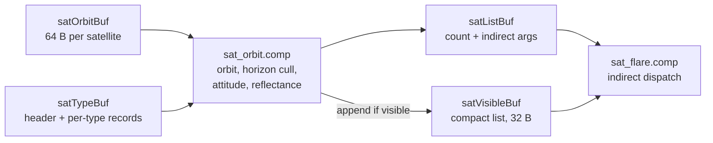

# Orbits and constellations

The orbit model, the five ways a constellation is laid out, formation clusters, sun-synchronous precession,
the shipped roster, and how the GPU evaluates millions of orbits per frame without losing precision. How a
constellation is declared in `constellations.json` is on [Constellations](../modding/constellations.md).
The objects that are not roster satellites (launch trains, retiring satellites, rockets, debris) are on
[Launches](launches.md), [Rockets](rockets.md) and [Kessler syndrome](kessler.md); how they share the
orbit pass is at the end of this page.

## The orbit model

Every satellite flies a **circular two-body orbit** of fixed radius \( a = R + h \), with
\( R = 6371 \) km and \( h \) its altitude. Its state at time \( t \) (seconds since J2000) follows in
closed form from four numbers: the right ascension of the ascending node \( \Omega \), the inclination
\( i \), the argument of latitude at epoch \( u_0 \), and the mean motion

\[
n = \sqrt{\frac{GM}{a^3}}, \qquad GM = 3.986004418 \times 10^{14}\ \text{m}^3\,\text{s}^{-2}.
\]

The argument of latitude advances linearly, \( u(t) = u_0 + n t \), and the position in ECI is

\[
\mathbf{r} = a \begin{pmatrix}
\cos\Omega\cos u - \sin\Omega\sin u\cos i \\
\sin\Omega\cos u + \cos\Omega\sin u\cos i \\
\sin u \sin i
\end{pmatrix}.
\]

The unit along-track velocity is \( \partial\mathbf{r}/\partial u \) divided by \( a \):

\[
\hat{\mathbf{v}} = \begin{pmatrix}
-\sin u\cos\Omega - \cos u\cos i\sin\Omega \\
-\sin u\sin\Omega + \cos u\cos i\cos\Omega \\
\cos u\sin i
\end{pmatrix},
\]

already of unit length for a circular orbit. Nadir is \( -\hat{\mathbf{r}} \). These three vectors are
the inputs to every attitude law (see [Attitude](attitude.md)).

### What is left out

| Effect | Size in LEO | Status |
|---|---|---|
| Eccentricity | operational shells are near-circular (\( e < 0.001 \), under 7 km) | not modelled |
| J2 node regression for non-SSO shells | several deg/day | not modelled; only sun-synchronous orbits precess |
| J2 apsidal and along-track effects | km per day | not modelled |
| Drag, solar radiation pressure, third bodies | decay over months | not modelled for roster satellites; Kessler debris has a drag lifetime ([Kessler syndrome](kessler.md)) |
| Station-keeping, real phasing | n/a | phases are synthetic, except the named GEO belt; formation rings fly passive relative orbits about their centres (below) |

The positions are therefore **statistically** right for a shell (the right altitudes, planes and
density), not a prediction of where a particular real satellite is. For brightness statistics, which is
what the [benchmarks](../accuracy/benchmarks.md) compare, the shell geometry is what matters.

## Constellation layouts

A constellation entry produces its satellites in one of five distributions (`OrbitDistribution` in
`src/simulations/SatelliteSim.h`, built by `buildOrbits()`). Walker, RandomShell and Disk produce
`numPlanes × perPlane`; Shells produces the sum over its table; List produces one satellite per named member.

### Walker

`numPlanes` planes with ascending nodes evenly spaced over 360 deg, all at the constellation's
inclination and altitude, `perPlane` satellites in each. Each satellite's \( u_0 \) is drawn uniformly at
random. This is not a Walker-delta phasing pattern with a fixed inter-plane phase offset: the planes are
regular, the satellites within a plane are not. With formation clusters, the clusters are evenly spaced
around each plane from a random start.

### RandomShell

`numPlanes × perPlane` independent satellites, each with

- \( \Omega \) uniform in \([0, 2\pi)\),
- \( i \) uniform in \([0, i_\text{max}]\) where \( i_\text{max} \) is the constellation's inclination,
- \( u_0 \) uniform,
- altitude \( h \pm \) a uniform jitter of `altJitterM`,
- a random tumble axis (uniform on the sphere), phase, and rate uniform in \([0, 2\pi \times 10^{-3}]\)
  rad/s (a tumble period of at least about 17 minutes).

It is used for debris. Note that a uniform inclination is not a uniform distribution over the sphere's
orbit normals; it concentrates satellites at low latitudes less than a physical isotropic cloud would.

### Disk

Concentric rings in **one** orbital plane: `numRings` rings centred on the constellation altitude and
spaced `ringSpacingM` apart, the satellites shared out between them (ceiling division, so the last ring
may hold fewer), evenly spaced around each ring with an optional altitude jitter. With
`alignTerminator` set, the plane is a dawn-dusk sun-synchronous plane, below.

### Shells

A shell table, as an operator files it: a list of **groups**, each with an altitude range, a number of
shells spread evenly over that range (a single shell sits at its middle), a number of planes per shell and
a number of satellites per plane. Without clusters, each plane's satellites are evenly spaced from a random
starting phase. A group is one of two kinds.

- **Walker group.** The inclination runs linearly from the group's minimum in the lowest shell to its
  maximum in the highest. Each shell's planes have nodes evenly spaced over 360 deg, and shell \( k \) of
  \( K \) is rotated by \( k/K \) of the gap between planes:
  \( \Omega_{k,p} = 2\pi\,(p + k/K)/P \) for plane \( p \) of \( P \). Neighbouring shells therefore never
  share a plane. The nodes are fixed, like a Walker entry's.
- **Sun-synchronous group.** Each shell takes the sun-synchronous inclination for its own altitude, and
  its nodes precess with the Sun (below). The planes start at the **dusk node**, \( \Omega_\text{dusk} \),
  where the ascending node is 90 deg of right ascension east of the Sun, i.e. at 18:00 local solar time
  (LTAN 18:00), and are spread evenly in right ascension from it: \( \Omega_p = \Omega_\text{dusk} + 2\pi p/P \).
  With two planes per shell these are the 18:00 and the 06:00 plane.

**The X-ring.** The 18:00 and 06:00 planes have their nodes 180 deg apart and the same inclination \( i \),
so they intersect along their common line of nodes, which lies on the terminator in the equatorial plane,
and the angle between them is \( 2i - 180 \) deg: 15.3 deg at 565 km (\( i = 97.64 \) deg), 19.0 deg at
1002 km (\( i = 99.48 \) deg). Seen from the Sun, each shell is two near-polar rings along the day-night
line forming a narrow X that crosses over the equator.

#### Node spread

`raanSpreadRad` offsets each sun-synchronous plane's node by up to \( \pm \Delta \) from its terminator
node (Walker groups are not touched). The offset of the entry's \( j \)-th sun-synchronous plane is
\( \Delta\,(2f_j - 1) \) with either \( f_j = \operatorname{frac}(0.5 + 0.618034\,j) \), a golden-ratio
sequence that covers the range evenly ("even"), or \( f_j \) uniform at random ("random").

The spread matters because of clusters. Without it, every shell of a sun-synchronous group shares the same
two planes, and shells only 1.7 to 2.2 km apart in altitude, carrying formation rings a few kilometres across,
overlap radially. Shells at different heights also move at different rates, so their rings slide through each
other along the shared plane. Counted on the Starmind shells flying rings 2 km in radius (a separate rebuild of
the same orbits, neighbour search at 12 instants, without the per-cluster scatter), the number of pairs of
satellites from **different** clusters within 1 km of each other at one instant is:

| Layout | Close pairs |
|---|---|
| Sun-synchronous shells, nodes exactly on the terminator | about 13 000 |
| ± 10 deg, even (the shipped spread) | 26 |
| ± 30 deg, even (the filed tolerance) | 12 |
| ± 30 deg, random | 25 |
| The 30 deg Walker shells (stagger only, for comparison) | 30 |

A spread of a few degrees puts each shell on its own plane; an even sequence clumps less than random draws
at the same width.

### Formation clusters

Walker, Disk and Shells planes can fly their satellites in **clusters** of \( C \) members, the clusters
evenly spaced around the plane (a short last cluster takes the remainder). A cluster is either a **line**,
members a fixed distance apart along the track at the plane's radius, or a **ring**: a passive formation in
which every member flies the cluster centre's circular orbit plus a bounded relative orbit about it.

**Ring formations.** Relative to a circular reference orbit, a nearby free orbit follows the
Clohessy-Wiltshire (Hill) equations. Their bounded, drift-free solutions, written in the centre's radial
(\( x \)), along-track (\( y \)) and cross-track (\( z \)) frame with \( \theta = u_c + \delta \), are

\[
x = \tfrac{\rho}{2}\cos\theta, \qquad y = -\rho\sin\theta, \qquad z = k\,x,
\]

with \( u_c \) the centre's argument of latitude and \( \rho \) = `cluster_radius_km`, the along-track
semi-axis (the radial amplitude is \( \rho/2 \)). Member \( m \) of \( C \) takes the phase
\( \delta_m = \delta_0 + 2\pi m / C \) from a per-cluster start \( \delta_0 \). The physics shows: a member
below the centre moves faster and runs ahead, one above falls behind, and the whole formation turns once per
orbit. The cross-track ratio \( k \) chooses the shape (`cluster_relative_orbit`):

| Shape | \( k \) | The relative orbit |
|---|---|---|
| `circular` (default) | \( \sqrt 3 \) | a circle of radius \( \rho \) tilted 60 deg out of the orbit plane about the along-track axis: every member stays \( \rho \) from the centre, so the spacing never changes |
| `projected_circular` | 2 | a circle seen from above, on the local horizontal |
| `in_plane` | 0 | the 2:1 ellipse in the orbit plane |

The offset is a closed-form function of \( u_c \), so it is exact at any sim time and reversible like the rest
of the orbit. A formation member never tumbles, so `GpuSatOrbit` carries the three coefficients
\( P = \tfrac{\rho}{2}\cos\delta \), \( Q = \tfrac{\rho}{2}\sin\delta \) and \( k \) in its tumble slots, flagged by
`kGpuFormationBit` in `constIdx` (masked off where the index selects the enable and highlight bits), and the
record stays 64 bytes. `sat_orbit.comp` adds `formationOffset()` after the exact `orbitPhase()`;
`satOrbitStateAt()` mirrors it in double, and magnitude traces carry it (`orbit_formation`,
`orbit_formation_pqk`).

**Per-cluster scatter.** A Shells entry can scatter its clusters so the constellation does not draw perfect
lattices: each cluster (or each satellite, without clusters) takes a deterministic offset, uniform within ±
the given amount, in altitude (`cluster_alt_jitter_km`), along-track phase (`cluster_phase_jitter`, a fraction
of the gap between clusters), node (`cluster_raan_jitter_deg`) and inclination (`cluster_incl_jitter_deg`).
The offsets come from an integer hash of the entry and cluster index, not from `rand()`, so the order of other
constellations in the file does not move them. The members of a ring share their cluster's offsets: the
formation stays intact. A Disk's ring formations take one `alt_jitter_km` draw per cluster for the same reason.

### List: named satellites

A List entry is a set of real, named **members**, each with its own type (directly, or through a class
such as "large comsat" that the entry maps to a type) and its own elements. The shipped GEO belt is one:
398 geostationary satellites by name, from `data/geo_satellites.json`, with slots at mid-2020s longitudes
rounded to 0.1 deg (approximate for the 2030s).

A member given by a longitude is **geostationary**. It sits at the radius whose mean motion, rounded to the
float the GPU holds, equals the Earth's rotation rate, with a small inclination (0.02 to 0.08 deg, hashed,
unless the member sets one) and a hashed node. Its phase at J2000 is solved so that at the sim time the
roster is built, \( t_b \), its sub-satellite longitude is its slot:

\[
u_0 = \lambda + \theta(t_b) - \Omega - n_\text{float}\, t_b.
\]

What remains is the drift \( (n_\text{float} - \omega_\oplus)\,t \), under 0.01 deg a year. There is no
station-keeping and no J2 for these records, and nothing else moves them. A member given by altitude,
inclination, node and phase flies that circular orbit.

### Randomness

Each constellation draws its random numbers (phases, shell elements, jitters) from its own stream,
`SatRng`, an emulation of the Microsoft C runtime's `rand()` linear congruential generator. The stream's
starting state is recorded on the first build, and a constellation added later seeds from a hash of its
name; the per-cluster scatter is a hash keyed by load order, and terminator planes are anchored to the Sun
at the sim's start. So the layout is identical on every platform, and a constellation keeps exactly the
same satellites when others are removed or re-added: only satellite indices move.

### Rebuilding the roster at run time

`rebuildRoster()` rebuilds every satellite and the per-satellite GPU buffers while the app runs. The harness
drives it (`roster list`, `roster remove "<name>"`, `roster add "<name>"`); a removal lasts for the session
only. A rebuild drops the selection, follow mode, Track and the model viewer, and restarts the
[Kessler scenario](kessler.md), whose history refers to satellites by index.

## Sun-synchronous orbits and terminator alignment

The Earth's oblateness makes an orbit's node regress at

\[
\dot\Omega = -\tfrac{3}{2}\, n\, J_2 \left(\frac{R}{a}\right)^2 \cos i,
\qquad J_2 = 1.08263 \times 10^{-3}.
\]

A **sun-synchronous** orbit chooses \( i \) so that \( \dot\Omega \) equals the Sun's mean motion,
\( \dot\Omega_\odot = 2\pi / (365.25 \times 86400\ \text{s}) \), keeping the plane fixed relative to
the Sun:

\[
\cos i = -\frac{\dot\Omega_\odot}{\tfrac{3}{2}\, n\, J_2\, (R/a)^2}.
\]

`computeSSOInclination()` solves this for **each ring's own altitude**, so a disk spanning hundreds of
kilometres is not biased by its centre altitude:

| Altitude | SSO inclination | Period |
|---|---|---|
| 500 km | 97.39 deg | 94.5 min |
| 575 km | 97.68 deg | 96.0 min |
| 1250 km | 100.65 deg | 110.4 min |
| 1925 km | 104.41 deg | 125.3 min |

The formula uses the mean radius 6371 km for \( R \) rather than the equatorial radius 6378 km that
defines \( J_2 \), which raises the computed inclination by about 0.02 deg at 500 km.

A sun-synchronous Shells group likewise takes the inclination for each shell's own altitude.

For an `alignTerminator` disk, and for the dusk node of a sun-synchronous Shells group, the node is
anchored at the sim's start instant to put the plane along the terminator:

\[
\Omega_0 = \operatorname{atan2}(s_x,\ -s_y),
\]

with \( \hat{s} \) the Sun's ECI direction at that instant. The ascending node is then 90 deg of right
ascension from the Sun: a dawn-dusk orbit whose plane faces the Sun. Afterwards the node advances
linearly, \( \Omega(t) = \Omega_0 + \dot\Omega_\odot\,(t - t_\text{start}) \). Anchoring at the start
instant, rather than extrapolating from J2000 at a constant rate, keeps the plane on the terminator
despite the Sun's non-uniform motion in right ascension (the equation of time, up to about 4 deg).

Non-SSO shells keep a fixed node. In reality a 53 deg shell at 550 km regresses about 4.5 deg per day; the
simulated shell's planes stay put in inertial space while the Earth turns under them, which is
indistinguishable for brightness statistics but not for following one real plane over days.

## The GPU orbit pipeline

All per-satellite work runs in `shaders/sat_orbit.comp`, one invocation per satellite, every frame. The
CPU only uploads the orbit table, a per-type table and a few push constants.

### The orbit record

`GpuSatOrbit` is 64 bytes of plain floats and integers (no `vec3`, so the C++ and std430 layouts agree
without padding). Only genuinely per-satellite data lives here; anything constant per type is in
`GpuSatType`.

| Offset | Fields |
|---|---|
| 0 | `raan`, `u0` (baked to the rebake epoch), `R_sat`, `meanMot` |
| 16 | `cosI`, `sinI`, `cosRaan`, `sinRaan` |
| 32 | `tumbleRate`, `tumblePhase`, `tumbleAxisX`, `tumbleAxisY` |
| 48 | `tumbleAxisZ`, `alignTerminator`, `typeIdx`, `constIdx` |

`constIdx` packs the satellite's constellation index into its low byte. The shader reads that entry's
Show and Highlight bits from two 256-bit arrays in the type buffer's header (`constEnabled`,
`constHighlight`), so up to 256 constellations can be toggled individually. Bits 8 to 15 hold a formation
member's cluster size and bits 16 to 23 its slot in the cluster. The top bit flags a formation-ring member,
whose tumble slots then hold the relative orbit's \( P, Q, k \) ([Formation clusters](#formation-clusters)).

### Horizon cull and the compact list

A satellite is appended to the visible list only if the observer can see it. With
\( \mathbf{d} = \mathbf{r}_\text{sat} - \mathbf{r}_\text{obs} \) and \( \hat{u} \) the observer's up,
the line of sight is blocked when \( \sin(\text{el}) = \mathbf{d}\cdot\hat{u}/|\mathbf{d}| \) is below
the Earth-limb value \( -\sqrt{1 - (R/r_\text{obs})^2} \) (never above \(-0.01\)), **unless** the
satellite lies between the observer and the Earth (the closest approach of the line to the Earth's
centre is beyond the satellite). The test is done in squared form with no square root.

Survivors are appended by workgroup: each group of 64 counts its survivors in shared memory and makes
one global `atomicAdd`. The same pass keeps the indirect dispatch and draw arguments in `satListBuf`, so
`sat_flare.comp` and the point draws scale with the number of **visible** satellites (typically 5 to 10%
of the roster), not the roster.

!!! warning "Invariant"
    Slot order in the compact list is nondeterministic (atomic append). Every consumer that blends
    satellites is order-independent (additive), and per-satellite identity always goes through
    `satVisibleIdxBuf` (slot to satellite index), never through the slot number.

## The orbital phase in two-float arithmetic

The phase \( u = u_0 + n\,\Delta t \) is the one large product in the pipeline. With a 7-day
\( \Delta t \) and LEO mean motion, \( n\,\Delta t \approx 700 \) rad. A plain float32 product keeps
about 24 bits of it: an error of up to \( 4 \times 10^{-5} \) rad, which is 60 m median and 770 m
worst case along-track (measured below). That is invisible for a point of light seen from the ground but
not for a mesh placed next to its own sprite, or a camera riding alongside.

`orbitPhase()` computes the product exactly in float arithmetic:

1. \( \Delta t \) arrives as two floats, \( \Delta t_\text{hi} \) (the push constant `deltaT`) and
   \( \Delta t_\text{lo} \) (`GpuSatTypeHeader::deltaTLo`), split from the CPU's double.
2. \( n\,\Delta t_\text{hi} = p + e \) exactly, by Dekker's two-product over a Veltkamp split (both
   factors split into 12-bit halves with the constant 4097).
3. \( 2\pi \) is subtracted as \( A + B \), where \( A = 6.28271484375 \) has only 14 significant bits,
   so \( kA \) is exact for \( k < 1024 \) and \( p - kA \) is exact (Sterbenz).
4. \( u = (p - kA - kB) + (e + n\,\Delta t_\text{lo} + u_0) \), reduced modulo \( 2\pi \).

!!! warning "Invariant"
    Every intermediate in `orbitPhase()` is declared `precise` (SPIR-V `NoContraction`). A compiler that
    fuses a multiply-add or reassociates the sums loses the whole construction. It does not use
    `fma()`, which Vulkan does not guarantee to be fused.

### Position error budget

Measured by emulating the shader's float32 arithmetic over 200 000 satellites (altitudes 300 to
2000 km, \( \Delta t \) uniform in 0 to 7 days), as along-track position error against the double
result:

| Phase computation | Median | p99 | Max |
|---|---|---|---|
| plain float32 \( u_0 + n\,\Delta t \) | 61 m | 439 m | 773 m |
| `orbitPhase()` two-float | 1.1 m | 6.2 m | 9.2 m |

The remaining error is the float32 rounding of the final angle (\( 2\pi \times 2^{-24} \) is about
\( 4 \times 10^{-7} \) rad, 2.6 m at 7000 km) plus the rounding of the stored `u0` and `meanMot`. On top
of it come the float rounding of the position itself (about 0.5 m) and the GPU's `sin`/`cos`, whose
accuracy Vulkan leaves to the implementation. The CPU evaluator uses the same stored float elements
promoted to double, so its positions differ from the GPU's only by these rounding terms, not by a
different orbit.

Other small terms: the SSO node uses the plain float `deltaT` (its rate is \( 2 \times 10^{-7} \)
rad/s, so the error is negligible), and the tumble angle the same.

## The weekly rebake

The GPU's \( \Delta t \) is measured from an **orbit epoch** \( t_e \), not from J2000. Each record holds
its phases baked to that epoch:

\[
u_0' = (u_0 + n\,t_e) \bmod 2\pi, \qquad
\Omega_0' = \Omega_0 + \dot\Omega_\odot\,(t_e - t_\text{start}) \bmod 2\pi \ \ \text{(SSO only)},
\]

and the tumble phase likewise. The shader adds \( n\,\Delta t \) with \( \Delta t = t - t_e \).
`recordCompute()` moves the epoch whenever \( |\text{day}(t) - \text{day}(t_e)| \geq 7 \), in either
direction of time, so \( |\Delta t| \) stays under 7 days (\( \Delta t_\text{hi} \) has a float ULP of
0.06 s there, and the low half carries the rest). The epoch is always a whole second.

**The rebake runs on the GPU** (`shaders/sat_rebake.comp`, one thread per satellite, no upload). It
rewrites each satellite's \( u_0 \), tumble phase and SSO node from **epoch-free bases** kept on the GPU
(`satPhaseBaseBuf`, 12 bytes per satellite), exactly:

\[
\text{phase}(T) = \operatorname{frac}\!\left(\frac{x + r\,T}{2\pi}\right)
\]

for a float phase \( x \), a float rate \( r \) and the integer epoch \( T \) in seconds. Each float is
converted from its own bits to a 64-bit fixed-point number of **turns** (its 24-bit mantissa times
\( \lfloor 2^{64}/2\pi \rfloor \), shifted by its exponent), and \( r\,T \) is taken modulo one turn as a
64 × 64 to low-64-bit integer product. Only the fractional turns survive, so no magnitude is lost: the
result is the double-precision \( (x + rT) \bmod 2\pi \) to the rounding of the output float, at any date.
The SSO node precesses at one rate for every satellite, so its offset since the anchor comes from the CPU.
The same dispatch re-bakes the Kessler debris pool's records (their mean anomaly, argument of perigee,
node and tumble are all linear in time).

At 1 yr/s the epoch moves every other frame. A CPU loop in double plus a full upload of 1.38 million records
takes about 27 ms, which is why the rebake is a GPU dispatch. The Performance tab and
the harness's `perf` report the CPU side as `orbit_rebake`. `uploadSatOrbits()` still writes the full table
when the roster is built or rebuilt, streaming it through a 64 MB staging buffer.

## Rosters

The shipped roster `data/constellations.json` has 30 entries, all enabled, about 1.38 million satellites:

| Group | Satellites | Notes |
|---|---|---|
| Starlink Gen1, Gen2, Gen3 Broadband, Gen3 Direct-to-Cell | 54 872 | Walker, 326 to 550 km |
| OneWeb, Amazon Leo (3 shells), Guowang (3 shells) | 16 722 | Walker, 572 to 1200 km |
| Qianfan (Spacesail) | 11 664 | Shells: phase 1 as flown (72 planes of 18 at about 1070 km, 89 deg) and two estimated later shells |
| ISS, Tiangong, seven commercial stations, Starship depots | 12 | small Walker shells |
| SpaceX Starmind, sun-synchronous X-ring | 499 072 | Shells, 54 shells at 565 to 1002 km, rings of 8 |
| SpaceX Starmind, 30 deg shells | 489 600 | Shells, 60 shells at 550 to 978 km, rings of 8 |
| Reflect Orbital | 5 000 | Disk, 3 rings about 500 km, terminator-aligned |
| Space junk | 300 000 | RandomShell, 1000 ± 500 km, inclination 0 to 180 deg |
| GEO belt | 398 | List, real geostationary satellites by name and slot |
| Hubble, 2020 Starlink benchmark shells | 3 169 | Walker |

Each entry has a `category` (Broadband, Stations, Orbital data centers, Reflectors, Debris, GEO, Science,
Benchmarks) that groups it in the Constellations settings tab. Not every satellite exists at every date:
with the deployment era on, a slot is filled only once its first launch arrives, and the 2020 benchmark
shells retire; see [Launches](launches.md).

### The Starmind roster

SpaceX's Starmind orbital data centres follow Table 1 of SpaceX's letter to the US Federal Communications
Commission (FCC) in application SAT-LOA-20260108-00016, filed 29 May 2026. <!-- history-ok -->

| Entry | Group | Altitudes | Shells | Inclination | Planes per shell | Per plane |
|---|---|---|---|---|---|---|
| X-ring | 1 | 565 to 585 km | 10 | sun-synchronous | 2 | 4168 |
| X-ring | 2 | 707 to 744 km | 22 | sun-synchronous | 2 | 4640 |
| X-ring | 3 | 967 to 1002 km | 22 | sun-synchronous | 2 | 4808 |
| 30 deg | 1 | 550 to 568 km | 10 | 26 to 32 deg | 30 | 272 |
| 30 deg | 2 | 686 to 718 km | 25 | 30 deg | 30 | 272 |
| 30 deg | 3 | 946 to 978 km | 25 | 30 deg | 30 | 272 |

The filed rows are per-group **maxima**: they sum to 1 198 120 satellites, against a requested total of
1 000 000. The roster scales each row's satellites per plane by \( 10^6 / 1\,198\,120 \approx 0.8346 \) and
rounds down to whole clusters of 8, which flies 988 672 satellites. Each cluster is a `circular` ring formation
of 8 with \( \rho \) = 0.35 km (700 m across, neighbours 268 m apart; the formations are reported to be under
750 m), scattered by 0.25 km in altitude, 0.25 of the gap in phase, 0.15 deg in node and 0.03 deg in
inclination. The X-ring's planes spread their nodes over ± 10 deg of the terminator ("even"), inside the
± 30 deg node tolerance in the filing; each plane keeps its offset from the terminator node. The
sun-synchronous and the 30 deg groups are two entries, each a whole filed table, so the constellation
list shows one row per table rather than one per shell.

!!! note "Modelling choice"
    The ring of 8 follows SpaceX's published visualization; the filing's text speaks of clusters of about
    ten satellites. The relative orbit and the scatter are this model's choices, not filed values.

The hard cap is `MAX_SATELLITES` = 10 000 000; GPU buffers are sized to the loaded roster, about
100 bytes per satellite. Larger stress rosters live in `data/custom/`.

## Records beyond the roster

The orbit pass also evaluates objects that are not roster satellites. They share one index space:

| Indices | What | Record |
|---|---|---|
| \([0, N)\) | the roster's \( N \) satellites | `GpuSatOrbit` in `satOrbitBuf` (circular, above) |
| \([N, N + 131072)\) | launch records: trains climbing to their slots and retiring satellites coming down (`kLaunchCap`) | Keplerian, in `kesslerBuf` from `kLaunchWord0` |
| \([N + 131072, \dots)\) | the Kessler debris pool: dead satellites' pieces and fragments (`poolIdx0()`) | Keplerian, in `kesslerBuf` from `poolWord0` |

The last two slots of the launch block are reserved: one for the selected transient object (a rocket or a
fireball) and one for the object Go to follows; see [Rockets](rockets.md).

A Keplerian record is 16 words: mean anomaly, argument of perigee and node at the orbit epoch with their
rates, the semi-major axis, eccentricity, the inclination's cosine and sine, a tumble rate and phase, a flux
scale, its born and death seconds, and its type and flags. `sat_orbit.comp` forms the mean anomaly with the
same two-float `orbitPhase()` as a roster satellite, solves Kepler's equation in five Newton steps, and
skips the record outside its born-to-death interval (seconds counted from the
[Kessler scenario](kessler.md)'s epoch, so a record that was never filled is invisible). The argument of
perigee and the node advance linearly, so a debris piece can precess under J2 while the roster cannot.

A roster satellite also has words in `kesslerBuf`: the second it died (from then on it tumbles) and the
second it was destroyed or re-entered (from then on it is skipped), plus, with the deployment era, the
seconds its slot is first filled and retired. Before any of these is set the words read "never", so the
plain sky is unchanged.

!!! warning "Invariant"
    Never assume the satellite array is the roster plus the debris pool. Per-constellation loops run over
    the roster's \( N \) only; launch-block entries that hold nothing have a constellation index of
    `UINT32_MAX`. `LAUNCH_CAP` in `sat_orbit.comp` must equal `SatelliteSim::kLaunchCap`.

How launch records are written (rewritten every 20 s of sim time as the osculating orbit of the member's
path) is on [Launches](launches.md).

## Settings

The constellation list, each constellation's enabled flag and highlight flag are persisted under
`constellations` (by name). Orbits themselves are defined only in `constellations.json`; see
[Constellations](../modding/constellations.md).

## Where in the code

| File | Function / symbol |
|---|---|
| `src/simulations/SatelliteSim.cpp` | `loadDefinitions()` (the `Shells` groups, cluster fields, List members), `buildOrbits()` (distributions, `clusterPhase`, `setFormation`, the per-cluster scatter, node spread, geostationary members), `rebuildRoster()`, `computeSSOInclination()`, `uploadSatOrbits()`, `recordSatRebake()`, the rebake check and `deltaT` split in `recordCompute()` |
| `src/simulations/SatelliteSim.h` | `GpuSatOrbit`, `GpuSatTypeHeader`, `GpuSatListHeader`, `kOrbitRebakeDays`, `SatRng`, `ConstMember`, `kLaunchCap`, `poolIdx0()` |
| `src/simulations/SatPhotometry.cpp` | `satOrbitStateAt()` (CPU double mirror, formation offset included) |
| `shaders/sat_orbit.comp` | `orbitPhase()`, `formationOffset()`, `satEciAt()`, `processSatellite()` (roster, launch and pool records), `main()` (workgroup append) |
| `shaders/sat_rebake.comp` | the exact fixed-point epoch rebake |
| `data/geo_satellites.json`, `tools/make_geo_belt.py` | the GEO belt's members |
