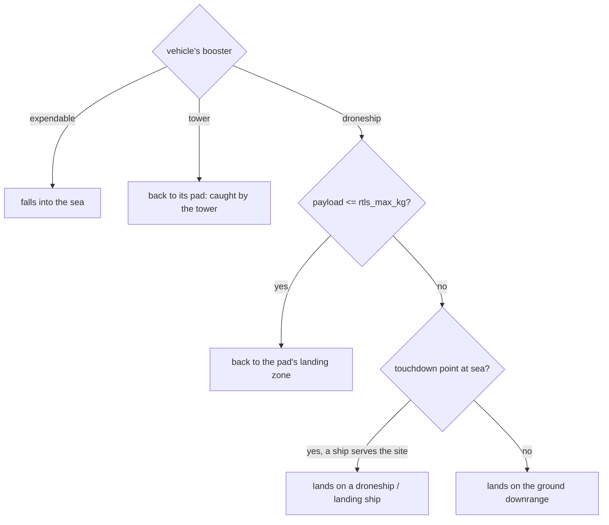
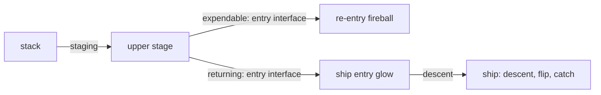

# Rockets: flight, recovery and mission timelines

This page describes how a rocket flies once a launch exists: the booster's and upper stage's trajectories, their
attitude, the upper stage's deorbit, Starship's ship coming home to a tower, how each booster is recovered (back to
the pad, onto a droneship, onto the ground, or not at all), the ships that carry boosters home, the mission
milestones you can skip between, how rockets and re-entries are selected and followed, and the sound of a launch.

It does not cover *when and where* launches happen, the satellite trains they deploy, or payload stacks and fairings:
those are on [Launches](launches.md). Crewed and cargo spacecraft after separation are on
[Crew flights](crew-flights.md). How the flames, plumes, pads and ships look is on
[Launch visuals](../rendering/launch-visuals.md), and the Missions window and the Info window's MISSION section are on
[Missions](../using/missions.md).

## The model in one paragraph

Every quantity on this page is a **pure function of sim time** and the launch's batch (its plane, refresh and batch
numbers, from which a hash seeds every random choice). Nothing is integrated frame to frame, so time warp, reverse
playback, bookmarks and a jump to any date show the same rocket in the same place. The expensive parts (the booster's
2D track, the deorbit ellipse, the ship's landing plan) are computed once when a batch is built and cached; each frame
then evaluates closed forms or interpolates sampled tables.

Positions use two frames (see [Time and frames](time-and-frames.md)). Anything still in the air near the pad flies an
**Earth-fixed ground track**: a great circle from the pad along the launch azimuth, with downrange distance \(x\) and
altitude \(h\). Anything in orbit flies an **inertial plane** fixed at lift-off: the plane of the target orbit, with
basis vectors \(\hat U_0\) (toward the pad at lift-off) and \(\hat A_0\) (90 degrees ahead in the plane).

## The booster

The booster's whole flight is a 2D track \((x, h)\) with velocity \((v_x, v_z)\), ground-relative, sampled every
0.5 s from lift-off (`launch::boosterTrack()`). The vehicle's catalog entry (`data/launches.json`) supplies MECO's
time \(t_1\), altitude \(h_1\) and downrange distance \(x_1\).

### Ascent to MECO

Up to MECO the track is closed form. With \(s = t / t_1\):

\[
h(t) = h_1 s^2, \qquad x(t) = x_1 s^3
\]

The rocket leaves the pad vertically and pitches over progressively; at MECO its velocity is
\((3 x_1 / t_1,\; 2 h_1 / t_1)\). This is not a gravity-turn integration. It is a smooth curve through the published
MECO point that gives plausible pitch and speed along the way.

**Max-Q** is read off this track: the sample before MECO with the largest dynamic pressure
\(q = \tfrac12 \rho(h)\, |v|^2\), using the simulation's piecewise-exponential atmosphere (`launch::airDensity()`:
scale heights 7.6, 6.4, 7.4 and 25 km over the bands 0-25, 25-75, 75-150 and above 150 km).

Before staging the stack is one object. Near the pad the track stands on the pad's graded plateau plus the launch
mount's height (`mount_m`, Starship 20 m); that offset fades out between 5 and 40 km downrange, so a booster landing at
sea touches down at sea level.

### After MECO: integrated descent

After MECO the track is integrated with a 0.05-s step under gravity, drag and the booster's burns:

\[
\mathbf a = -g\,\hat z \;-\; \frac{\rho(h)}{2\beta}\,|\mathbf v|\,\mathbf v \;+\; \mathbf a_{\text{burn}} \;+\; \mathbf a_{\text{lift}},
\qquad \beta = 2200\ \text{kg/m}^2
\]

The ballistic coefficient \(\beta = m / (C_d A)\) corresponds to an emptied Falcon 9 core falling engines first: a
terminal speed of about 190 m/s at sea level.

The burns, in order:

| Burn | When | Acceleration |
|---|---|---|
| Boostback (return to the pad) or downrange trim | from MECO + 12 s until the horizontal speed reaches its target | 30 m/s² horizontal |
| Entry burn | descending below 60 km (higher for fast arrivals, below) | 28 m/s² against the velocity |
| Landing burn | below 8 km, once a constant deceleration of 25 m/s² would be needed | constant, solved (below) |

The **boostback** target speed is found by a secant search on the whole flight: the speed that makes the booster land
at \(x = 0\) (its pad, tower or landing zone). A booster bound for a ship 600 km downrange whose ballistic arc would
overshoot flies a short retrograde **trim** instead, secant-solved the same way so it comes down at `droneship_km`.
After the search the small remaining miss is removed smoothly over the post-MECO samples, so the track ends exactly on
its target.

The **entry burn** lasts 22 s, or up to 40 s while the booster is still faster than 900 m/s. A booster arriving faster
than about 2.4 km/s (New Glenn's 1000-km shot reaches ~3.3 km/s) starts it higher, up to 100 km, and keeps burning
(up to 150 s) until its speed is one whose peak deceleration in the denser air below stays near 1.5 g. That speed comes
from the Allen-Eggers ballistic entry result, peak deceleration \(a_{\text{peak}} = v^2 \sin\gamma / (2 e H)\) with
\(H = 7.6\) km:

\[
v_{\text{safe}} = \sqrt{\frac{2 e H \cdot 15\ \text{m/s}^2}{\sin\gamma}}
\]

**Aerodynamic glide.** Between the entry burn and the landing burn the grid fins and the body at an angle of attack
give lift. The simulation lets lift steer the horizontal speed toward the speed that reaches the landing point in the
time left, \(v_{x,\text{des}} = (x_{\text{target}} - x)/(t_{\text{go}} + 8\ \text{s})\), with a 3-s time constant and the
lift capped at 0.6 times the drag. A booster therefore arrives over its target nearly vertical, as real ones do. The
harness's `launch check` reports the lean from the vertical by altitude: at 1 km, at most about 3.7 degrees for a ship
landing, 1.6 for a landing zone and 0.2 for a tower; at touchdown under 1 degree.

### The landing burn

The landing burn is a **constant deceleration that zeroes both velocity components together** at the touchdown
height \(h_C\). It starts below 8 km when

\[
\max\!\left(v_z^2,\; |v_x v_z|\right) \ge 2 a_L (h - h_C), \qquad a_L = 25\ \text{m/s}^2
\]

and from there the track is analytic. With \(\mathbf v_0\), \(h_0\) at ignition and the end velocity
\(\mathbf v_E = (0, -1.5)\) m/s (a real landing burn ends at a metre or two per second straight down):

\[
T = \frac{2 (h_0 - h_C)}{-v_{z0} + 1.5}, \qquad
\mathbf a_B = \frac{\mathbf v_E - \mathbf v_0}{T}, \qquad
\mathbf p(s) = \mathbf p_0 + \mathbf v_0 s + \tfrac12 \mathbf a_B s^2
\]

A faster arrival triggers the burn earlier and burns harder, about 40-50 m/s² for 20-25 s from a few kilometres up.

The touchdown height \(h_C\) is the surface the booster comes to rest on plus its landing legs' length (`leg_m`, Falcon
9 1.68 m, New Glenn 2.36 m), because the track describes the booster's aft end while the legs' feet touch the deck,
pad or ground. A tower catch stops `catch_m` (Starship 10 m) above the mount. Boosters with legs fly them folded and
swing them down over 2.5 s starting 7 s before touchdown (`transientLegs()`).

!!! warning "Invariant"
    `boosterTrack()` records its post-MECO samples from \(t_1 + \Delta t\) on; the MECO sample itself is pushed
    separately. Without it every later sample sits one index early and the stack jumps by twice its speed for one
    sample at separation. Keep `Track::at()` index-aligned with \(t = i \cdot dt\).

### An expendable booster

A booster with `booster: expendable` falls away under gravity and drag after MECO and is drawn until it descends
through 30 km.

## Booster recovery

Each launch decides its booster's fate once, in `planRecovery()`, from its vehicle and payload mass.

The **payload mass** is the program's `payload_mass_kg`, or its `sat_mass_kg` times the satellites per launch, times a
hashed factor between 0.9 and 1.1 per launch. A vehicle with `rtls_max_kg` > 0 flies back to its pad (return to launch
site, RTLS) when the payload is at most that. With Falcon 9's 7000 kg: OneWeb (36 x 148 kg) and Reflect Orbital
(40 x 170 kg) return to the landing zone; Starlink Gen1 (31 x 300 kg), Amazon Leo and Crew Dragon (12.5 t) land at
sea. A returning Falcon booster has its own track (`L.boosterRtls`) with a boostback. Its touchdown point is the pad's
centre, and over its last 150 s (by time, the last 15 s purely vertical) it slides 2.3 km aside to the landing zone and
the zone's ground height.

A downrange touchdown is **at sea** when the point is more than 3 km offshore (the water map's shore distance). The
launch then picks one of the vehicle's `landing_ships` that serves its site, by hash. Otherwise the booster lands on the
ground there, at the elevation map's height: inland Jiuquan's reusable boosters come down on land. (A downrange
touchdown at sea from a site no ship serves is treated the same way, at sea level.)

| Landing kind (`landKind`) | Where the booster comes to rest | Held there |
|---|---|---|
| Tower | caught `catch_m` above its pad's mount | 30 min |
| Landing zone | its feet on the zone's concrete beside the pad | 30 min |
| Ship | its feet on the ship's deck, riding home | until the ship stops being drawn |
| Ground | its feet on the ground downrange | 30 min |
| None | expendable | |

`boosterLandingAt()` gives the kind, the touchdown time and the point (Earth-fixed, moving with a ship's deck) for the
landing effects on [Launch visuals](../rendering/launch-visuals.md).

### Droneships and landing ships

The catalog lists the ships per vehicle: *A Shortfall of Gravitas* and *Just Read the Instructions* off Florida, *Of
Course I Still Love You* off Vandenberg, Blue Origin's *Jacklyn* for New Glenn, and recovery barges for the Chinese
reusable boosters flying from Hainan. Each has a render model (`data/satellite_models/ship_*.json`, written by
`tools/make_ship_models.py`) and a deck height `deck_m` that must equal the model's deck.

- **On station** from 8 h before lift-off at the touchdown point, bow toward the launch site.
- **Riding the swell**: heave, pitch and roll, each a sum of three sinusoids with periods near 7, 9.5 and 12.5 s
  (hashed per ship), amplitudes 0.3 m, 0.35 and 0.7 degrees times the sea state there; Jacklyn, a much larger ship,
  moves at 0.6 times that. Over the last 6 s of the landing burn the booster takes up the deck's motion, so it touches
  down on the moving deck.
- **Securing**: the booster stands on the deck for 1.5 h.
- **Steaming home** along the great circle toward the launch site at 4 m/s (about 8 knots), eased in over 10 minutes,
  with the booster aboard. The ship and its booster are drawn until 12 h after the landing, some 150 km on.

## The upper stage

### Ascent to the parking orbit

The upper stage shares the closed-form ascent up to MECO, then follows its own track to SECO at \(t_2\)
(`launch::upperTrack()`): altitude a cubic Hermite from \((h_1, v_{z1})\) to \((h_{\text{park}}, 0)\), and the
horizontal speed eased by a smoothstep from the MECO value to the parking orbit's **ground** rate,

\[
\dot x = v_{x1} + \left(\sqrt{\frac{GM}{R + h_{\text{park}}}}\,\frac{R}{R + h} - v_{x1}\right)\operatorname{smoothstep}(s)
\]

because \(x\) is an arc along the ground and the stage's speed at altitude \(h\) covers ground at \(R/(R+h)\) of it.

Between MECO and SECO the stage's position blends from the Earth-fixed ground track into the inertial plane, with a
smoothstep weight running from 0 at staging to 1 at SECO. The upper track is integrated on its own and stands about a
kilometre from the booster's at separation, so that difference is added at staging and faded out with the same weight:
the upper stage leaves exactly where the stack was.

After SECO the stage is on a circular **parking orbit** of radius \(r_{\text{park}} = R + h_{\text{park}}\), at the
program's `park_km`:

\[
\mathbf P(t) = r_{\text{park}} \left(\cos\theta\,\hat U_0 + \sin\theta\,\hat A_0\right), \qquad
\theta = \theta_{\text{ins}} + n_{\text{park}}\,(\tau - t_2)
\]

with \(\theta_{\text{ins}}\) the track's downrange angle at SECO and \(n_{\text{park}}\) Kepler's mean motion. The
payload is deployed `deploy_after_seco_s` later (see [Launches](launches.md#leaving-the-stage)).

**Starship's payload door** is a steel panel (`payload_door` in its upper-stage model) over a black slot on the
leeward side, 31.1 m up the ship. It stays closed except around deployment: it slides up open over 20 s starting
90 s before the first satellite's release, and closes over 20 s starting 60 s after the last (`transientLegs()`
drives it as the part's unfolding progress). The slot has its own dark material, not the engine bells' `soot`,
which glows white-hot while the engines burn.

### Deorbit

Every upper stage deorbits after it has deployed. An expendable stage burns up; a returning one (Starship's ship) enters
and flies home.

1. **Timing.** The burn starts 30-90 minutes after deployment begins (hashed), and never before the last satellite has
   left the dispenser plus 15 minutes. For a returning ship it is moved to the moment that brings it down near a catch
   tower (below).
2. **The target ellipse** has its apoapsis at the burn and its perigee at 20 km (45 km for a returning ship, which
   enters shallower). The burn's \(\Delta v\) is the difference between the circular speed and the ellipse's speed at
   apoapsis.
3. **The burn** runs one engine throttled to about 12% of the stage's full thrust,
   \(a = 0.12\,\dot m_2 v_{e2} / m_{\text{stage}}\), for \(D = \operatorname{clamp}(\Delta v / a, 12, 240)\) s.
   Its thrust is flat with 1-s start-up and shut-down ramps. The ellipse is the impulsive equivalent of this finite
   burn, centred on the burn's middle, and the stage's offset from its parking circle grows as the double integral of
   the thrust profile, normalised to reach the ellipse exactly at the burn's end (`deorbitBurnShape()`). Position and
   velocity are continuous through the burn and its acceleration is the burn's own, \(\Delta v / D\).
4. **Coast** on the ellipse (Kepler's equation, `deorbitPos()`) to the **entry interface** at 100 km, about half an
   orbit (~32 minutes) later.

An expendable stage ends there as a re-entry fireball lasting 200 s, drawn by the re-entry model on
[The Kessler syndrome](kessler.md): 3 to 80 fragments by mass, the main body's magnitude at 100 km
\(-4 - 2.5\log_{10}(m/100\ \text{kg})\).

### Venting

A share of upper stages (`vent_chance`, 0.15-0.5 by vehicle) vents its residual propellant (`ventStart()`):

- **An expendable stage** dumps it while spinning: about 10 t over two minutes as a 700 m/s jet whose direction
  turns about the velocity, starting 50 s after the deorbit burn begins. Seen from below in sunlight against a dark
  sky this draws the kind of spiral that has been seen over Norway and New Zealand.
- **A returning ship** (Starship) makes a controlled dump out of its aft end along its own axis: about 10 t over
  three minutes at 350 m/s, starting 20 minutes before its deorbit burn and never earlier than 3 h after
  deployment, by which time its train has drifted kilometres away.

## Attitude

A stage's body axis (`stageNose()`) is its nose direction in ECI, handed to the mesh renderer as the attitude's
"velocity" axis.

**The booster** is described by a pitch angle \(\psi\) in its trajectory's vertical plane, measured from downrange
toward up on the branch [-90, 270) degrees so that nothing it flies wraps (`boosterPitchRaw()`):

- before MECO + 1 s: along its velocity;
- in a burn (boostback, entry, landing): along its thrust, the track's acceleration less gravity;
- otherwise after staging: engines first, along \(-\mathbf v\);
- landed: upright.

The raw angle is averaged over the last 10 s. Every change (the flip after MECO, the flip back after an RTLS
boostback) passes through the vertical, and the averaged angle turns at no more than about 18 deg/s.

!!! warning "Invariant"
    Average the booster's pitch **angle**, never its nose vectors. After an RTLS boostback the engines-first and
    along-thrust directions point opposite ways, and the mean of opposite vectors turns through a near-zero vector:
    the booster spins at hundreds of degrees per second.

**The upper stage** (`upperNoseRaw()`) points along its Earth-fixed velocity to orbit (in ECI the pad's rotation would
tilt a rising rocket), then along its inertial velocity. From 150 s to 20 s before the deorbit burn it pitches through
the local vertical to retrograde, and holds retrograde through the burn. A returning ship then pitches up to its entry
attitude, nose 60 degrees above the velocity, between 1 and 6 minutes after the burn ends. The upper stage's nose vectors are
averaged over 6 s (they never oppose each other, so a vector average is safe here), turning at most about 2 deg/s.

The upper stage's full body frame (`upperFrame()`) puts +Z on the nose and -Y as close to nadir as it can be: the rocket
models' attitude law, so a stack or the ship's heat shield sits the right way round.

## Starship's ship comes home

A vehicle with `upper_stage_deorbit: false` (Starship) does not burn up. Its ship enters, falls belly first and is
caught by a tower.

### Entry

The entry glow lasts 480 s from the entry interface (`shipEntry()`): along the deorbit ellipse's plane, the speed falls
from the ellipse's speed at 100 km to 1.2 km/s, and the altitude from 100 km to about 65 km over the first 45% of the
time, then to 45 km. The descent starts at the ellipse's own descent rate. The difference between the ellipse's
position and this model at the entry interface is eased out over the first minute, so position is continuous across the
hand-over.

### Choosing a tower: the timed deorbit burn

`planShipLanding()` moves the deorbit burn so the entry ends near a Starship pad. Only the phase of the burn changes the
entry's end point, so for each candidate burn time the end point is a closed form. The search:

- steps the burn time over 72 h after its nominal time in 30-s steps (skipping stretches where no Starship pad can be
  within reach, exactly, from the ground track's maximum rate);
- scores each pad with a catch tower **at that date** that lies 120-450 km short of the entry's end along its ground
  track and within 200 km across it: score \(|x_\perp| + 0.3\,|x_\parallel - 260\ \text{km}|\);
- at the first time any pad scores, refines over the next 10 minutes in 2-s steps and takes the best.

If no pad is reachable in 72 h the ship keeps its nominal burn and splashes down 250 km past the entry's end. With the
default catalog every ship finds a tower.

### Descent, flip and catch

After the entry the ship flies in the landing pad's local gnomonic plane plus altitude, as cubic Hermite curves per axis
(`shipDescentEcef()`):

1. **Belly-flop descent** from the entry's end (about 45 km) to a point 1.1 km above the catch point and 400 m back
   along the approach, arriving at about 75 m/s down. Its duration is twice the distance over the start speed, clamped
   to 150-1000 s, so the start tangent never exceeds three times the chord (no loop back). The nose turns from the
   entry attitude to level along the path over the ground in the first 90 s.
2. **Flip and landing burn** to the catch point at rest, over 15-60 s. The ship turns upright from 2 s before the burn
   to 5 s into it.
3. **Caught** 55 m above the pad's ground (the tower's arms hold it under its flaps), held 30 minutes. A splashdown
   holds 30 s at sea level.

## Mission milestones

Every launch object has a timeline built from its batch's phase times (`missionBatchMilestones()`). Each milestone says
whose it is (payload, booster, train, retiree), and the subject sees only its own:

| Phase | Milestones |
|---|---|
| Launch | lift-off; max-Q (with its value in kPa); MECO and stage separation |
| Booster | every change of its burn kind after staging, read off its track (boostback, entry burn, landing burn, or any burn kind added later); then "caught by the tower", "lands at the landing zone", "lands on the droneship", "touches down on the ground", or "falls into the sea" |
| Payload | fairing separation; SECO; deployment begins; last satellite released |
| Upper stage | deorbit burn; re-entry (burns up) or the ship's entry interface; belly-flop descent; flip and landing burn; caught by the tower or splashes down |
| Train | starts raising; arrival in the slots |
| Retirees | replacement arrives; first and last retiree re-enter |

Because the booster's milestones come from its own track, a recovery kind needs no code here. A crew flight adds its
spacecraft's phasing, approach, docking and return (see [Crew flights](crew-flights.md)). A satellite in operations is
given the launch that put it there (launched, released, arrived in its slot), its time in the slot, the share of its
design life used, and when its replacement arrives.

**Skipping** to a milestone (`missionJump()`) sets the clock to the milestone's time less a lead of 10 s, or 0.45 times
the gap to the previous milestone where they crowd (never under 0.5 s), at 1x, and resets the temporal histories.
Whatever followed or selected the subject is moved onto the same object at the new time (`missionAttachAt()`):

- a payload subject takes the rocket (the stack before staging, the upper stage after, the ship through its return);
- a booster subject takes the booster;
- a train member takes the rocket before deployment, its own launch record during the climb (attached right after the
  launch update has allocated the record at the new time), and its roster slot after arrival;
- a retiree takes its roster slot before the replacement arrives, its record while deorbiting, then its fireball.

Go to keeps its offset in the object's frame across the jump. The controls (keys `]` and `[`, the Go to bar, the Info
window's MISSION section, the Missions window) are described on [Missions](../using/missions.md).

## Rockets and re-entries as selectable objects

Rocket stages, a returning ship, payload fairing halves and every re-entry fireball are **transients**: they are not
satellite records. The code that draws them lists each one every frame as a `SelTransient` (a stable key, kind, ECI
position, velocity and acceleration, body axis, model type and drawn brightness). Rockets are listed within 4000 km of
the eye, and always when selected, followed, or part of the launch a harness jump last framed.

| Kind | Object |
|---|---|
| 1 | rocket stage (0 booster or stack, 1 upper stage, including the ship's descent and catch) |
| 2 | Starship's ship during its entry glow |
| 3 | a retiring satellite's re-entry |
| 4 | an expendable upper stage's re-entry |
| 5, 6 | a Kessler re-entry; a small fragment |
| 7 | a payload fairing half |
| 8, 9 | a visiting spacecraft; a cargo ship's destructive re-entry |

**Selecting.** A click picks the nearest drawn transient within 10 px. A click on a rocket's mesh picks that rocket's
transient. A rocket named elsewhere (a Missions row, the harness) is placed by the launch model
(`launchRocketTransient()`), so it can be selected whether or not it is drawn from where you stand. The selection lives
in the reserved last launch slot as a fixed state extrapolated from the frame's position, velocity and acceleration;
the panel, Track and the harness see an ordinary satellite there. A selected transient that stops being listed is kept
for a grace period of 2 s of sim time (or a tenth of a second of wall time at a fast warp), longer while its successor
is awaited.

**Labels** (`transientLabelOf()`) name the vehicle and stage and what it is doing: "on the pad", "ascent burn",
"boostback burn", "coasting to deployment", "deploying", "turning for its deorbit burn", "deorbit burn", "falling
toward entry", "belly-flop descent", "flip and landing burn", "caught by the tower", or a landed booster's place
("on A Shortfall of Gravitas's deck, heading home, 42 km from home"), with T±, altitude and speed. The speed is over the
ground below 80 km and inertial above 150 km, blended between, so a stack on its pad reads 0, not the Earth's rotation.

**Following.** The followed transient has its own slot, independent of the selection, and is re-evaluated from the
launch model at the frame's exact time at any warp (`transientExactState()`). At a mission's seams it hands over to
whatever continues it (`transientContinue()`):

The booster is a separate object at staging. The predecessor and successor are compared at the same instant, and the
camera eases across any jump with a 0.6-s time constant while the object holds its place on screen. Run backwards, the
chain runs backwards. When nothing continues an object, Go to ends in place: the camera becomes a free observer there.
The selection follows the same chain, so the Info window keeps its subject through staging, entry and re-entry, even
where a fireball cannot be seen from the observer.

## Sound

Each burning stage within 150 km is a voice of the thunder synth ([Ambient sound](../sound/ambience.md)), computed in
`launchSounds()`.

**Retarded time.** Sound travels at 343 m/s through air that moves with the Earth, so positions are Earth-fixed. What
the listener hears now is the latest emission time \(\tau\) with

\[
g(\tau) = (T - \tau) - \frac{|\mathbf P(\tau) - \mathbf E|}{c} = 0
\]

where \(T\) is the time since lift-off and \(\mathbf E\) the listener. The code scans back over the last 440 s (150 km of
sound) in 2-s steps for the latest sign change of \(g\) in either direction, then bisects. A crossing in either
direction matters: \(g\) rises with \(\tau\) while a stage approaches faster than sound, so a booster's supersonic
descent toward a landing near the listener is heard in reverse order. If nothing emitted is arriving, or the stage was
not burning at that emission, the voice is silent. Before staging only the booster carries the roar.

**Level** (relative, before the synth's mix):

\[
L = 9 \sqrt{\dot m / 2500}\;\frac{1000\ \text{m}}{r}\; e^{-h/20\ \text{km}}\;\bigl(1 - \operatorname{smoothstep}(80, 150\ \text{km}, r)\bigr)
\]

with \(\dot m\) the stage's propellant flow (a booster's burns after staging at 0.3 of its ascent flow), \(r\) the
distance (at least 200 m) and \(h\) the emitter's altitude (thin air carries less). It is capped at 8 and panned by the
direction relative to the camera.

**The rocket voice** is its own kind in the synth: brown and pink noise low-passed at \(2200/(1 + d/1.8\ \text{km})\) Hz
under a sub layer at 62-66 Hz; Mach-wave crackle (sparse one-sided spikes, 350 Hz to \(9000/(1 + d/4\ \text{km})\) Hz)
that fades out by 40 km; a punch when the roar first arrives out of silence (the level up to three times, rising in
25 ms and decaying over 1.4 s, with a burst of crackle and a thump falling from about 70 to 30 Hz); and a send into a
feedback-delay-network echo with a 3.4-s decay, the roar off the ground and landscape.

## Settings

| UI label | `settings.json` key | Default |
|---|---|---|
| Launches and retirements | `launches.enabled` | on |

The setting is in Settings > Launches, section LAUNCHES. The rockets' appearance settings (the exhaust, flame and
rocket-light sliders) are on [Launch visuals](../rendering/launch-visuals.md#settings); the schedule's ("Satellite
design life", "Deployment era") on [Launches](launches.md#settings).

## Checking the physics

- Harness `launch check` reports, among others, the fastest nose turns of booster and upper stage, the upper stage's
  largest 1-s step through the deorbit burn and entry interface, the booster's lean by altitude, and touchdown offsets,
  heights and speeds per landing kind.
- `launch trace` follows one launch through its phases; `tools/harness/mission_ops.py run` traces the next launch of
  every vehicle and program pair at several epochs and judges each phase against one threshold table.
- `launch next`, `launch deorbit`, `launch vent`, `launch landing`, `launch droneship` and `launch ships` frame the
  moments above. See [Harness](../development/harness.md).

## Where in the code

| File | What |
|---|---|
| `src/simulations/Launches.h/.cpp` | `Vehicle` (catalog fields), `Track`, `boosterTrack()`, `upperTrack()`, `airDensity()` |
| `src/simulations/SatelliteSimLaunches.cpp` | `planRecovery()`, `boosterLandingAt()`, `rocketPos()`, `trackEcef()`, `deorbitPos()`, `deorbitBurnShape()`, `shipEntry()`, `planShipLanding()`, `shipDescentEcef()`, `shipEcef()`, `shipSwell()`, `boosterPitchRaw()`, `upperNoseRaw()`, `stageNose()`, `upperFrame()`, `ventStart()`, `transientLegs()` |
| same file | the deorbit plan in `buildBatch()` (`setDeorbit`) |
| same file | transients: `transientLabelOf()`, `transientExactState()`, `transientContinue()`, `followTransientUpdate()`, `selTransientUpdate()`, `launchRocketTransient()` |
| same file | milestones: `missionBatchMilestones()`, `missionFinish()`, `missionJump()`, `missionAttachAt()`, `missionAttachAfterJump()` |
| same file | sound: `launchSounds()` |
| `src/AmbientSynth.cpp` | the rocket voice: `rocketTick()` |
| `data/launches.json` | vehicles (`meco_*`, `seco_s`, `booster`, `droneship_km`, `rtls_max_kg`, `landing_ships`, `leg_m`, `mount_m`, `catch_m`, `upper_stage_deorbit`, `vent_chance`) and programs (`sat_mass_kg`, `payload_mass_kg`) |
| `tools/make_ship_models.py` | the droneship and Jacklyn models |
